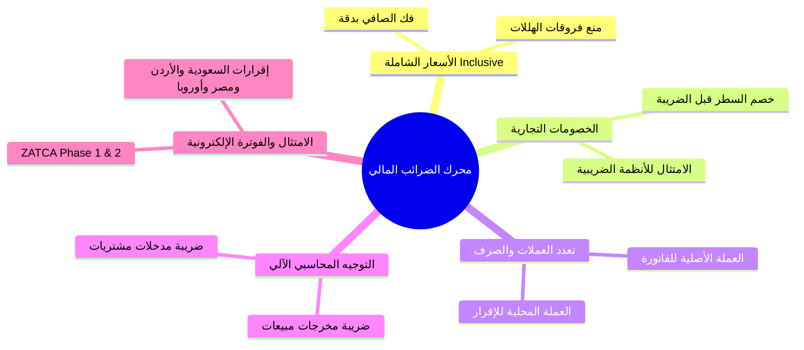
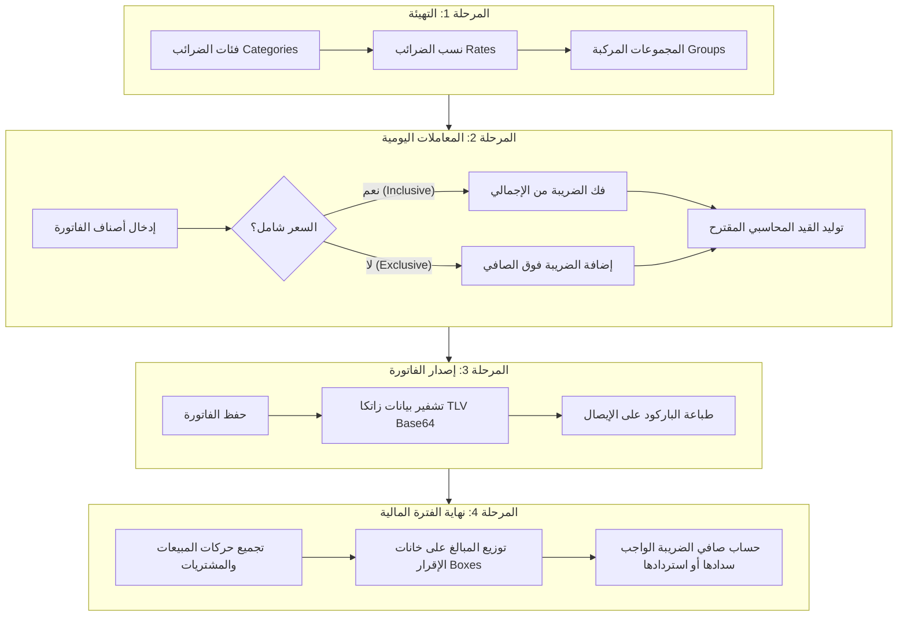

# الدليل الشامل لمحرك الضرائب (Enterprise Tax Engine Comprehensive Manual)
**نظام ThinkOnErp — الدليل الفني والمالي الكامل لفهم واستخدام محرك الضرائب**

---

## فهرس المحتويات (Table of Contents)
1. [المقدمة وفلسفة بناء محرك الضرائب](#1-المقدمة-وفلسفة-بناء-محرك-الضرائب)
2. [المراحل الأربع لدورة حياة الضريبة (The 4-Step Lifecycle)](#2-المراحل-الأربع-لدورة-حياة-الضريبة)
   - [المرحلة 1: التهيئة والبيانات الأساسية (Master Data Setup)](#المرحلة-1-التهيئة-والبيانات-الأساسية)
   - [المرحلة 2: الاحتساب اللحظي والقيود الآلية (Tax Calculation & GL Posting)](#المرحلة-2-الاحتساب-اللحظي-والقيود-الآلية)
   - [المرحلة 3: الفوترة الإلكترونية وتشفير زاتكا (ZATCA E-Invoicing TLV QR)](#المرحلة-3-الفوترة-الإلكترونية-وتشفير-زاتكا)
   - [المرحلة 4: استخراج الإقرارات الضريبية الرسمية (VAT Returns)](#المرحلة-4-استخراج-الإقرارات-الضريبية-الرسمية)
3. [ضريبة الدخل على الرواتب (HR Payroll Income Tax Engine)](#3-ضريبة-الدخل-على-الرواتب)
4. [سيناريوهات تطبيقية بالأرقام والـ JSON (Practical Real-World Scenarios)](#4-سيناريوهات-تطبيقية-بالأرقام-والـ-json)
5. [جدول المرجع السريع لنقاط النهاية (API Reference Cheat Sheet)](#5-جدول-المرجع-السريع-لنقاط-النهاية)
6. [إرشادات الدقة وتجنب الأخطاء الشائعة (Best Practices & Pitfalls)](#6-إرشادات-الدقة-وتجنب-الأخطاء-الشائعة)

---

## 1. المقدمة وفلسفة بناء محرك الضرائب

في الأنظمة البسيطة، يُختصر احتساب الضريبة في عملية ضرب عادية: `السعر × 0.15`. ولكن في الأنظمة المالية المؤسسية (**Enterprise ERP**) كنظام **ThinkOnErp**، تُعد هذه الطريقة قاصرة وتؤدي لأخطاء محاسبية وقانونية جسيمة للأسباب التالية:



1. **الأسعار الشاملة للضريبة (Inclusive Pricing):** في محلات التجزئة ونقاط البيع (B2C)، يُعرض السعر للزبون شاملاً الضريبة (مثل 115 ريال). يجب على النظام فك هذا المبلغ وعزل الإيراد الحقيقي عن الضريبة بدقة.
2. **الخصومات التجارية:** الضريبة قانوناً تُحسب على **الصافي بعد الخصم** وليس على السعر الإجمالي، لتفادي سداد ضريبة على إيرادات لم تُقبض.
3. **تعدد العملات وأسعار الصرف:** عند البيع بالدولار أو اليورو، يلزم النظام بحساب الفاتورة بعملتها مع تقييم قيمتها بالعملة المحلية لحظياً بحسب سعر الصرف المعتمد لإقرارات هيئة الزكاة والضريبة.
4. **القيود المحاسبية التلقائية:** الضريبة ليست مجرد رقم؛ بل هي التزام مالي (خصم متداول) في المبيعات، أو حق استرداد (أصل متداول) في المشتريات.
5. **الامتثال للهيئات الضريبية:** يدعم المحرك الفوترة الإلكترونية المشفرة بـ TLV، ونماذج الإقرارات المعتمدة في السعودية والأردن ومصر والمملكة المتحدة.

---

## 2. المراحل الأربع لدورة حياة الضريبة



---

### المرحلة 1: التهيئة والبيانات الأساسية (Master Data Setup)

تُبنى منظومة الضرائب هرمياً على 3 مستويات رئيسية:

#### أ. فئات الضرائب (Tax Categories):
تمثل النوع أو المظلة القانونية للضريبة:
* `VAT`: ضريبة القيمة المضافة (Value Added Tax).
* `WHT`: ضريبة الاستقطاع (Withholding Tax).
* `EXCISE`: الضريبة الانتقائية على السلع الضارة أو الخاصة.

#### ب. نسب وشرائح الضرائب (Tax Rates):
تمثل النسبة المئوية المطبقة مع ربطها بشجرة الحسابات (GL Accounts):
* `VAT_15` (15%): النسبة القياسية في السعودية $\rightarrow$ ربط بحساب مخرجات المبيعات `213101` وحساب مدخلات المشتريات `113101`.
* `VAT_16` (16%): النسبة القياسية في الأردن.
* `VAT_5` (5%): النسبة المخفضة في الإمارات وعمان أو بعض القطاعات العقارية.
* `VAT_0` (0%): السلع والخدمات الخاضعة لنسبة الصفر (مثل الصادرات الدولية).
* `VAT_EXEMPT` (معفاة): الخدمات المالية، التأمين على الحياة، وتأجير العقارات السكنية.

#### ج. مجموعات الضرائب (Tax Groups):
تُستخدم عند تطبيق أكثر من ضريبة على نفس الصنف بتسلسل محدد:
* **عادية (Simple):** ضريبة مبيعات 16% + ضريبة بلديات 2% (كلتاهما تُحسبان على أصل المبلغ).
* **مركبة (Compound):** ضريبة مبيعات 16% تُحسب أولاً، ثم ضريبة الخدمة تُحسب على (المبلغ الأصلي + ضريبة المبيعات).

---

### المرحلة 2: الاحتساب اللحظي والقيود الآلية (Tax Calculation & GL Posting)

عند قيام الكاشير أو المحاسب بإدخال الأسطر، يستدعي النظام:  
`POST /api/accounting/tax/calculate` أو `POST /api/pos/tax/calculate`

#### القواعد والمعادلات الرياضية:

#### 1. السعر غير الشامل للضريبة (`isInclusive: false`):
يُستخدم غالباً في تعاملات الشركات (B2B):
$$\text{GrossAmount} = \text{Quantity} \times \text{UnitPrice}$$
$$\text{NetBase} = \text{GrossAmount} - \text{DiscountAmount}$$
$$\text{TaxAmount} = \text{NetBase} \times \left(\frac{\text{RatePercent}}{100}\right)$$
$$\text{LineTotal} = \text{NetBase} + \text{TaxAmount}$$

#### 2. السعر الشامل للضريبة (`isInclusive: true`):
يُستخدم في متاجر التجزئة والمطاعم ونقاط البيع (B2C):
$$\text{NetGross} = (\text{Quantity} \times \text{UnitPrice}) - \text{DiscountAmount}$$
$$\text{NetBase} = \frac{\text{NetGross}}{1 + \left(\frac{\text{RatePercent}}{100}\right)}$$
$$\text{TaxAmount} = \text{NetGross} - \text{NetBase}$$
$$\text{LineTotal} = \text{NetGross}$$

> **قاعدة التقريب في النظام:** يتم التقريب لأقرب 3 خانات عشرية باستخدام أسلوب `MidpointRounding.AwayFromZero` لضمان عدم ضياع أي أجزاء من الهللات/الفلسات.

#### 3. التوجيه المحاسبي الآلي (Suggested GL Journal):
يقوم المحرك بتوليد القيد المحاسبي المتوازن تلقائياً كجزء من الاستجابة:

* **في فواتير المبيعات (`isSales: true`):**
  * **مدين (Dr):** حـ/ العملاء أو الصندوق (بإجمالي الفاتورة شاملاً الضريبة).
  * **دائن (Cr):** حـ/ إيرادات المبيعات (بصافي المبلغ قبل الضريبة).
  * **دائن (Cr):** حـ/ ضريبة القيمة المضافة المستحقة - المخرجات (بمبلغ الضريبة).

* **في فواتير المشتريات (`isSales: false`):**
  * **مدين (Dr):** حـ/ المشتريات أو المصروفات (بصافي المبلغ قبل الضريبة).
  * **مدين (Dr):** حـ/ ضريبة القيمة المضافة المدخلات - المستردة (بمبلغ الضريبة).
  * **دائن (Cr):** حـ/ الموردين أو البنك (بإجمالي الفاتورة المطلوب سداده).

---

### المرحلة 3: الفوترة الإلكترونية وتشفير زاتكا (ZATCA E-Invoicing TLV QR)

وفقاً لمتطلبات هيئة الزكاة والضريبة والجمارك (المملكة العربية السعودية)، يجب أن تحتوي الفواتير الضريبية المبسطة وإيصالات نقاط البيع على رمز استجابة سريع مشفر بتنسيق **TLV (Tag-Length-Value)** ومحول إلى **Base64**.

#### استدعاء الـ API:
`POST /api/accounting/tax/zatca-qr`

#### وسوم الـ TLV الخمسة المدمجة:
| الوسم (Tag) | الحقل | الوصف والشروط |
| :---: | :--- | :--- |
| **Tag 1** | اسم المورّد / المنشأة | اسم الشركة الرسمي المسجل بالهيئة |
| **Tag 2** | الرقم الضريبي | الرقم الضريبي المكون من 15 رقماً يبدأ وينتهي بالرقم 3 |
| **Tag 3** | وقت وتاريخ الفاتورة | بصيغة التوقيت العالمي الموحد UTC ISO 8601: `yyyy-MM-ddTHH:mm:ssZ` |
| **Tag 4** | إجمالي الفاتورة مع الضريبة | رقم عشري بخانتين `F2` |
| **Tag 5** | إجمالي مبلغ الضريبة | رقم عشري بخانتين `F2` |

تنتج العملية سلسلة نصية مثل `AQ3YtNix...`، يتم تمريرها في الواجهة لمكتبة QR لترسم كوداً يمكن مسحه بتطبيق زاتكا الرسمي والتحقق من صحته فورياً.

---

### المرحلة 4: استخراج الإقرارات الضريبية الرسمية (VAT Returns)

في نهاية كل فترة ضريبية (شهرية أو ربع سنوية)، لا يحتاج المحاسب لجمع فواتيره يدوياً في إكسل؛ بل يستدعي المحرك:  
`GET /api/accounting/tax/vat-declaration?fromDate=...&toDate=...&templateCode=...`

#### القوالب المعتمدة في النظام:
1. **`GCC_ZATCA_16` (السعودية):** يوزع الحركات على الـ 16 خانة الرسمية لهيئة الزكاة والضريبة والجمارك:
   * خانات المبيعات: الخاضعة للنسبة الأساسية (15%)، الخاضعة لنسبة الصفر، الصادرات، والمعفاة.
   * خانات المشتريات: المشتريات المحلية، والاستيرادات الجمركية الخاضعة لضريبة القيمة المضافة.
2. **`JO_SALES_TAX` (الأردن):** الإقرار المعتمد لدائرة ضريبة الدخل والمبيعات الأردنية (ISTD) لضريبة المبيعات العامة والخاصة.
3. **`EG_VAT_FORM_10` (مصر):** نموذج 10 المعتمد لمصلحة الضرائب المصرية (ETA).
4. **`UK_EU_VAT_9` (بريطانيا وأوروبا):** نموذج الـ 9 خانات المعتمد في نظام ضريبة القيمة المضافة لـ HMRC والاتحاد الأوروبي.
5. **`GLOBAL_GENERIC`:** نموذج إقرار عالمي عام ومرن لأي دولة أخرى.

#### حساب الصافي الضريبي:
$$\text{NetVatDueAmount} = \text{TotalOutputVat (ضريبة المخرجات)} - \text{TotalInputVat (ضريبة المدخلات)}$$
* إذا كان الناتج **موجباً ($\ge 0$)**: تكون الحالة `"مستحق السداد للهيئة"` (التزام واجب الدفع).
* إذا كان الناتج **سالباً ($< 0$)**: تكون الحالة `"رصيد مسترد من الهيئة"` (رصيد دائن للمنشأة يُرحل أو يُسترد).

---

## 3. ضريبة الدخل على الرواتب (HR Payroll Income Tax Engine)

يختلف نظام ضريبة الرواتب جوهرياً عن ضريبة القيمة المضافة:
* **ضريبة المبيعات:** نسبة مباشرة وثابتة على قيمة السلعة أو الخدمة.
* **ضريبة الدخل:** نظام **تصاعدي بشرائح (Progressive Brackets)** يراعي العدالة الاجتماعية والإعفاءات.

### مكونات سياسة ضريبة الدخل في ThinkOnErp:
* المسار: `/api/hr/payroll-policies/tax`
1. **الإعفاء الشخصي (`personalExemptionSelf`):** مبلغ معفى من الدخل السنوي للموظف (مثلاً 9,000 دينار).
2. **إعفاء المعالين (`personalExemptionDependent`):** إعفاء إضافي عن الزوجة والأبناء (مثلاً 9,000 دينار أخرى).
3. **اقتطاع الضمان الاجتماعي (`isSscTaxDeductible`):** يحدد هل تُخصم اشتراكات التأمينات الاجتماعية من الراتب قبل احتساب الضريبة.
4. **مساهمة التكافل الوطني (`nationalContribRate`):** نسبة إضافية تُفرض على أصحاب الدخول المرتفعة التي تتجاوز سقفاً معيناً.
5. **جدول الشرائح التصاعدية (`Brackets`):**
   * الشريحة 1: من 0 إلى 5,000 دينار $\rightarrow$ بنسبة 5%.
   * الشريحة 2: من 5,001 إلى 10,000 دينار $\rightarrow$ بنسبة 10%.
   * الشريحة 3: من 10,001 إلى 15,000 دينار $\rightarrow$ بنسبة 15%.
   * الشريحة 4: من 15,001 إلى 20,000 دينار $\rightarrow$ بنسبة 20%.
   * الشريحة 5: ما زاد عن 20,000 دينار $\rightarrow$ بنسبة 25%.

---

## 4. سيناريوهات تطبيقية بالأرقام والـ JSON

### سيناريو 1: مبيعات B2B غير شاملة للضريبة مع خصم تجاري
* **العملية:** بيع 3 أجهزة حاسوب بسعر 2,000 ريال للجهاز، مع منح العميل خصماً قدره 500 ريال، والضريبة 15%:

#### كائن الطلب إلى `/api/accounting/tax/calculate`:
```json
{
  "isSales": true,
  "isInclusive": false,
  "exchangeRate": 1.0,
  "lines": [
    {
      "lineNumber": 1,
      "itemCode": "PC-DELL",
      "itemName": "كمبيوتر ديل المكتبي",
      "quantity": 3,
      "unitPrice": 2000.0,
      "discountAmount": 500.0,
      "taxRateCode": "VAT_15"
    }
  ]
}
```

#### النتيجة المحسوبة:
* المبلغ الإجمالي: $3 \times 2000 = 6000$ ريال.
* الصافي بعد الخصم: $6000 - 500 = 5500$ ريال.
* مبلغ الضريبة 15%: $5500 \times 0.15 = 825$ ريال.
* الإجمالي المستحق: $5500 + 825 = 6325$ ريال.
* القيد المحاسبي المولد تلقائياً:
  * مدين: العميل بـ 6,325 ريال.
  * دائن: الإيرادات بـ 5,500 ريال.
  * دائن: ضريبة القيمة المضافة المستحقة بـ 825 ريال.

---

### سيناريو 2: كاشير نقطة بيع POS بسعر شامل للضريبة
* **العملية:** عميل اشترى وجبة عائلية بمبلغ 230 ريال معروضة بالسعر الشامل للضريبة (15%):

#### كائن الطلب إلى `/api/pos/tax/calculate`:
```json
{
  "isSales": true,
  "isInclusive": true,
  "exchangeRate": 1.0,
  "lines": [
    {
      "lineNumber": 1,
      "itemCode": "MEAL-FAM",
      "itemName": "وجبة التوفير العائلية",
      "quantity": 1,
      "unitPrice": 230.0,
      "discountAmount": 0.0,
      "taxRateCode": "VAT_15"
    }
  ]
}
```

#### النتيجة المحسوبة:
* صافي قيمة الوجبة قبل الضريبة: $\frac{230}{1.15} = 200.00$ ريال.
* ضريبة القيمة المضافة المقتطعة: $230 - 200 = 30.00$ ريال.
* الإجمالي النهائي على شاشة الكاشير والإيصال: 230.00 ريال بالضبط.

---

## 5. جدول المرجع السريع لنقاط النهاية (API Reference Cheat Sheet)

| الطريقة | المسار | الوظيفة |
| :--- | :--- | :--- |
| **POST** | `/api/accounting/tax/calculate` | احتساب ضرائب الفواتير والمعاملات وتوليد القيود المحاسبية |
| **POST** | `/api/pos/tax/calculate` | احتساب ضرائب سلة مبيعات نقاط البيع والكاشير |
| **POST** | `/api/accounting/tax/zatca-qr` | تشفير وتوليد باركود الفوترة الإلكترونية ZATCA TLV Base64 |
| **POST** | `/api/pos/tax/zatca-qr` | توليد باركود الفوترة الإلكترونية لطباعته على إيصال الكاشير |
| **GET** | `/api/accounting/tax/declaration/templates` | استعراض قوالب الإقرارات الضريبية الرسمية لجميع الدول |
| **GET** | `/api/accounting/tax/declaration/templates/{code}` | استرجاع بنود وخانات قالب إقرار محدد |
| **GET** | `/api/accounting/tax/vat-declaration` | استخراج تقرير الإقرار الضريبي الرسمي المعتمد وحساب الصافي |
| **GET** | `/api/accounting/tax/categories` | استعراض فئات الضرائب (VAT, WHT, EXCISE) |
| **POST** | `/api/accounting/tax/categories` | إنشاء فئة ضريبية جديدة |
| **GET** | `/api/accounting/tax/rates` | استعراض نسب الضرائب وربطها مع شجرة الحسابات |
| **POST** | `/api/accounting/tax/rates` | إضافة نسبة ضريبية جديدة |
| **GET** | `/api/accounting/tax/groups` | استعراض مجموعات الضرائب المركبة |
| **POST** | `/api/accounting/tax/groups` | إنشاء مجموعة ضريبية متعددة النسب |
| **GET** | `/api/pos/reports/tax-summary` | تقرير ملخص ضرائب نقاط البيع للكاشيرات والفروع |
| **GET** | `/api/pos/reports/tax-summary/pdf` | تصدير تقرير ملخص الضرائب كملف PDF رسمي مهيأ للطباعة |
| **GET** | `/api/hr/payroll-policies/tax` | استعراض سياسات وإعفاءات وشرائح ضريبة الدخل على الرواتب |
| **POST** | `/api/hr/payroll-policies/tax` | حفظ وتعديل سلم شرائح ضريبة الدخل للرواتب |

---

## 6. إرشادات الدقة وتجنب الأخطاء الشائعة

1. **الفرق بين النسبة الصفرية والمعفاة:**
   * **السلعة المعفاة (Exempt):** لا تخضع لضريبة، **ولا يحق** للمنشأة استرداد ضريبة المدخلات المدفوعة على تكاليفها.
   * **السلعة الخاضعة لنسبة الصفر (Zero-Rated):** تخضع لضريبة بنسبة (0%)، **ويحق** للمنشأة قانوناً استرداد كامل ضريبة المدخلات التي دفعتها عند شرائها أو تصنيعها.
2. **تسلسل الخصم والضريبة:** يجب دائماً خصم التخفيضات التجارية قبل تطبيق النسبة المئوية للضريبة.
3. **تعدد الفروع والعملات:** عند طلب الإقرار الضريبي الموحد لشركة متعددة الفروع، تأكد من استدعاء `GET /vat-declaration` دون تمرير `branchId` ليقوم المحرك بتجميع بيانات كافة الفروع بالعملة الرسمية الموحدة للمنشأة.
