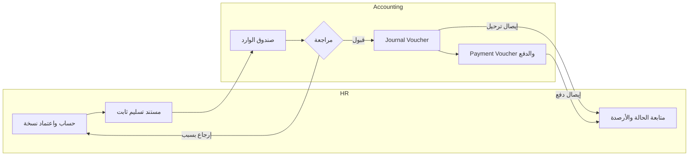

# القرار المعتمد: تسليم HR مستقل للمحاسبة

اعتمد المستخدم هذه الدورة في6 نوفمبر2026. هذه الوثيقة تحدد العقد المستهدف وترتيب التنفيذ، ولا تعلن أن مستند التسليم أو صندوق المحاسبة أو إيصالات الدفع منفذة. الخطة الرئيسية HR_ROADMAP_AR.md تربطها بالمهام INT-01..14.

## الملكية

| المسؤولية | المالك |
|---|---|
| الموظف، الحضور، الإجازات، مكونات الراتب وحساب الاستحقاق | HR |
| مراجعة واعتماد نسخة المسير وحساب اقتطاع مقترح | HR |
| تسليم نسخة معتمدة ومتابعة الاستلام والإرجاع | HR عبر عقد التكامل |
| مراجعة المستند الوارد والحسابات ومراكز التكلفة والفترة | Accounting |
| إنشاء/ترحيل/عكس Journal Voucher | Accounting |
| سند الصرف ودفعات البنك وتأكيد الصرف والدفع الجزئي والعكس | Accounting |
| اعتماد طلب قرض/سلفة ومتابعة الجدول والمتبقي | HR |
| إثبات تمويل القرض/السلفة وتأكيد تسوية الاقتطاع مالياً | Accounting بإيصالات موثوقة إلى HR |

الاستقلال داخل ERP الحالي يتحقق بعقود ومستندات وحالات وصلاحيات مخصصة. خدمة HR لا تعتمد على مستودع قيود أو خدمة صرف لإنشاء أثر مالي. المحاسبة تعمل على لقطة مستلمة ومعتمدة، وتحفظ مرجع المصدر، دون إعادة احتساب الرواتب من بيانات موظف حية.

## دورة Payroll

حساب ومراجعة HR → اعتماد نسخة ثابتة → مستند تسليم محفوظ → إرسال قابل لإعادة المحاولة → صندوق Accounting → قبول أو إرجاع بسبب موثق → إنشاء/ترحيل Journal Voucher → إيصال الترحيل إلى HR → Payment Voucher/دفعات الدفع → إيصالات المدفوع والمتبقي إلى HR.

المحاسبة تستطيع اختيار التوجيه المحاسبي المخول: حسابات المصروف والمطلوبات والضمان والضرائب والذمم وتوزيعات مراكز التكلفة. لا تغيّر مبالغ الراتب/الاقتطاع أو العملة المعتمدة؛ أي تصحيح للاستحقاق يُرجع إلى HR وينتج نسخة معتمدة جديدة بعد معالجة التوابع.

القبول في صندوق المحاسبة مستقل عن ترحيل القيد. تصدير ملف بنك أو إرسال تعليمات لا يثبت الدفع. الدفع الجزئي يخفض المتبقي بمقدار الدفع المؤكد فقط، ويحفظ المرجع والإثبات لكل محاولة دون تكرار.

## مخطط دورة الرواتب المستهدفة

## الحالات المستقلة

| المحور | حالات العقد المستهدف |
|---|---|
| HR Payroll | DRAFT / CALCULATED / APPROVED / CANCELLED، مع نسخة اعتماد |
| التسليم والمحاسبة | NOT_SENT / QUEUED / DELIVERED / RETURNED / ACCEPTED / POSTED / REVERSED |
| الدفع | UNPAID / PARTIAL / PAID / REVERSED؛ حالات فشل/إرسال المحاولة تحفظ منفصلة |

هذه محاور جديدة مخططة، لا إعادة تفسير تلقائية لقيمة HR_PAYROLL_RUN.STATUS القديمة. Accounting يملك إيصالات حالتي المحاسبة والدفع؛ HR لا يقبل هاتين الحالتين كمدخل مستخدم عادي. وجود رابط قيد لا يكفي لاستنتاج أن المسير ما زال مرحّلاً أو مدفوعاً.

## عقد المستند واللقطة

INT-02/03 تنفذان رأساً وسطوره ولائحة انتقالاته: الشركة/الفرع من نطاق موثوق، نوع المصدر Payroll/Loan/Advance، معرّف المصدر ونسخته، نوع العملية، معرّف تسليم، بصمة محتوى، المنفذ والتواريخ والمراجع. رأس الحوالة يحتفظ أيضاً بفترة المسير وتاريخ اعتماد المصدر؛ لا يحتاج Accounting إلى قراءة مسير حي لمعرفة فترة النسخة المستلمة. مفتاح التكرار يشمل الشركة ونوع المصدر ومعرّفه ونسخته ونوع العملية؛ تساوي معرّف قرض ومعرّف مسير لا يخلطهما.

لقطة المسير تشمل الفترة والعملة والمكونات والمجاميع وتوزيع الفرع/مركز التكلفة ومراجع تخصيص الأقساط. دقة المبالغ والتقريب من عقد الشركة؛ لا FX أو حساب أو عملة دولة مفترضة. مجموع السطور يطابق الرأس، ولا تجمع مبالغ عملات مختلفة في مجموع غير معرّف العملة.

مستند الاستحقاق لا يحمل كيان الموظف أو الهوية أو تفاصيل البنك غير اللازمة للقيد. تعليمات الدفع المحمية تسلّم إلى Accounting ضمن عقد دفع منفصل مبني على اللقطة المعتمدة، وبالصلاحيات الضرورية؛ لا تُستبدل ببيانات ملف الموظف الحالية عند إعادة الإرسال. حفظ خصوصية البيانات والتدقيق جزء من INT-12.

تصنّف استردادات السلف وسداد أقساط القروض بمراجعها المنفصلة عن بقية الاقتطاعات؛ Accounting يوجه استرداد السلفة وسداد القرض كلّاً إلى حساب فرعي يضبطه لكل فرع، ولا يرحّل الإجمالي المختلط إلى حساب واحد. لا يطرح المبلغ مرتين من الصافي. مستند يتضمن أقساطاً لا يُرسل قبل إثبات تمويلها وحجز تخصيصها من INT-08/09. إذا غاب حساب نوع له مبلغ مستحق يرفض إنشاء JV حتى يهيئه Accounting؛ لا تخمين أو رجوع صامت للحساب العام.

تهيئة هذه الحسابات تتم من Accounting عبر `GET/PUT /api/accounting/hr-handoffs/payroll-posting-config/{branchId}` وبمنحة `accounting-handoff/configure` ونطاق الفرع؛ تسجيل الميزة لا يمنحها تلقائياً. يظل مسار إعداد HR القديم للقراءة فقط/مرفوضاً.

اللقطة المعتمدة لا تتغير بعد التسليم. الإرجاع ثم التصحيح يحفظ تاريخ النسخة القديمة ويولّد نسخة جديدة؛ لا تعديل صامت لمستند مقبول ولا إعادة توليد مبالغ عند وصول إعادة محاولة.

## دورة Loan/Advance

طلب الموظف → اعتماد HR إلى APPROVED → تسليم طلب الصرف → مراجعة Accounting → تسجيل وصرف بسند الصرف المعتمد → إيصال صرف مؤكد إلى HR → تفعيل المبلغ المصروف وجدول الخصم → اقتطاع مقترح في Payroll → تثبيت التسوية عند إيصال ترحيل استحقاق الرواتب → تحديث المتبقي مرة واحدة.

اعتماد HR لا يعني صرفاً أو تفعيل قرض، ولا يثبت تحصيل قسط. التمويل الجزئي، إن أجازته سياسة الشركة، لا يحوّل كامل الطلب إلى مبلغ مصروف. جدول الاقتطاع يتبع مبلغاً ممولاً مثبتاً والسياسة المعتمدة، وتبقى الالتزامات غير المصروفة واضحة.

عقد طلب القرض/السلفة يحتاج عملة صريحة ومبلغاً معتمداً ضمن INT-08؛ لا نخمن عملة للطلبات القديمة. INT-08 تنفذ إيصال الصرف وربطه وسقوفه والعملات وحماية نسخه قبل أي تفعيل. INT-09 تحجز مراجع الأقساط عند اعتماد/تسليم المسير كي لا تُقترح في مسير آخر أثناء الانتظار؛ الحجز ليس تحصيلاً. إيصال ترحيل Accounting يثبت التسوية مرة واحدة. الإرجاع الآمن يحرر الحجز، والعكس يعكس التسوية بعد التحقق من الحركات التابعة. دفع صافي الرواتب لاحقاً له دورة مستقلة عن تسوية قسط القرض ضمن قيد الاستحقاق.

## التسليم والإيصالات

INT-10 تحفظ Outbox/Inbox وإيصالات بقاعدة البيانات مع قيود تفرد وتزامن. إعادة النقل مسموحة؛ تكرار الإيصال لا يكرر قيداً أو صرفاً أو تسوية. لا يرجع API حالة202/تم الإرسال قبل حفظ المستند والإرسال المعلق بمعاملة موثوقة.

تُرفض إيصالات شركة/فرع/نسخة/عملة أو مبلغ غير مطابق. النسخة القديمة أو حدث متأخر لا يعيد حالة مدفوعة إلى غير مدفوعة ولا يفتح نسخة جديدة. تحفظ مفاتيح الحدث وترتيبه والبصمات وسبب الرفض، وتوجد معالجة فشل وإعادة محاولة ومطابقة للأثر بين الموديولين.

## التصحيح والعكس

قبل قبول Accounting أو ترحيل القيد: يمكن لـHR سحب نسخة التسليم بسبب موثق؛ يلغي حدث الإرسال المعلق أو يرسل حدث سحب منفصلاً إذا وصلت النسخة، ويحرر الحجوزات ضمن المعاملة. تُعرض حالة السحب وسببها لصندوق Accounting ولا تقبل النسخة المسحوبة. بعد القبول/الترحيل: طلب عكس للمحاسبة، ثم معالجة سندات/دفعات وتوابع الدفع أولاً حسب الحالة، ثم القيد والتسويات المالية، ثم إيصال إلى HR يسمح بمسار التصحيح. لا يمسح رابط الأصل، ولا يقوم HR بتغيير حالة GL مباشرة. INT-11 وPAY-09 يحددان ترتيب التوابع وسلامة إعادة الطلب.

## حدود الانتقال التي نُفذت الآن

أزيلت عمليات إنشاء/عكس GL وتبعيات مستودع القيود وخدمة الترحيل من IPayrollService/PayrollService الحية. كود القيود والعكس السابق نُقل إلى Accounting.Legacy.LegacyPayrollJournalService غير مسجلة في DI، للاختبارات واستخراج الضوابط خلال INT-06/11 فقط؛ لا يحقق الفصل بمجرد تغيير اسم الخدمة، ولا يجوز تشغيل محوّل يقرأ المسير الحي بدلاً من مستند مقبول.

واجهات HR القديمة post-to-gl وreverse-gl وexport-bank ومعاينتها وPUT إعداد الترحيل ترجع409 مع HR_ACCOUNTING_HANDOFF_REQUIRED دون أثر مالي. بقيت صلاحياتها ومراجعة الجسم لتوفير رفض واضح للعميل القديم. قراءة إعداد الترحيل القديم تبقى للإدارة/التدقيق؛ لا تستخدم لإعداد هدف الدورة الجديدة. لم ينشأ بديل send-to-accounting شكلي؛ INT-04 لن يُفتح قبل التخزين الدائم.

اعتماد HR للمسير يثبت الحالة واللقطة دون سداد القروض/السلف. CalculateAndApplyDeductionsAsync أصبح حساب معاينة على نسخ ويمنع persistChanges=true. اعتماد طلب القرض/السلفة يبقى APPROVED، وإعادة الاعتماد لا تغير المنفذ/التاريخ ولا تعيد حالات متقدمة. APPROVED لا تدخل اقتطاع المعاينة؛ ACTIVE تبقى حالة أهلية Legacy تحتاج تدقيق تمويل قبل تشغيل العميل، ولا توجد حالياً واجهة HR جديدة لتفعيلها. لا يوجد بعد إيصال صرف يتيح اعتماد ACTIVE كدليل تمويل في الدورة الجديدة.

مهيئ البنك القديم وحماية بياناته واختبارات الحساب/القيود بقيت مراجع قابلة لإعادة الاستخدام، وأزيل تسجيل مهيئ البنك من DI الحية. لا نعد نجاح اختبارات Legacy إثباتاً لمسار التسليم الجديد.

## ترحيل القديم والإطلاق

INT-13 تفحص كل مسير/قيد/عكس وقرض ACTIVE وسلفة APPROVED/مقتطعة وأرصدة افتتاحية، وتربطها بأدلة موثوقة. لا تخمين لصرف أو دفع من الحالة القديمة وحدها، ولا إنشاء قيد مكرر أو تعديل مبالغ/بيانات تاريخية تلقائياً. تتم المطابقة والنسخ الاحتياطي والرجوع قبل فتح عميل فعلي.

ترتيب التنفيذ: العقد وحراس الحدود INT-01 → التخزين واللقطة INT-02/03 → إرسال HR وصندوق المحاسبة INT-04/05 → قيد Accounting INT-06 → أساس الصرف/الدفعات INT-07 → تمويل القروض/تسويات الأقساط INT-08/09 → استكمال الإيصالات والعكس والواجهات والقبول INT-10..14. متطلبات التكرار والتزامن INT-10 تدخل من أول تخزين ولا تؤجل إلى نهاية التنفيذ.

لا تنشر هذه الحزمة وحدها على عميل يحتاج عمليات مالية مستمرة: واجهات HR المالية أوقفت في الكود، ومسار التسليم الجديد لم يُبنَ بعد. الإطلاق بعد تجربة الشركتين/الفروع والصلاحيات وحساب/قبول/ترحيل/دفع جزئي وعكس كامل على Oracle والواجهة. لا DDL أو مزامنة عميل أو نشر أو تغيير بيانات تاريخية ضمن هذه الحزمة.

## نتائج حزمة INT-01

نجح469 اختبار HR و211 عقد/فلتر/HTTP محلي =680؛ تشمل42 HTTP و29 عقداً مباشراً و140 فلتر/نطاق/مستودع. جزء من المجموعة اختبارات Legacy مرجعية، وليس تشغيل خدمة مسجلة. السجلان int01-boundary-hr.log وint01-boundary-api.log. جرد API بقي131 مساراً/18 متحكماً مع توثيق409 للواجهات المتوقفة.

نجح --verify-accounting-boundary على DEV_TEMPLATE: إنشاء طلبَي قرض/سلفة مؤقتين واعتمادهما إلى APPROVED، إعادة اعتماد دون تغيير الفاعل، ثبات الأرصدة/الأقساط واستبعاد غير الممول من الأهلية/المعاينة ورفض persist، دون إنشاء GL. تراجعت المعاملة وغابت fixtures وبقيت الأعداد الأصلية؛ سجل int01-boundary-oracle.log. المقارنة المستقلة int01-boundary-preservation-after.log نجحت59/59 جدولاً أصلياً. لا يثبت ذلك مستند التسليم أو صندوق المحاسبة أو الدفع أو Legacy migration، ولم يُطبّق DDL أو يُنشر تغيير.
