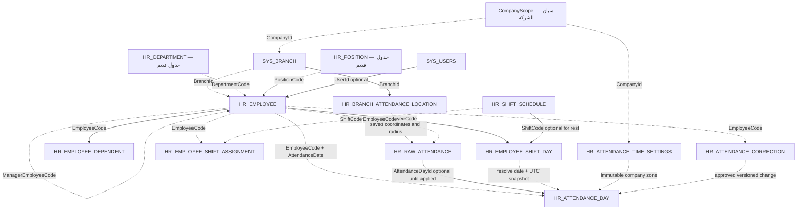
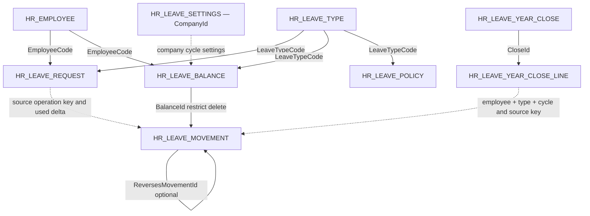
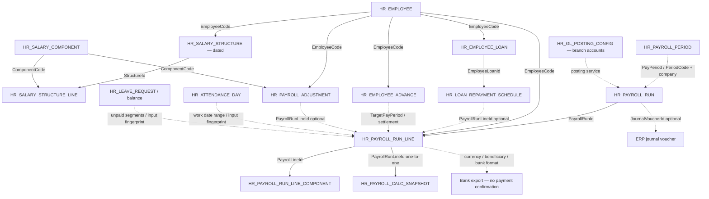
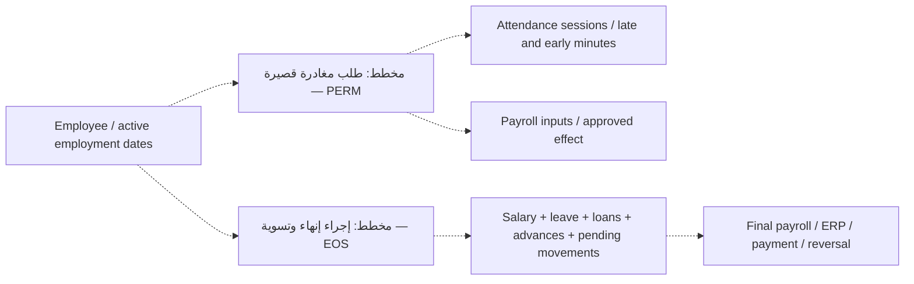

# BASE-02 — خريطة علاقات HR

5 نوفمبر 2026. خريطة للكود الجاري ولحدود التنفيذ؛ ليست DDL أو شهادة اكتمال جميع قيود Oracle. مراجعة DEV_TEMPLATE الحالية تثبت قراءة 43 نوع EF مقابل 66 جدول HR؛ الجداول القديمة غير الممثلة في EF تحتاج مراجعة مستقلة قبل ترحيل العملاء.

في الرسوم: السهم المتصل علاقة معرفة في إعداد EF، والسهم المنقط رابط حقول/استعلام أو أثر أعمال في الخدمة دون ادعاء FK. العقد التي تحمل «مخطط» لم تُنفذ كدورة متكاملة. CompanyScope سياق شركة موثوق من ERP، وليس ادعاء وجود جدول SYS_COMPANY داخل مخطط العميل؛ العزل الأساسي مخطط مستقل ثم نطاق الشركة/الفروع/الموظف داخل الطلب.

## التنظيم والدوام

Employee.DepartmentCode وPositionCode وManagerEmployeeCode حقول حالية، دون علاقة إدارة/مدير EF متكاملة في EmployeeConfiguration. تحديث 6 نوفمبر: رُبط HR_DEPARTMENT/HR_POSITION للقراءة بالنطاق دون DDL، مع التحقق من توافق الإدارة/المسمى/الفرع ومنع دورات المدير في الخدمة. أُضيفت إدارة الكتالوج ودورات الهيكل عند تحريره ضمن [حزمة الكتالوج](HR_ORGANIZATION_CATALOG_2026-11-06_AR.md)، دون تغيير FK أو DDL؛ مدير الإدارة وصفحات SET-02 بقيتا ضمن EMP-02 آنذاك؛ EMP-03 وBASE-04 مستقلتان. ارتباط حساب المستخدم اختياري وفريد بحسب تعريف EF، ولا يساوي منح الموظف صلاحية إدارية.

EmployeeShiftAssignment يربط الموظف والشفت برموز في الخدمة، مع BASE/TEMPORARY وفترة سريان؛ تعريفه الحالي لا يعلن HasOne بينهما. EmployeeShiftDay يعلن FK للموظف والشفت، وتفرد الموظف/التاريخ حتى للسجل غير الفعال؛ يوم الراحة يسمح ShiftCode=null. اختيار اليوم أسبق من الإسناد، والمؤقت يتقدم على الأساسي. شفت الليل يتبع تاريخ البداية، ولقطة UTC في يوم الحضور تحمي الحساب التاريخي.

raw دليل مصدر مستقل؛ EventId مع الموظف يمنع تكرار الدليل الجديد. ResolvedWorkDate رابط منطقي لتاريخ العمل، وAttendanceDayId رابط EF/Oracle محدود الحذف بعد التطبيق فقط. المرفوض/المتجاهل يحتفظ بالدليل والتدقيق دون يوم؛ المعلق يبقى عند قفل الرواتب. التصحيح يرتبط بالموظف/التاريخ وOriginalDayVersion؛ الموافقة تعدل اليوم ولا تمحو دليل raw، والدليل المتأخر لا يكتب فوق تصحيح معتمد بلا مراجعة. ATT-09 ما زالت تفصل الجلسات المتعددة عن اختزال أول IN/آخر OUT.

## الإجازات والأرصدة

الرصيد له مفتاح دورة الموظف/النوع/بداية الدورة؛ YearNo محفوظ للتوافق ولا يختزل دورة تبدأ في شهر مختلف. دفتر الحركة تسلسلي وغير قابل للتعديل/الحذف، ويسجل before/after بالدلتا والحالة بعد الحركة، والسبب والفاعل ومصدر العملية ومفتاح تكرارها؛ الرابط إلى طلب/إقفال هو مصدر عملية في الخدمة وليس FK عاماً من Movement إلى كل أنواع الوثائق.

رأس الإقفال يحمي الدورة، وخطوطه تشرح الترحيل/الانتهاء/التحويل. الإقفال الفارغ ما زال يمنع الكتابة في الدورة المقفلة. عكس الإقفال يتبع الحركات التابعة ولا يحذف سجل الحركة؛ إلغاء طلب الإجازة وعكس تعديل الرصيد الكامل لهما مهامهما المفتوحة.

## الراتب وروابط ERP

SalaryStructure بتاريخ السريان هو مدخل الحساب؛ مقاطع الأساسي/العلاوات والاقتطاعات والإجازة غير المدفوعة تُجمع قبل الضرائب/الضمان. PayrollPeriod يرتبط بالمسير عبر رمز فترة وسياق الشركة والخدمة، لا عبر PayrollPeriodId FK على PayrollRun. أقفال الفترة والموظف وحالة المسير وبصمة المدخلات تمنع تغيير المدخلات بعد الإقفال/الاعتماد دون الدورة المطلوبة.

PayrollRunLine يملك مكوناته ولقطة الحساب؛ الروابط إلى قسط/تعديل مستهلك تحفظ هوية سطر المسير. السلفة الحالية تربط الفترة والموظف والتسوية، دون الادعاء بوجود رابط سطر دائم غير موجود في النموذج. عكس اعتماد المسير PAY-09 يجب أن يعالج كل تسويات التوابع؛ cancel للحساب لا يحقق ذلك.

JournalVoucherId وGlAccountCode وروابط إعداد حسابات الفرع هي نقاط اتصال ERP الحالية؛ هذا الرسم لا يثبت أن القيود المحاسبية والعكس والدفع اكتملت. تصدير البنك ملف/معاينة من بيانات المستفيد والعملة لا يثبت تنفيذ دفع أو تأكيد البنك. ERP-01.. وبقية مهام الرواتب تحدد التحقق المتبقي. الإضافي مؤجل ولا يدخل الصافي تلقائياً.

## المغادرات وتسوية نهاية الخدمة — مخطط

المغادرة القصيرة طلب تأخر أو خروج وعودة أو خروج مبكر، وهي غير الإجازة وغير إنهاء الخدمة. لم تُعرّف هنا جداول أو FK منفذة لها؛ PERM-01.. توثق الدورة المتبقية. TerminationDate/TerminationReason الحالية على Employee تتحكم ببعض حدود الأهلية، لكنها لا تنشئ ملف إنهاء واعتماده وتجميع حقوقه وتسويته. EOS-01..06 تبقى مفتوحة، والربط أعلاه تصميم حدود العمل فقط.

## المصادر وحدود التحقق

رُوجعت نماذج EmployeeEntities وAttendanceEntities وEmployeeShiftDay وLeaveEntities وLeaveBalanceMovement وPayrollEntities وLoanAndAdjustmentEntities، وإعدادات EF المقابلة. المصادر الرئيسية: [إعداد الموظف](../../src/ThinkOnErp.Infrastructure/Data/Configurations/Hr/EmployeeConfigurations.cs)، [إعداد الحضور](../../src/ThinkOnErp.Infrastructure/Data/Configurations/Hr/AttendanceConfigurations.cs)، [اليومي](../../src/ThinkOnErp.Infrastructure/Data/Configurations/Hr/EmployeeShiftDayConfiguration.cs)، [الإجازات](../../src/ThinkOnErp.Infrastructure/Data/Configurations/Hr/LeaveConfigurations.cs)، [دفتر الإجازات](../../src/ThinkOnErp.Infrastructure/Data/Configurations/Hr/LeaveMovementConfiguration.cs)، [الرواتب](../../src/ThinkOnErp.Infrastructure/Data/Configurations/Hr/PayrollConfigurations.cs)، [القروض والتعديلات](../../src/ThinkOnErp.Infrastructure/Data/Configurations/Hr/LoanAndAdjustmentConfigurations.cs).

الروابط أعلاه تشير من docs/hr إلى جذر المستودع. فحوص Oracle للقراءة والأقفال والحركات/rollback ومطابقة البيانات الأصلية في att05-oracle.log وatt07-regression.log مستقلة؛ الخريطة لم تطبق DDL أو تزامن عملاء أو اختبار كل FK قديم. الجرد الحديث [116 API](../HR_API_REFERENCE_2026-11-05.md) يربط هذه الدورات بمساراتها الحالية؛ [الخطة](../../HR_ROADMAP_AR.md) تحسم ما نُفذ وما بقي.

تحديث 6 نوفمبر: رابط ManagerEmployeeCode يُستخدم أيضاً في [قراءة الفريق المباشر](HR_EMPLOYEE_TEAM_2026-11-06_AR.md)، مقاطعاً منح الشركة/الفروع دون تفويض تلقائي أو توسع للأحفاد. [معاينة الاستيراد](HR_EMPLOYEE_IMPORT_PREVIEW_2026-11-06_AR.md) تعرض أثر الملف غير المؤرخ على الفترات ولا تحفظ أو تنشئ علاقة مالية جديدة. النموذج43 EF/66 جدول HR كما كان في ذلك التاريخ. تحديث 13 نوفمبر: أضيف عمود `HR_DEPARTMENT.MANAGER_EMPLOYEE_CODE` nullable بلا backfill إلى `DEV_TEMPLATE`؛ [العقد المعتمد](HR_DEPARTMENT_MANAGER_CONTRACT_2026-11-13_AR.md) يصف علاقة الإدارة بالمدير، ولا يغير رابط الفريق المباشر بين الموظفين أو يمنح صلاحية تلقائية.
