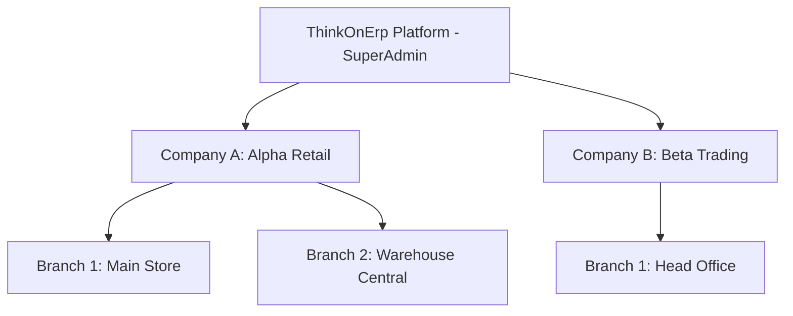
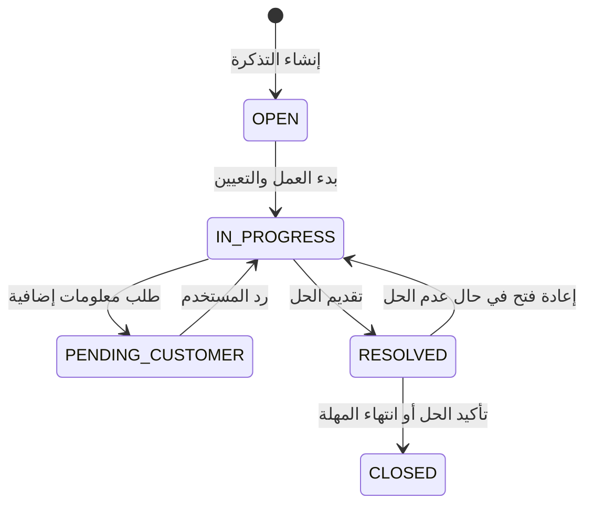

# ThinkOnErp - موديول المنصة الأساسية والأمان والتدقيق (Core Platform & System)
## وثيقة متطلبات وقواعد الأعمال (busniss.md)

---

## 1. نظرة عامة والهدف التجاري (Business Overview & Objectives)

موديول **Core Platform & System** هو العمود الفقري والمحرك المركزي لنظام **ThinkOnErp**. يوفر هذا الموديول البنية التحتية الشاملة لإدارة الشركات المتعددة (Multi-Tenancy)، الفروع، الأمان والصلاحيات الدقيقة، التدقيق الأمني والامتثال القانوني (Compliance & Resilient Audit)، إدارة التهديدات، ونظام التذاكر والدعم الفني الداخلي، بالإضافة إلى المحرك الديناميكي لقواعد التحقق والترجمة.

### الأهداف الاستراتيجية:
1. **دعم الشركات القابضة والمجموعات (Multi-Company & Multi-Branch):** عزل تام للبيانات المالية والتشغيلية لكل شركة، مع إمكانية إدارة مركزية عليا عبر SuperAdmin.
2. **حوكمة الأمان والوصول (Enterprise Security & Governance):** تطبيق مبدأ أقل الصلاحيات (Least Privilege) عبر صلاحيات تفصيلية على مستوى الشاشات والميزات (Screen & Feature-level RBAC).
3. **الامتثال الرقابي ومنع التلاعب (Regulatory Compliance & Zero-Log-Loss):** تسجيل وتشفير كافة العمليات الحساسة مع ضمان عدم فقدان أي سجل تدقيق حتى في حال انهيار قواعد البيانات.
4. **استمرارية الأعمال والدعم الذاتي (Incident Management & Support):** نظام مكتب مساعدة مدمج لتسجيل المشكلات وطلبات التطوير ومتابعة مؤشرات الأداء (SLA).

---

## 2. الهيكل التنظيمي ونموذج تعدد المستأجرين (Multi-Tenancy Model)

### 2.1 مستويات الإدارة والتنظيم:
1. **المسؤول العام (SuperAdmin):**
   - يدير النظام على المستوى الكلي (Platform Level).
   - صلاحية إنشاء الشركات، تفعيل الأنظمة المرخصة، ومراقبة سلامة الخوادم والأداء.
   - لا يخضع للقيود الفرعية للشركات، ولكنه ملزم بتحديد سياق الشركة (`X-Company-Id`) عند استعراض البيانات التشغيلية.

2. **الشركة المستأجرة (Tenant / Company):**
   - الكيان القانوني المستقل مالياً وتشغيلياً.
   - تمتلك مخطط قاعدة بيانات خاص بها (Dedicated Oracle Schema) لضمان الخصوصية والعزل الصارم.
   - تمتلك إعداداتها الخاصة، عملتها الأساسية، ودليل الحسابات الخاص بها.

3. **الفرع (Branch):**
   - وحدة تشغيلية تابعة للشركة (مستودع، نقطة بيع، معرض، مكتب إقليمي).
   - يرتبط به المستخدمون وتُخصص له الشاشات والميزات المفعلة.
   - يمكن للمستخدم الانتماء لفرع واحد أو عدة فروع، ويتم تقييد حركاته المالية والتشغيلية بناءً عليها.



---

## 3. الأمان وإدارة الهوية والصلاحيات (Identity & Access Governance)

### 3.1 أنواع الحسابات:
- **حسابات المسؤولين الشاملين (SuperAdmin Users):** تسجيل دخول خاص عبر بوابة النظام المركزية، واستخدام مصادقة معززة.
- **حسابات مستخدمي الشركات (Company Users):** تسجيل دخول مقترن بهوية الشركة واسم المستخدم وكلمة المرور المشفرة.

### 3.2 هيكل الصلاحيات المصفوفي (Matrix RBAC):
النظام لا يعتمد على الصلاحيات التقليدية الفضفاضة، بل يستخدم نموذجاً ثلاثي الأبعاد:
1. **النظام (System):** مثل المحاسبة، المخزون، نقاط البيع، الموارد البشرية.
2. **الشاشة (Screen):** واجهة محددة للتعامل مع كيان معين (مثل: شاشة قيود اليومية، شاشة فواتير المشتريات).
3. **الميزة / الإجراء (Feature / Action):** صلاحية محددة داخل الشاشة (عرض `VIEW`، إضافة `CREATE`، تعديل `EDIT`، حذف `DELETE`، ترحيل `POST`، اعتماد `APPROVE`، تصدير `EXPORT`).

```
[المستخدم] ---> [الأدوار المسندة Roles] ---> [صلاحيات الشاشات والميزات]
    |                                                 ^
    +-------------> [استثناءات مخصصة User Overrides]---+
```

### 3.3 قواعد العمل الصارمة في الصلاحيات:
- **الصلاحية الصريحة (Explicit Grant):** يتم منح الصلاحية فقط إذا وُجد سجل يمنحها، والرفض هو الأصل (Default Deny).
- **أولوية استثناءات المستخدم (User Overrides):** إذا تم سحب ميزة من المستخدم تحديداً، يُلغى مفعول منحها المكتسب من الدور (Role).
- **إنهاء الجلسات الإجباري (Force Logout):** عند تغيير دور المستخدم، تجميد حسابه، أو وجود تهديد أمني، يقوم النظام بتسجيل تاريخ `ForceLogoutDate`، مما يبطل فوراً كافة الرموز السابقة (JWT Tokens) الصادرة قبل هذا التاريخ.

---

## 4. نظام التدقيق الشامل والامتثال الأمني (Audit & Compliance)

### 4.1 التزامات الأعمال الرقابية (Regulatory Requirements):
- يتوافق النظام مع معايير الحوكمة المالية والأمنية الدولية (مثل SOX, ISO 27001, GDPR, ZATCA).
- **حظر التعديل أو الحذف (Immutability):** سجلات التدقيق غير قابلة للتعديل أو الحذف إطلاقاً من قبل أي مستخدم أو حتى SuperAdmin.
- **سلامة السجلات ومنع التلاعب (Tamper Evidence):** كل حركة تدقيق يتم توقيعها برمز تجزئة (Cryptographic Hash Chaining)؛ أي تعديل يدوي في قاعدة البيانات يكشفه النظام فوراً كتهديد أمني.

### 4.2 تصنيف أحداث التدقيق:
1. **أحداث المصادقة (Authentication Events):** تسجيل الدخول، فشل الدخول، تجديد الرمز، تسجيل الخروج، محاولات الدخول بحسابات مجمدة.
2. **أحداث تعديل البيانات (Data Changes):** الحالة قبل التعديل (Old Values) والحالة بعد التعديل (New Values)، مفاتيح الكيانات، وهوية المنفذ وعنوان IP.
3. **أحداث الصلاحيات والأمان (Security & Permissions):** تعديل صلاحيات الشاشات، إنشاء الأدوار، منح الفروع للمستخدمين.
4. **أحداث الأداء والأخطاء (Performance & Exceptions):** الاستعلامات البطيئة (Slow Queries)، تجاوزات الذاكرة، وانهيارات الاتصال.

### 4.3 قاعدة عدم فقدان السجلات (Zero Log Loss Policy):
- في حال توقف قاعدة بيانات التدقيق المركزية، يُمنع إسقاط السجل؛ بل يتم تحويله لمخزن محلي مشفر (Encrypted File System Fallback) وإعادة ترحيله تلقائياً بمجرد عودة الخدمة.

---

## 5. نظام التذاكر والدعم الفني (Ticketing & Service Desk)

### 5.1 دورة حياة التذكرة (Ticket Lifecycle):
1. **الإنشاء (Open):** يفتح المستخدم تذكرة مع تحديد النوع (مشكلة فنية، طلب تدريب، طلب صلاحية، ميزة جديدة)، والفئة، ودرجة الأهمية.
2. **التعيين والبدء (In Progress):** يعين موظف الدعم نفسه أو يتم الإسناد التلقائي.
3. **انتظار الرد (Pending Customer):** عند طلب معلومات إضافية من المستخدم.
4. **الحل (Resolved):** تقديم الحل وإشعار العميل.
5. **الإغلاق (Closed):** إغلاق رسمي للتذكرة بعد تأكيد العميل أو انتهاء مهلة الإغلاق التلقائي.



### 5.2 اتفاقيات مستوى الخدمة (SLA):
- **حرج (Critical):** زمن الاستجابة < 30 دقيقة، زمن الحل < 4 ساعات.
- **مرتفع (High):** زمن الاستجابة < ساعتين، زمن الحل < 12 ساعة.
- **متوسط (Medium):** زمن الاستجابة < 8 ساعات، زمن الحل < 48 ساعة.
- **منخفض (Low):** زمن الاستجابة < 24 ساعة، زمن الحل < 5 أيام عمل.

---

## 6. المحرك الديناميكي لقواعد التحقق والترجمة (Dynamic Validation & Localization)

### 6.1 قواعد التحقق الديناميكية (Field Validation Rules):
- تتيح لمدير النظام ضبط شروط إلزامية أو قيود حدودية على حقول الشاشات دون الحاجة لتعديل الكود البرمجي (مثل: إلزامية الرقم الضريبي للموردين، تحديد الحد الأقصى للخصم النقدي).
- تدعم القواعد: الحقول الإلزامية، التعبيرات النمطية (Regex)، الحدود الدنيا والقصوى (Min/Max)، والتحقق المخصص.

### 6.2 الترجمة العالمية وتعدد اللغات:
- النظام يدعم اللغة العربية والإنجليزية كلغات افتراضية، مع هيكل يسمح بإضافة أي لغة جديدة عبر جدول `SYS_ENTITY_TRANSLATION`.
- الترجمة تشمل أسماء الحسابات، مسميات المواد، الأصناف، شاشات النظام، ورسائل الأخطاء.

---

## 7. حالات الاستخدام الرئيسية ومسارات العمل (Key Use Cases)

1. **تهيئة شركة جديدة وتعيين مدير النظام:** SuperAdmin ينشئ الشركة، يُنشئ المخطط في Oracle، يُفعل موديولات المحاسبة والمخزون، ويُنشئ حساب مدير الشركة.
2. **إسناد فرع وصلاحيات محاسبية:** مدير الشركة يربط المستخدم بالفرع الرئيسي، ويمنحه دور "محاسب أول" المقيد بشاشات القيود دون شاشات إقفال السنوات.
3. **تتبع تعديل مالي مشبوه:** مسؤول الامتثال يستعلم عن حركة تعديل سند قبض، فيظهر له المستخدم، عنوان IP، القيمة القديمة والقيمة الجديدة، ووقت التنفيذ بالتحديد الميلي ثانية.
4. **فتح تذكرة عطل في طابعة الكاشير:** كاشير نقطة البيع يفتح تذكرة عاجلة، تظهر فوراً لفريق الدعم التقني، مع سجل إشعارات ومرفقات بالخطأ.
