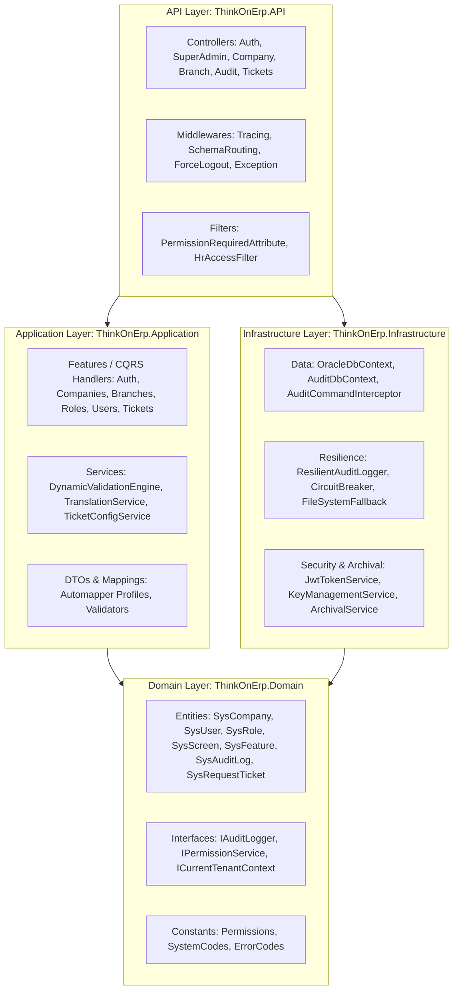
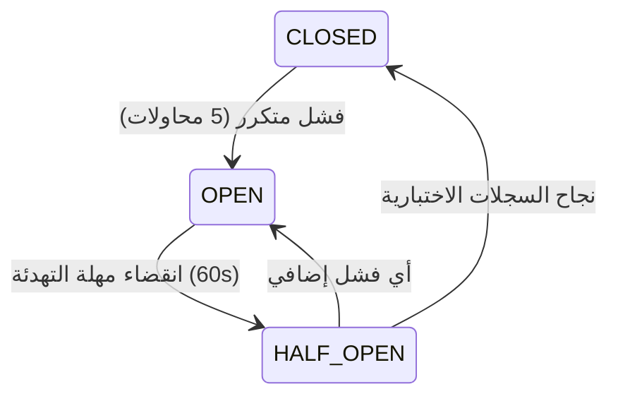

# ThinkOnErp - موديول المنصة الأساسية والأمان والتدقيق (Core Platform & System)
## وثيقة المعمارية والمنطق التقني البرمجي (logic.md)

---

## 1. المعمارية العامة وموقع الموديول في النظام (System Architecture)

ينفذ موديول **Core Platform** مبادئ معمارية البصلة (Onion / Clean Architecture) ونمط التصميم المدفوع بالمجال (Domain-Driven Design - DDD). يمثل هذا الموديول النواة التشغيلية لجميع الموديولات التخصصية الأخرى (المحاسبة، المخزون، نقاط البيع، الموارد البشرية).



---

## 2. فهرس الملفات البرمجية المكونة للموديول (Source Files Catalog)

### 2.1 طبقة المجال (Domain Layer)
- **ملفات الكيانات المركزية (Core Entities):**
  - `SysCompany.cs`: بيانات الشركة، المعرف، الاسم المحلي والإنجليزي، اسم مخطط Oracle المخصص (`SchemaName`)، العملة، الحالة.
  - `SysBranch.cs`: بيانات الفروع، كود الفرع، الاسم، العنوان، الارتباط بالشركة، الحالة.
  - `SysSuperAdmin.cs`: حسابات الإدارة المركزية العليا، التجزئة المشفرة لكلمة المرور، البريد، الحالة.
  - `SysUser.cs`: مستخدمو الشركات، البريد، اسم المستخدم، تاريخ إبطال الجلسات (`ForceLogoutDate`)، نوع الحساب.
  - `SysRole.cs`: الأدوار الوظيفية (مثل: محاسب عام، أمين مستودع، كاشير).
  - `SysUserRole.cs`: الربط المتعدد بين المستخدمين والأدوار.
  - `SysUserBranch.cs`: ربط المستخدم بالفروع المسموح له العمل عليها.
  - `SysSystem.cs`: الأنظمة المكونة للمنصة (المحاسبة، المخزون، نقاط البيع، الموارد البشرية).
  - `SysScreen.cs`: الشاشات التابعة لكل نظام، مساراتها وأكوادها الفريدة.
  - `SysFeature.cs`: الإجراءات المتاحة داخل الشاشات (قراءة، إنشاء، تعديل، حذف، ترحيل، اعتماد).
  - `SysScreenFeature.cs`: الربط بين الشاشات والميزات المتاحة فيها.
  - `SysBranchSystem.cs`, `SysBranchScreen.cs`, `SysBranchFeature.cs`: تهيئة الأنظمة والشاشات والميزات المتاحة لكل فرع.
  - `SysRoleScreenPermission.cs`: مصفوفة صلاحيات الأدوار على الشاشات والميزات.
  - `SysUserScreenPermission.cs`: استثناءات الصلاحيات الممنوحة أو المحجوبة لمستخدم محدد.
- **ملفات التدقيق والامتثال والأمان:**
  - `SysAuditLog.cs`: السجل الرئيسي لحركات التدقيق، المعرف التسلسلي، المستخدم، الوقت، نوع الحدث، تفاصيل التغيير بتنسيق JSON، توقيع السلامة (HMAC/SHA256).
  - `SysAuditLogArchive.cs`: سجلات التدقيق المؤرشفة تاريخياً.
  - `SysSecurityThreat.cs`: سجل التهديدات الأمنية المكتشفة تلقائياً (محاولات تخمين، كسر جلسات، تلاعب بالبيانات).
  - `SysFailedLogin.cs`: محاولات تسجيل الدخول الفاشلة وعناوين الـ IP المرتبطة بها.
  - `SysPerformanceMetric.cs`: مقاييس استهلاك الموارد، زمن الاستجابة، ونقاط الاختناق.
  - `SysSlowQuery.cs`: الاستعلامات البطيئة في قاعدة البيانات وخطط تنفيذها.
  - `SysRetentionPolicy.cs`: قواعد الاحتفاظ بالبيانات وسياسات الأرشفة الدورية.
- **ملفات التذاكر والدعم الفني:**
  - `SysRequestTicket.cs`: التذكرة، العنوان، الوصف، الحالة، الأولوية، موعد الإنجاز المستهدف (SLA Due Date)، الموظف المعين.
  - `SysTicketCategory.cs`, `SysTicketPriority.cs`, `SysTicketStatus.cs`, `SysTicketType.cs`: الجداول المعيارية لتهيئة التذاكر.
  - `SysTicketComment.cs`: التعليقات والردود المتبادلة في التذكرة.
  - `SysTicketAttachment.cs`: المرفقات والوثائق المدعمة للشكوى أو الحل.
  - `SysTicketConfig.cs`: إعدادات وتخصيصات نظام التذاكر لكل شركة.
- **ملفات الإعدادات والتحقق والترجمة:**
  - `SysCode.cs`: الأكواد المعيارية العامة للنظام (Lookup Codes).
  - `SysSetting.cs`: إعدادات النظام وقيمها على مستوى الشركة والفرع.
  - `SysEntityTranslation.cs`: نصوص الترجمة المتعددة للكائنات والحقول.
  - `SysFieldValidationRule.cs`: قواعد التحقق الديناميكية للحقول والمدخلات.
  - `SysDocument.cs`: إدارة الملفات والمستندات الرقمية المرفوعة.
  - `SysSavedSearch.cs`, `SysSearchAnalytics.cs`: عمليات البحث المحفوظة وتحليلات البحث.

### 2.2 طبقة التطبيق (Application Layer)
- **الخدمات (Services):**
  - `DynamicValidationEngine.cs`: محرك فحص المدخلات البرمجية مقابل القواعد المخزنة في `SysFieldValidationRule`.
  - `InvoiceBusinessValidationService.cs`: التحقق التجاري الشامل للوثائق والمستندات المالية والمخزنية.
  - `TranslationService.cs`: خدمة استرجاع الترجمات الديناميكية لجميع الكائنات.
  - `TicketConfigurationService.cs`: تهيئة معايير التذاكر وإجراءات سير العمل.
- **مسارات الأوامر والاستعلامات (CQRS Features):**
  - `Features/Auth/`: تسجيل الدخول، تجديد الرمز، التحقق من الحسابات.
  - `Features/Companies/`: إنشاء الشركات، تحديث البيانات، تفعيل الأنظمة.
  - `Features/Branches/`: إدارة الفروع، تهيئة شاشات الفرع.
  - `Features/Roles/`, `Features/Users/`: إدارة المستخدمين وتوزيع الأدوار والصلاحيات.
  - `Features/Tickets/`: دورة حياة التذاكر وإسنادها والرد عليها.

### 2.3 طبقة البنية التحتية (Infrastructure Layer)
- **إدارة قواعد البيانات والجلسات:**
  - `OracleDbContext.cs`: سياق الكيانات الرئيسي مع دعم التبديل الديناميكي للمخططات والفلاتر العامة.
  - `AuditDbContext.cs`: سياق قاعدة بيانات التدقيق المنفصل في مخطط `THINKON_AUDIT`.
  - `AuditCommandInterceptor.cs`: معترض استعلامات EF Core لرصد التغييرات وتوليد أحداث التدقيق تلقائياً قبل حفظ التغييرات.
  - `AuditableOracleConnection.cs`: تغليف اتصالات Oracle لمراقبة الأداء واكتشاف الاستعلامات البطيئة.
- **خدمات التدقيق والأمان الفائقة المرونة (Resilience & Audit Services):**
  - `ResilientAuditLogger.cs`: مزين (Decorator) يطبق نمط قاطع الدائرة (Circuit Breaker) ونمط إعادة المحاولة (Retry Policy).
  - `FileSystemAuditFallback.cs`: نظام التخزين المحلي المشفر لسجلات التدقيق عند انقطاع قاعدة البيانات.
  - `FallbackReplayBackgroundService.cs`: خادم خلفي دوري لإعادة ترحيل السجلات المحلية لقاعدة البيانات عند تعافيها.
  - `AuditDataEncryption.cs`: تشفير الحقول الحساسة بواسطة خوارزمية AES-GCM (256-bit).
  - `AuditLogIntegrityService.cs`: توليد والتحقق من سلسلة التجزئة المشفرة (HMAC-SHA256) لمنع التعديل المباشر.
  - `ArchivalService.cs`, `ArchivalBackgroundService.cs`: أرشفة السجلات التاريخية وضغطها ونقلها إلى التخزين البارد (Cold Storage / S3 / Azure Blob).
  - `SecurityMonitor.cs`, `MemoryMonitor.cs`: مراقبة التهديدات، هجمات حجب الخدمة، وتسريبات الذاكرة.
  - `JwtTokenService.cs`, `PasswordHashingService.cs`: إدارة وتوليد رموز JWT وتجزئة كلمات المرور باستخدام PBKDF2/Argon2.
  - `KeyManagementService.cs`, `KeyRotationBackgroundService.cs`: إدارة وتدوير مفاتيح التشفير التلقائية.

### 2.4 طبقة واجهة برمجة التطبيقات (API Layer)
- **البرمجيات الوسيطة (Middlewares):**
  - `RequestTracingMiddleware.cs`: توليد رقم تتبع فريد (`CorrelationId`)، وتسجيل مسار الطلب، زمن التنفيذ، ورأس المتصفح وعنوان IP.
  - `SchemaRoutingMiddleware.cs`: قراءة رأس `X-Company-Id` أو `X-Company-Code`، التحقق من صلاحية المعرف كاسم صالح في Oracle، وتنفيذ أمر تبديل الجلسة:
    ```sql
    ALTER SESSION SET CURRENT_SCHEMA = "{TenantSchema}";
    ```
  - `ForceLogoutMiddleware.cs`: فحص تاريخ إبطال الجلسات الخاص بالمستخدم ورفض أي رمز صادر قبله بـ 401 Unauthorized.
  - `ExceptionHandlingMiddleware.cs`: التقاط كافة الاستثناءات غير المعالجة، توحيد هيكل الاستجابة وفق مواصفات RFC 7807 (ProblemDetails)، وتسجيل الحدث في سجل التدقيق الأمني.
- **فلاتر الحماية (Authorization Filters):**
  - `PermissionRequiredAttribute.cs`: فحص صلاحية المستخدم على مستوى كود الشاشة وكود الميزة قبل تنفيذ أي دالة (Action).
- **المتحكمات الرئيسية (Controllers):**
  - `AuthController.cs`: مصادقة مستخدمي الشركات، استخراج الرموز، تجديد التوكن (`/api/auth/login`, `/api/auth/refresh-token`).
  - `SuperAdminAuthController.cs`: مصادقة مديري النظام المركزيين (`/api/superadmin/auth/login`).
  - `SuperAdminController.cs`: استعراض الشركات، مقاييس النظام، وسجلات التهديدات الأمنية.
  - `CompanyController.cs`, `CompanyPermissionsController.cs`: إدارة الشركات وصلاحياتها.
  - `BranchController.cs`, `BranchAccessController.cs`: إدارة الفروع، تهيئة الشاشات والميزات للفرع.
  - `UsersController.cs`, `RolesController.cs`, `PermissionsController.cs`: إدارة المستخدمين ومصفوفة الأدوار والصلاحيات.
  - `ScreensController.cs`, `FeaturesController.cs`, `ModulesController.cs`: شجرة الأنظمة والشاشات والميزات المتاحة.
  - `AuditLogsController.cs`, `AuditTrailController.cs`, `AuditHealthController.cs`: الاستعلام عن سجلات التدقيق وفحص سلامتها.
  - `ComplianceController.cs`: تصدير تقارير الامتثال والحوكمة.
  - `AlertsController.cs`, `MonitoringController.cs`: إدارة التنبيهات الأمنية ومقاييس النظام.
  - `TicketsController.cs`, `TicketTypesController.cs`: دورة حياة تذاكر الدعم الفني والمرفقات والتعليقات.
  - `SysCodesController.cs`, `SysSettingsController.cs`, `TranslationsController.cs`: إدارة أكواد النظام، الإعدادات، والترجمات.
  - `ValidationRulesController.cs`: إدارة قواعد التحقق الديناميكية على الشاشات والحقول.

---

## 3. تدفق البيانات وسير العمليات البرمجية (Data Flow & Logic Execution)

### 3.1 معالجة الطلب الوارد من العميل (Request Lifecycle Flow):
```
Client Request (Headers: Authorization Bearer, X-Company-Id)
   │
   ▼
[RequestTracingMiddleware] ──> ينشئ CorrelationId ويسجل سياق الطلب
   │
   ▼
[SchemaRoutingMiddleware]  ──> يقرأ X-Company-Id، يتحقق من الشركة، وينفذ:
                                ALTER SESSION SET CURRENT_SCHEMA = "TENANT_SCHEMA"
   │
   ▼
[Authentication Middleware]──> يتحقق من توقيع وصلاحية JWT Token
   │
   ▼
[ForceLogoutMiddleware]    ──> يفحص هل iat <= ForceLogoutDate (يطرد المستخدم إذا تم إبطاله)
   │
   ▼
[PermissionRequiredFilter] ──> يفحص IPermissionService.CanAccessByCodeAsync(UserId, Screen, Feature)
   │
   ▼
[Controller Action]        ──> يستلم الطلب ويستدعي MediatR Handler أو Service
   │
   ▼
[DynamicValidationEngine]  ──> يتحقق من قواعد الحقول والشروط الديناميكية
   │
   ▼
[OracleDbContext]          ──> ينفذ الاستعلامات أو التعديلات داخل سياق الشركة
   │
   ├──> [AuditCommandInterceptor] ──> يلتقط الكيانات المعدلة وقيمها السابقة والجديدة
   │
   ▼
[ResilientAuditLogger]     ──> يشفر البيانات ويسجلها في THINKON_AUDIT مع توقيع الـ HMAC
   │
   ▼
Response to Client (JSON + CorrelationId Header)
```

---

## 4. محرك التدقيق فائق الصمود (Resilient Audit Logger Engine)

### 4.1 منطق قاطع الدائرة وحالاته (Circuit Breaker State Machine):
1. **حالة الإغلاق (Closed - Normal):** يتم إرسال سجلات التدقيق مباشرة إلى `AuditDbContext`.
2. **حالة الفتح (Open - Failure Detected):** عند تكرار فشل الاتصال بقاعدة البيانات (مثلاً 5 محاولات متتالية)، يتحول القاطع إلى حالة Open؛ حيث يتم توجيه السجلات مباشرة إلى التخزين المحلي المشفر `FileSystemAuditFallback` دون إبطاء طلبات المستخدم أو رمي استثناءات توقف عمل الـ ERP.
3. **حالة نصف المفتوح (Half-Open - Probing):** بعد انقضاء مدة التهدئة (Cooldown Duration مثلاً 60 ثانية)، يتم السماح بعدد محدود من السجلات لاختبار تعافي قاعدة البيانات؛ فإذا نجحت يعود القاطع إلى `Closed`.



### 4.2 الحفاظ على سلامة السجلات (HMAC Cryptographic Hash Chaining):
كل سجل تدقيق جديد يحسب له Hash بالمعادلة التالية:
$$\text{RecordHash} = \text{HMAC-SHA256}(\text{SecretKey}, \text{PreviousHash} + \text{Timestamp} + \text{UserId} + \text{EventType} + \text{ChangesJson})$$
هذه السلسلة تضمن رياضياً أنه لو قام مدير قاعدة البيانات بتعديل حرف واحد في جدول التدقيق يدوياً، فإن سلسلة الـ Hash تنكسر بالكامل وتكتشفها خدمة `AuditLogIntegrityService` كاختراق فوري.

---

## 5. قواعد التحقق الديناميكية (Dynamic Validation Rules Engine)

تعتمد خدمة `DynamicValidationEngine` على قراءة شروط التحقق المخزنة في `SYS_FIELD_VALIDATION_RULE` لكل شاشة ونوع مستند:
- **نوع القاعدة الإلزامية (Required):** رفض حفظ الكيان إذا كانت القيمة فارغة أو نصوص بيضاء.
- **نوع التعبير النمطي (Regex):** مطابقة القيمة لنمط محدد (مثل التحقق من صيغة السجل التجاري، الرقم الضريبي، الهواتف).
- **نوع النطاق الرقمي (Range):** التأكد من أن القيمة تقع بين `MinValue` و `MaxValue`.
- **نوع الحجم والمرفقات (File Rules):** تحديد الامتدادات المسموحة والحد الأقصى لحجم الملفات المرفقة في شاشات التذاكر والوثائق.
تُخزن القواعد مؤقتاً في الذاكرة السريعة عبر `ValidationRuleCacheService` مع إبطال الكاش التلقائي عند أي تحديث في جدول القواعد.

---

## 6. الكتالوج الشامل لنقاط النهاية البرمجية (API Catalog Summary)

| المتحكم (Controller) | المسار الأساسي (Route) | الأفعال المتاحة (HTTP Methods) | مستوى الصلاحية المطلوب | الوظيفة التقنية |
|---|---|---|---|---|
| `AuthController` | `/api/auth` | POST | Anonymous / Authenticated | تسجيل الدخول، تجديد التوكن، إبطال الجلسة |
| `SuperAdminAuthController` | `/api/superadmin/auth` | POST | Anonymous | تسجيل دخول الإدارة العليا للمنصة |
| `SuperAdminController` | `/api/superadmin` | GET, POST, PUT | SuperAdmin Only | إدارة منصة المستأجرين والصحة العامة |
| `CompanyController` | `/api/companies` | GET, POST, PUT, DELETE | SuperAdmin / Company Admin | إدارة بيانات الشركات ومخططات القواعد |
| `BranchController` | `/api/branches` | GET, POST, PUT, DELETE | PermissionRequired (Branch Screen) | إدارة الفروع وتفعيل الشاشات والميزات |
| `UsersController` | `/api/users` | GET, POST, PUT, DELETE | PermissionRequired (User Screen) | إنشاء المستخدمين، ربط الفروع، طرد المستخدم |
| `RolesController` | `/api/roles` | GET, POST, PUT, DELETE | PermissionRequired (Role Screen) | تعريف الأدوار وإسناد مصفوفة الصلاحيات |
| `PermissionsController` | `/api/permissions` | GET, POST, PUT | PermissionRequired (Role/User Screen) | قراءة وتحديث الصلاحيات والاستثناءات |
| `ScreensController` | `/api/screens` | GET, POST, PUT | Admin / System | استعراض شجرة الشاشات والأنظمة |
| `AuditLogsController` | `/api/audit/logs` | GET, POST | Compliance / Admin | الاستعلام عن سجلات التدقيق والتفاصيل |
| `AuditTrailController` | `/api/audit/trail` | GET | Compliance / Admin | استعراض المسار التاريخي لتعديل كيان معين |
| `TicketsController` | `/api/tickets` | GET, POST, PUT, DELETE | Authenticated Users | دورة حياة التذاكر، التعليقات، المرفقات |
| `SysCodesController` | `/api/syscodes` | GET, POST, PUT, DELETE | System / Admin | إدارة الأكواد والخيارات المعيارية |
| `SysSettingsController` | `/api/syssettings` | GET, POST, PUT | Company Admin | تخصيص إعدادات الشركة والفروع |
| `ValidationRulesController`| `/api/validation-rules` | GET, POST, PUT, DELETE | SuperAdmin / Admin | إدارة قواعد التحقق الديناميكية للحقول |
