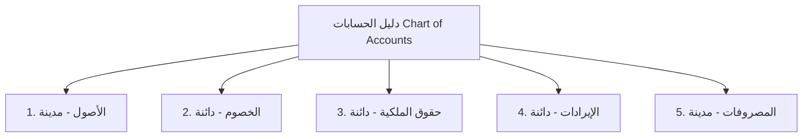
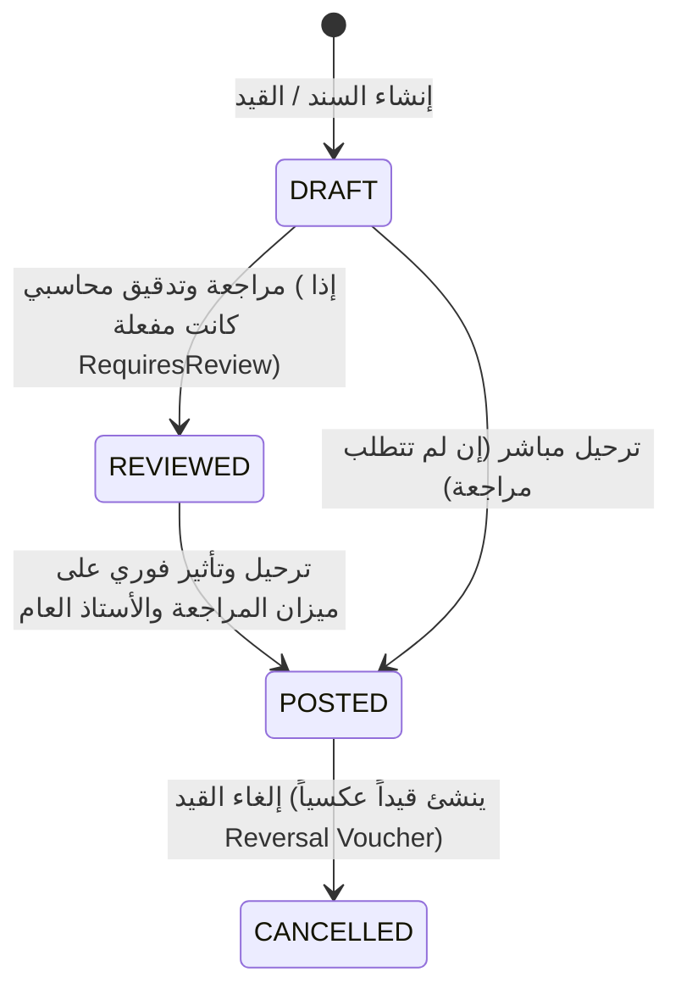
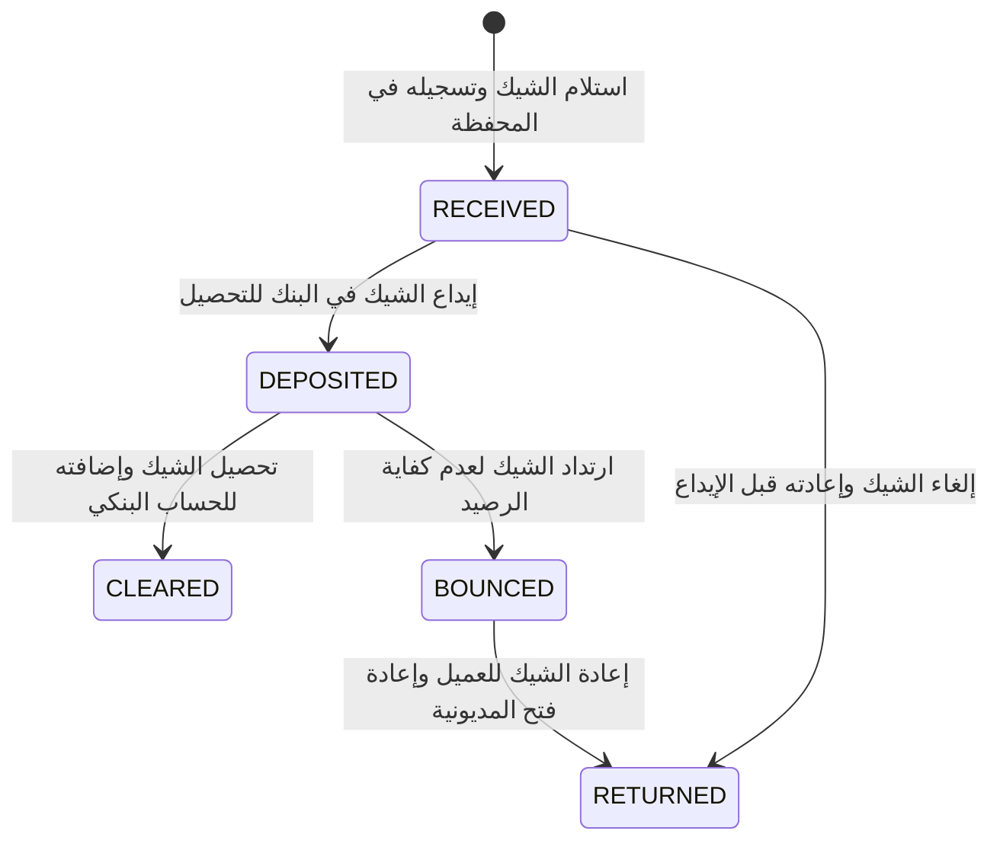

# ThinkOnErp - موديول المحاسبة والإدارة المالية (Accounting & Financials)
## وثيقة متطلبات وقواعد الأعمال (busniss.md)

---

## 1. نظرة عامة والهدف التجاري (Business Overview & Strategic Goals)

موديول **المحاسبة والإدارة المالية** في **ThinkOnErp** هو القلب المالي للمنظومة، مصمم لإدارة كافة العمليات المحاسبية للشركات والمجموعات القابضة وفقاً لمعايير المحاسبة الدولية (IFRS / GAAP) ومعايير هيئات الزكاة والضرائب والجمارك (مثل ZATCA).

### الأهداف الاستراتيجية:
1. **التحكم المالي الصارم (Strict Financial Integrity):** منع أي قيد غير متوازن، وتطبيق الرقابة المزدوجة على السندات والقيود المحاسبية.
2. **شجرة حسابات مرنة وشاملة (Dynamic Multi-Level Chart of Accounts):** هيكلة دليل الحسابات بعدة مستويات وتصنيفات، مع ربطها بمراكز التكلفة والعملات الأجنبية.
3. **دفاتر الأستاذ المساعدة المتكاملة (Subledgers - AR / AP):** إدارة مديونيات العملاء والتزامات الموردين وربطها التلقائي بحسابات الأستاذ العام (Control Accounts).
4. **إدارة الخزينة والمدفوعات والشيكات الآجلة (Cash, Banking & PDC Management):** إدارة الحسابات البنكية، الخزائن النقدية، المطابقات البنكية، ودورة حياة الشيكات المؤجلة الصادرة والواردة.
5. **المحرك الضريبي المتقدم (Advanced Tax Engine):** احتساب الضرائب المركبة والقيم المضافة وتتبعها على مستوى كل بند لضمان دقة الإقرارات الضريبية.
6. **التقارير المالية والختامية (Financial Statements & Closing):** توليد موازين المراجعة، الميزانيات العمومية، وقوائم الدخل، مع محرك الإقفال السنوي للفترات والسنوات المالية.

---

## 2. دليل الحسابات وهيكل الشجرة (Chart of Accounts - COA)

### 2.1 تصنيف الحسابات الرئيسية:
تنقسم الحسابات وفق المعايير المالية إلى 5 فئات رئيسية:
1. **الأصول (Assets - كود يبدأ بـ 1):** أصول متداولة (نقدية، بنوك، عملاء، مخزون)، وأصول غير متداولة (أصول ثابتة، ممتلكات). طبيعتها: **مدينة (Debit)**.
2. **الخصوم / الالتزامات (Liabilities - كود يبدأ بـ 2):** التزامات متداولة (موردون، شيكات آجلة، مستحقات رواتب، ضرائب مستحقة)، والتزامات طويلة الأجل. طبيعتها: **دائنة (Credit)**.
3. **حقوق الملكية (Equity - كود يبدأ بـ 3):** رأس المال، الأرباح المبقاة (Retained Earnings)، الاحتياطيات. طبيعتها: **دائنة (Credit)**.
4. **الإيرادات (Revenues - كود يبدأ بـ 4):** إيرادات المبيعات، إيرادات الخدمات، إيرادات أخرى. طبيعتها: **دائنة (Credit)**.
5. **المصروفات (Expenses - كود يبدأ بـ 5):** تكلفة البضاعة المباعة (COGS)، مصاريف الرواتب والأجور، الإيجارات، الاستهلاكات. طبيعتها: **مدينة (Debit)**.

### 2.2 قواعد العمل في دليل الحسابات:
- **المستوى التجميعي مقابل المستوى التحليلي (Parent vs Postable):** لا يجوز ترحيل أي قيد أو حركة مالية على حساب رئيسي/تجميعي (Header Account)؛ الترحيل مسموح فقط على الحسابات الطرفية التحليلية (Leaf / Postable Accounts).
- **الربط بالفروع (Branch Isolation):** يمكن تحديد ما إذا كان الحساب عاماً على مستوى الشركة بأكملها أو مخصصاً لفرع بعينه (مثل صناديق الفروع والحسابات البنكية الإقليمية).
- **العملات الأجنبية وتعدد العملات:** يمكن تحديد عملة الحساب كعملة محلية أو عملة أجنبية محددة، مع قيد سعر الصرف عند الحركة واحتساب فروق تقييم العملة (Forex Gain/Loss).

---

## 3. قيود اليومية وسير العمليات (General Ledger Vouchers)

### 3.1 أنواع السندات والقيود (Voucher Types):
1. **قيد اليومية العام (General Journal Voucher - JV):** للتسويات المحاسبية والقيود الافتتاحية والإقفال.
2. **سند القبض (Receipt Voucher - RV):** تحصيل نقدية أو شيكات أو حوالات بنكية من العملاء أو المدينين.
3. **سند الصرف (Payment Voucher - PV):** سداد التزامات الموردين أو المصروفات التشغيلية.
4. **قيود الأنظمة الآلية (System Vouchers):** قيود المبيعات الآلية من نقاط البيع، قيود تكلفة المبيعات وإيرادات المبيعات من فواتير المستودعات، وقيود الرواتب والأجور الشهرية من موديول الموارد البشرية.

### 3.2 دورة حياة القيد وسير اعتماده:

### 3.3 قواعد التحقق الصارمة في القيود المحاسبية:
- **مبدأ توازن القيد (Balance Invariant):**
  $$\sum \text{Debit Amounts} = \sum \text{Credit Amounts}$$
  يرفض النظام تماماً حفظ أي قيد في حالة `POSTED` إذا لم يتساوى مجموع المدين مع مجموع الدائن تماماً.
- **فحص الفترة المالية (Fiscal Period Check):** لا يمكن إدخال أو ترحيل قيد في فترة مالية مغلقة (`CLOSED`) أو مقفلة نهائياً (`LOCKED`).
- **إلزامية مركز التكلفة (Cost Center Enforcement):** إذا كان الحساب معلماً بأنه يتطلب مركز تكلفة (مثل حسابات المصروفات التشغيلية)، يمنع النظام الترحيل دون إسناد مركز تكلفة نشط.

---

## 4. دفاتر الأستاذ المساعدة للعملاء والموردين (AR / AP Subledgers)

### 4.1 حسابات المراقبة (Control Accounts):
- لا يتم إدخال حركات العملاء والموردين مباشرة على الأستاذ العام؛ بل يتم فتح بطاقة لكل عميل ومورد، وترتبط البطاقة بحساب المراقبة في شجرة الحسابات (مثل حساب "العملاء التجاريين" وحساب "الموردين المحليين").
- كل حركة في دفتر الأستاذ المساعد تُنشئ حركة متزامنة في الأستاذ العام، مما يضمن مطابقة ميزان المراجعة مع كشوف حسابات العملاء والموردين بنسبة 100%.

### 4.2 مطابقة الدفعات والتحصيلات (Cash Application / Matching):
- يدعم النظام مطابقة سندات القبض مع الفواتير الآجلة غير المسددة (Invoice Matching):
  - السداد الكامل (Full Settlement).
  - السداد الجزئي (Partial Payment) وتتبع الرصيد المتبقي.
  - السداد على الحساب (On Account) وتوزيع الدفعة لاحقاً على أقدم الفواتير (FIFO Matching).

### 4.3 تقارير أعمار الديون (Aging Analysis):
يقوم النظام بتصنيف أرصدة العملاء والموردين آلياً وفق فترات زمنية محددة:
- ديون حالية (Current / Not Due).
- 1 إلى 30 يوماً.
- 31 إلى 60 يوماً.
- 61 إلى 90 يوماً.
- أكثر من 90 يوماً (أرصدة متأخرة أو مشكوك في تحصيلها).

---

## 5. دورة حياة الشيكات المؤجلة (Post-Dated Cheques - PDC)

إدارة الشيكات الآجلة الواردة من العملاء (PDC Receivable) والشيكات الآجلة الصادرة للموردين (PDC Payable) عبر جدول `GL_PDC_REGISTER`:

### المعالجة المحاسبية لكل مرحلة:
1. **عند الاستلام (Received):**
   - من حـ/ شيكات برسم التحصيل (PDC Under Collection)
   - إلى حـ/ العميل (يقل رصيد العميل دفترياً أو ينشأ التزام مقابل).
2. **عند التحصيل (Cleared):**
   - من حـ/ البنك الجاري
   - إلى حـ/ شيكات برسم التحصيل.
3. **عند الارتداد (Bounced):**
   - من حـ/ العميل (إعادة المديونية)
   - إلى حـ/ شيكات برسم التحصيل، مع احتساب عمولة الارتداد البنكية إن وجدت.

---

## 6. الخزينة والمطابقة البنكية (Treasury, Cash & Bank Reconciliation)

### 6.1 الخزائن النقدية (Cash Registers):
- كل فرع أو نقطة بيع تمتلك خزينة أو صندوق كاشير مرتبط بحساب أستاذ عام.
- عمليات التغذية النقدية (Cash In) وتوريد النقدية للبنك (Cash Out) تتبع سندات صرف وقبض رسمية.

### 6.2 المطابقة البنكية (Bank Reconciliation):
- استيراد كشف الحساب البنكي الفعلي (Bank Statement).
- مطابقة الحركات البنكية آلياً بناءً على رقم الشيك، المرجع، والتاريخ والقيمة.
- فصل الشيكات المسحوبة التي لم تقدم للصرف (Unpresented Cheques) والإيداعات بالطريق (Deposits in Transit) للوصول إلى الرصيد البنكي المعدل.

---

## 7. المحرك الضريبي (Tax Engine & Compliance)

### 7.1 هيكل الضرائب:
- **فئات الضرائب (Tax Categories):** ضريبة القيمة المضافة القياسية (Standard VAT 15%)، النسبة الصفرية (Zero-Rated)، الإعفاء الضريبي (Exempt)، والضرائب الانتقائية (Excise Tax).
- **المجموعات الضريبية (Tax Groups):** تجميع أكثر من نسبة ضريبية وتطبيقها آلياً على المبيعات أو المشتريات.
- **سجل الحركات الضريبية (Tax Transactions):** جدول مالي تحليلي يسجل كل عملية بيع وشراء، النسبة المطبقة، المبلغ الخاضع للضريبة، ومبلغ الضريبة المستحق لإنشاء الإقرار الضريبي الرسمي دون الحاجة لمسح كافة جداول المبيعات والمشتريات.

---

## 8. الفترات والسنوات المالية والإقفال (Fiscal Closing & Year-End)

### 8.1 الفترات المالية (Fiscal Periods):
- تقسم السنة المالية عادة إلى 12 فترة شهرية وفترة تسوية رقم 13 (Period 13).
- حالات الفترة: `OPEN` (مفتوحة لإدخال الحركات)، `CLOSED` (مغلقة مؤقتاً)، `LOCKED` (مقفلة نهائياً لا يمكن فتحها إلا بإذن SuperAdmin).

### 8.2 عملية إقفال نهاية السنة (Year-End Closing):
1. التحقق من توازن ميزان المراجعة الختامي.
2. تصفير حسابات قائمة الدخل (الإيرادات والمصروفات).
3. ترحيل صافي الربح أو الخسارة تلقائياً إلى حساب **الأرباح المبقاة (Retained Earnings)** في حقوق الملكية.
4. ترحيل الأرصدة الختامية للأصول والخصوم لتصبح أرصدة افتتاحية (Opening Balances) للسنة المالية الجديدة.
