# ThinkOnErp - موديول المحاسبة والإدارة المالية (Accounting & Financials)
## وثيقة المعمارية والمنطق التقني البرمجي (logic.md)

---

## 1. المعمارية الفنية لموديول المحاسبة (Technical Architecture)

ينفذ موديول المحاسبة والإدارة المالية نمط العزل الكامل للمستأجرين (Tenant Schema Isolation)، حيث تقع جداول الحسابات والقيود داخل مخطط الشركة في Oracle، بينما تتم إدارة الاتصال وتنفيذ القواعد عبر خدمات ومستودعات متخصصة تعتمد على حقن التبعيات (Dependency Injection) ونمط المستودع (Repository Pattern) مع EF Core.

```mermaid
flowchart TD
    subgraph Accounting_Controllers [Controllers: 25 Controllers]
        VouchersCtrl[GlVouchersController & Types]
        AccountsCtrl[GlAccountsController & Structure]
        FiscalCtrl[FiscalYear, Periods & Closing]
        SubledgerCtrl[Subledger, Customers, Vendors]
        BankingCtrl[BankAccounts, Reconciliation, Cash, PDC]
        TaxCtrl[TaxController & Categories]
        ReportsCtrl[FinancialReports & AccountStatement]
    end

    subgraph Accounting_Services [Application Services]
        VoucherSvc[GlVoucherService]
        BalanceSvc[GlAccountBalanceService]
        ClosingSvc[FiscalClosingService]
        SubledgerSvc[SubledgerService & PartyServices]
        BankingSvc[BankingService & PdcService]
        TaxSvc[TaxEngineService]
        CoaSvc[GlAccountService & CoaExcelImportService]
    end

    subgraph Accounting_Repositories [Infrastructure Repositories]
        VoucherRepo[GlVoucherRepository]
        AccountRepo[GlAccountRepository]
        BalanceRepo[GlAccountBalanceRepository]
        SubledgerRepo[Ar/ApSubledgerRepositories]
        TaxRepo[TaxRepository]
        PeriodRepo[GlFiscalPeriodRepository]
    end

    subgraph Accounting_Entities [Domain Entities & Views]
        VoucherEnt[GlVoucherHeader & Detail]
        AccountEnt[GlAccount & Balance]
        SubledgerEnt[Ar/ApSubledgerTransaction]
        ViewsEnt[GlAccountStatementView, AgingViews]
    end

    Accounting_Controllers --> Accounting_Services
    Accounting_Services --> Accounting_Repositories
    Accounting_Repositories --> Accounting_Entities
```

---

## 2. فهرس الملفات البرمجية المكونة للموديول (Source Files Catalog)

### 2.1 طبقة المجال (Domain Entities & Views)
- **شجرة الحسابات والهيكل:**
  - `GlAccount.cs`: بطاقة الحساب، رقم الحساب (`AccountNumber`)، الاسم المحلي والإنجليزي، طبيعة الحساب (Debit/Credit)، الفئة (Asset, Liability, Equity, Revenue, Expense)، هل الحساب يقبل الترحيل (`IsPostable`)، المستوى الشجري (`Level`)، الحساب الأب (`ParentAccountId`)، هل يتطلب مركز تكلفة (`RequiresCostCenter`).
  - `GlAccountBranch.cs`: ربط الحسابات المحاسبية بفروع محددة.
  - `GlAccountStructureConfig.cs`: ضبط بنية أرقام الحسابات وأطوال المقاطع لكل مستوى.
  - `GlCostCenter.cs`: مراكز التكلفة، كود المركز، الاسم، التسلسل الهرمي الأبوي، والحالة.
  - `GlAccountBalance.cs`: الأرصدة الشهرية المتراكمة لكل حساب، رصيد افتتاحي، إجمالي المدين، إجمالي الدائن، الرصيد النهائي لكل فترة مالية.
- **قيود وسندات اليومية العامة:**
  - `GlVoucherHeader.cs`: رأس القيد/السند، رقم القيد (`VoucherNumber`)، نوع السند (`VoucherTypeId`)، تاريخ السند، الفترة المالية (`FiscalPeriodId`)، العملة، سعر الصرف، إجمالي المدين والدائن، الحالة (`Status`: DRAFT, POSTED, CANCELLED)، والوصف.
  - `GlVoucherDetail.cs`: أسطر القيد، معرف الحساب، مركز التكلفة، المبلغ مدين ومبلغ دائن، المرجع التحليلي، العملة الأجنبية، والملاحظات.
  - `GlVoucherType.cs`: أنواع السندات (قيد يومية، قبض، صرف، تسوية)، البادئة (`Prefix`)، سياسة تصفير الترقيم (سنوي/شهري).
  - `GlVoucherSerial.cs`: جداول تتبع تسلسل الأرقام التلقائية لكل نوع سند وفترة.
  - `GlPostingRule.cs`: قواعد الترحيل الآلية بين الحسابات الفرعية والرئيسية.
  - `GlOpeningBalanceHeader.cs`, `GlOpeningBalanceDetail.cs`: جداول تهيئة واعتماد الأرصدة الافتتاحية للمنشأة.
- **السنوات والفترات المالية:**
  - `SysFiscalYear.cs`: السنة المالية، تاريخ البداية والنهاية، وحالتها.
  - `GlFiscalPeriod.cs`: الفترات الشهرية التابعة للسنة، تاريخ البداية والنهاية، حالة الفترة (`OPEN`, `CLOSED`, `LOCKED`).
- **دفاتر الأستاذ المساعدة للعملاء والموردين (AR / AP Subledgers):**
  - `Customer.cs`: بطاقة العميل، الاسم، الرقم الضريبي، السجل التجاري، الحد الائتماني، فترة السماح، وحساب المراقبة المرتبط (`GlAccountId`).
  - `Vendor.cs`: بطاقة المورد، الاسم، الرقم الضريبي، شروط الدفع، وحساب المراقبة في الأستاذ العام.
  - `ArSubledgerTransaction.cs`: حركات حسابات المدينين (فواتير، إشعارات دائنة/مدينة، مقبوضات)، المبلغ الأصلي، المبلغ المسدد، والرصيد المتبقي.
  - `ArCashApplication.cs`: سجل مطابقة وتخصيص دفعات وسندات قبض العملاء مقابل الفواتير غير المسددة.
  - `ApSubledgerTransaction.cs`: حركات حسابات الدائنين والموردين، الفواتير الآجلة، المسدد منها والمتبقي.
  - `ApCashApplication.cs`: مطابقة سندات صرف الموردين مع فواتير المشتريات الآجلة.
- **الخزينة، البنوك، والشيكات المؤجلة (Cash, Banking & PDC):**
  - `BankAndCashEntities.cs`: يشمل `BankMaster` (بيانات البنوك)، `BankAccountMaster` (الحسابات الجارية وأرقام الآيبان وحساب الأستاذ المقابل)، `CashRegisterMaster` (الخزائن والصناديق)، `BankReconciliationHeader` و `BankReconciliationLine` (المطابقة البنكية وكشوف الحساب).
  - `GlPdcRegister.cs`: محفظة الشيكات الآجلة، رقم الشيك، البنك الساحب، الساحب/المستفيد، تاريخ الاستحقاق، القيمة، وحالة الشيك (`RECEIVED`, `DEPOSITED`, `CLEARED`, `BOUNCED`, `RETURNED`).
  - `PaymentMethod.cs`, `PaymentMethodType.cs`: طرق الدفع المعتمدة (نقدي، شبكة/مدى، فيزا، ماستركارد، تحويل بنكي، سداد، شيك).
- **المحرك الضريبي (Tax Engine):**
  - `TaxCategory.cs`: تصنيفات الضرائب (قيمة مضافة، استقطاع، ضريبة دخل، انتقائية).
  - `TaxRate.cs`: نسب الضرائب وتاريخ سريانها ونوعها (مئوية أو ثابتة).
  - `TaxGroup.cs`, `TaxGroupItem.cs`: تجميع الضرائب لتطبيقها مجتمعة على البنود.
  - `TaxTransaction.cs`: سجل تفصيلي للحركات الضريبية المتولدة من المبيعات والمشتريات لحساب الإقرار الضريبي.
- **قواعد البيانات وعروض الأداء العالي (Database Views):**
  - `GlAccountStatementView.cs`: عرض عالي السرعة لكشف حساب الأستاذ العام مع الرصيد المتحرك.
  - `ArAgingAnalysisView.cs`: عرض أعمار ديون العملاء مقسمة حسب الفترات.
  - `ApAgingAnalysisView.cs`: عرض أعمار ديون الموردين.

### 2.2 طبقة التطبيق (Application Services)
- `GlVoucherService.cs`: منطق إنشاء، مراجعة، ترحيل، وإلغاء القيود وسندات الصرف والقبض وفحص التوازن المالي.
- `GlAccountBalanceService.cs`: تحديث وإعادة احتساب الأرصدة الشهرية والتراكمية للحسابات ومراكز التكلفة فور الترحيل.
- `GlAccountService.cs`: إدارة شجرة الحسابات، التحقق من مستويات الأبناء والآباء وصلاحية الترحيل.
- `CoaExcelImportService.cs`: استيراد شجرة الحسابات بالكامل من ملفات Excel والتحقق من صحتها وتناسقها.
- `FiscalClosingService.cs`: منطق إقفال الفترات المالية والإقفال النهائي للسنة المالية وترحيل الأرباح والخسائر للأرباح المبقاة.
- `OpeningBalanceService.cs`: إدارة دورة حياة إدخال وتدقيق وترحيل الأرصدة الافتتاحية للمؤسسة.
- `SubledgerService.cs`: ترحيل ومطابقة حركات العملاء والموردين وربطها التلقائي بالأستاذ العام وحساب الفروقات.
- `PartyServices.cs`: إدارة بيانات وبطاقات العملاء والموردين ومراقبة الحدود الائتمانية.
- `BankingService.cs`: إدارة الحسابات البنكية وإجراءات المطابقة البنكية الآلية ومطابقة الحركات العالقة.
- `PdcService.cs`: دورة حياة الشيكات المؤجلة، وتوليد القيود المحاسبية التلقائية عند الإيداع، التحصيل، أو الارتداد.
- `TaxEngineService.cs`: احتساب الضرائب، حل المجموعات الضريبية للبنود، وتسجيل حركات الضرائب.
- `FinancialReportsService.cs`: استخراج ميزان المراجعة، قائمة الدخل، الميزانية العمومية، وكشوف الحساب التفصيلية.

### 2.3 طبقة البنية التحتية (Repositories & EF Configurations)
- `Repositories/Accounting/`: مستودعات مخصصة عالية الأداء تستخدم استعلامات محسنة:
  `GlVoucherRepository.cs`, `GlAccountRepository.cs`, `GlAccountBalanceRepository.cs`, `GlCostCenterRepository.cs`, `GlFiscalPeriodRepository.cs`, `GlOpeningBalanceRepository.cs`, `PostingRuleRepository.cs`, `PdcRepository.cs`, `PaymentMethodRepository.cs`, `CustomerRepository.cs`, `VendorRepository.cs`, `TaxRepository.cs`.
- `Data/Configurations/Accounting/`: تكوينات EF Core لضبط أسماء الجداول في Oracle، المفاتيح الأساسية والخارجية، الدقة العشرية `decimal(18, 4)` و `decimal(18, 2)`، والفهارس الفريدة لمنع تكرار أرقام القيود وأرقام الحسابات.

---

## 3. المنطق البرمجي للعمليات المحاسبية الأساسية (Core Accounting Logic)

### 3.1 خوارزمية ترحيل القيد المحاسبي (Voucher Posting Algorithm):
يتم تنفيذ الترحيل داخل معاملة قاعدة بيانات متسلسلة (`IDbContextTransaction`) بالخطوات الصارمة التالية:
1. **التحقق من حالة القيد:** يجب أن تكون حالة القيد `DRAFT` أو `REVIEWED`.
2. **التحقق من توازن القيد:**
   $$\text{TotalDebit} = \sum \text{line.DebitAmount}$$
   $$\text{TotalCredit} = \sum \text{line.CreditAmount}$$
   $$\text{if } |\text{TotalDebit} - \text{TotalCredit}| > 0.0001 \implies \text{Throw AccountingException("Voucher is not balanced")}$$
3. **التحقق من حالة الفترة المالية:**
   - فحص `GlFiscalPeriod` المقترن بتاريخ القيد.
   - إذا كانت الفترة `CLOSED` أو `LOCKED`، يتم رفض العملية فوراً بـ `PeriodClosedException`.
4. **التحقق من الحسابات والترحيل ومراكز التكلفة:**
   - التأكد من أن جميع الحسابات نشطة (`IsActive == true`).
   - التأكد من أن جميع الحسابات طرفية وتقبل الترحيل (`IsPostable == true`).
   - فحص الحسابات التي تتطلب مركز تكلفة (`RequiresCostCenter == true`)؛ والتأكد من إدخال مركز تكلفة نشط في السطر.
5. **توليد الرقم التسلسلي المالي الرسمي (Official Voucher Numbering):**
   - اعتماداً على نوع السند والسياسة (سنوي/شهري)، يتم سحب الرقم التالي بقفل تسلسلي آمن لمنع التكرار (Sequence Locking).
6. **تحديث أرصدة الأستاذ العام (`GlAccountBalance`):**
   - لكل سطر في القيد، يتم استدعاء `GlAccountBalanceRepository.UpdateBalanceAsync`:
     $$\text{NewDebitBalance} = \text{CurrentDebitBalance} + \text{line.DebitAmount}$$
     $$\text{NewCreditBalance} = \text{CurrentCreditBalance} + \text{line.CreditAmount}$$
7. **تحديث دفاتر الأستاذ المساعدة (Subledgers):**
   - إذا كان الحساب مرتبطاً بعميل أو مورد، يتم إنشاء حركة في `ArSubledgerTransaction` أو `ApSubledgerTransaction`.
8. **تغيير حالة القيد:** يتم وسم القيد بـ `POSTED`، وتسجيل `PostingDate` وهوية المستخدم، وتثبيت المعاملة (`Commit`).

---

### 3.2 خوارزمية إقفال نهاية السنة المالية (Year-End Closing Algorithm):
1. التحقق من إقفال كافة الفترات الشهرية (1 إلى 12) من السنة المالية الحالية.
2. حساب مجموع الإيرادات (`Revenue Accounts` فئة 4) ومجموع المصروفات (`Expense Accounts` فئة 5).
3. احتساب صافي الربح أو الخسارة:
   $$\text{NetIncome} = \sum \text{Revenues} - \sum \text{Expenses}$$
4. توليد قيد إقفال تلقائي من نوع `YEAR_END_CLOSING`:
   - جعل كافة حسابات الإيرادات ذات الأرصدة الدائنة **مدينة** بقيمتها لتصفيرها.
   - جعل كافة حسابات المصروفات ذات الأرصدة المدينة **دائنة** بقيمتها لتصفيرها.
   - الفرق يُقيد في حساب **الأرباح المبقاة (Retained Earnings Account)**:
     - إذا كان ربحاً ($\text{NetIncome} > 0$): يكون حساب الأرباح المبقاة **دائناً**.
     - إذا كانت خسارة ($\text{NetIncome} < 0$): يكون حساب الأرباح المبقاة **مديناً**.
5. ترحيل أرصدة حسابات الميزانية (الأصول، الخصوم، حقوق الملكية) كأرصدة افتتاحية (`Opening Balances`) للسنة المالية الجديدة.
6. وسم السنة المالية السابقة بـ `LOCKED`.

---

### 3.3 خوارزمية مطابقة الدفعات الآجلة (Subledger Cash Allocation - FIFO & Specific):
عند تسجيل دفعة أو سند قبض لعميل بقيمة $P$:
- في حال التخصيص التلقائي (FIFO Allocation):
  1. جلب فواتير العميل المفتوحة مرتبة تصاعدياً حسب تاريخ الاستحقاق `DueDate`.
  2. لكل فاتورة برصيد متبقي $R_i$:
     $$\text{Allocated}_i = \min(P, R_i)$$
     $$P \leftarrow P - \text{Allocated}_i$$
     $$R_i \leftarrow R_i - \text{Allocated}_i$$
     - إنشاء سجل في `ArCashApplication` يربط سند القبض برقم الفاتورة والقيمة المسددة.
     - إذا أصبح $R_i = 0$، تصبح الفاتورة مسددة بالكامل (`IsFullyPaid = true`).
  3. إذا تبقت قيمة من $P > 0$ بعد سداد كافة الفواتير، تُسجل كرصيد دائن على الحساب (On-Account / Unapplied Credit).

---

## 4. الكتالوج الشامل لنقاط النهاية البرمجية للمحاسبة (API Controllers Catalog)

| المتحكم (Controller) | المسار (Route) | الأفعال (HTTP Methods) | الوظيفة التقنية |
|---|---|---|---|
| `GlAccountsController` | `/api/accounting/gl-accounts` | GET, POST, PUT, DELETE | إدارة شجرة الحسابات، قراءة المستويات، فحص صلاحية الترحيل |
| `GlAccountStructureController` | `/api/accounting/gl-account-structure` | GET, POST, PUT | تهيئة هيكل وأطوال مقاطع الشجرة المحاسبية |
| `GlVouchersController` | `/api/accounting/gl-vouchers` | GET, POST, PUT, DELETE | إنشاء القيود، حفظ المسودات، ترحيل القيود، إلغاء السندات |
| `VoucherTypesController` | `/api/accounting/voucher-types` | GET, POST, PUT | إدارة أنواع السندات وبادئات الترقيم والتسلسل |
| `PostingRulesController` | `/api/accounting/posting-rules` | GET, POST, PUT, DELETE | ضبط وتخصيص قواعد الترحيل الآلية بين الحسابات |
| `FiscalYearController` | `/api/accounting/fiscal-years` | GET, POST, PUT | إدارة السنوات المالية وحالاتها |
| `FiscalPeriodsController` | `/api/accounting/fiscal-periods` | GET, POST, PUT | إدارة الفترات المالية الشهرية وفتحها وإغلاقها |
| `FiscalClosingController` | `/api/accounting/fiscal-closing` | POST | تنفيذ الإقفال الشهري والسنوي وترحيل الأرباح المبقاة |
| `OpeningBalancesController` | `/api/accounting/opening-balances` | GET, POST, PUT | إدخال وتدقيق وترحيل الأرصدة الافتتاحية للمنشأة |
| `AccountBalancesController` | `/api/accounting/account-balances` | GET | الاستعلام عن أرصدة الحسابات وميزان المراجعة التجريبي |
| `AccountStatementController` | `/api/accounting/account-statement` | GET | كشف حساب الأستاذ العام التحليلي مع الرصيد المتحرك |
| `AccountCategoriesController` | `/api/accounting/account-categories` | GET, POST | إدارة تصنيفات الحسابات المالية الرئيسية والفرعية |
| `BankAccountsController` | `/api/accounting/bank-accounts` | GET, POST, PUT | إدارة الحسابات البنكية للمنشأة وربطها بالأستاذ العام |
| `BankReconciliationController`| `/api/accounting/bank-reconciliation` | GET, POST, PUT | تسوية ومطابقة كشوف الحسابات البنكية مع الحركات الدفترية |
| `CashRegistersController` | `/api/accounting/cash-registers` | GET, POST, PUT | إدارة الخزائن وصناديق النقدية بالفروع |
| `PdcController` | `/api/accounting/pdc` | GET, POST, PUT | دورة حياة الشيكات المؤجلة (استلام، إيداع، تحصيل، ارتداد) |
| `PaymentsController` | `/api/accounting/payments` | GET, POST, PUT | سندات الصرف للموردين والمصروفات النقدية والبنكية |
| `ReceiptsController` | `/api/accounting/receipts` | GET, POST, PUT | سندات القبض والتحصيل من العملاء |
| `PaymentMethodsController` | `/api/accounting/payment-methods` | GET, POST, PUT | تهيئة وسائل الدفع المعتمدة (نقدي، مدى، فيزا، تحويل) |
| `TaxController` | `/api/accounting/tax` | GET, POST, PUT | إدارة الفئات والنسب والمجموعات الضريبية والإقرار الضريبي |
| `CostCentersController` | `/api/accounting/cost-centers` | GET, POST, PUT, DELETE | إدارة الشجرة الهرمية لمراكز التكلفة ومتابعة المصروفات |
| `CustomersController` | `/api/accounting/customers` | GET, POST, PUT, DELETE | إدارة بطاقات العملاء، الحسابات الرقابية، والحدود الائتمانية |
| `VendorsController` | `/api/accounting/vendors` | GET, POST, PUT, DELETE | إدارة بطاقات الموردين وشروط السداد وحسابات المراقبة |
| `SubledgerController` | `/api/accounting/subledger` | GET, POST | الاستعلام عن كشوف حركات ومطابقات العملاء والموردين |
| `CoaImportController` | `/api/accounting/coa-import` | POST | استيراد دليل الحسابات من ملفات Excel ومطابقته آلياً |
| `FinancialReportsController` | `/api/accounting/financial-reports` | GET | استخراج ميزان المراجعة، الميزانية العمومية، وقائمة الدخل |
