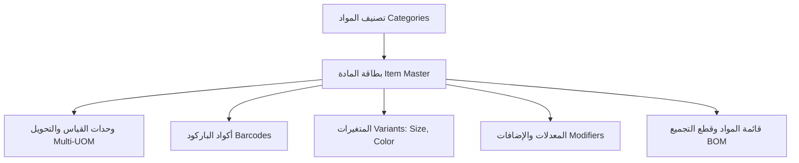
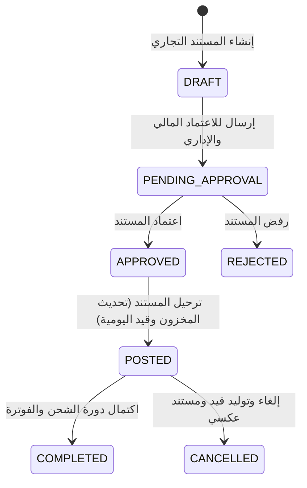

# ThinkOnErp - موديول المخزون والمستودعات والتجارة الموحدة (Inventory & Unified Trade)
## وثيقة متطلبات وقواعد الأعمال (busniss.md)

---

## 1. نظرة عامة والهدف التجاري (Business Overview & Strategic Goals)

موديول **المخزون وسلسلة التوريد والتجارة الموحدة (Inventory & Trade Engine)** في **ThinkOnErp** هو المحرك التشغيلي لكافة أنشطة التخزين، المشتريات، المبيعات التجارية، التوزيع، وإدارة البضائع. صُمم الموديول ليدعم الشركات التجارية، الموزعين، سلاسل التجزئة، والمصانع التجميعية الخفيفة.

### الأهداف الاستراتيجية:
1. **التحكم اللحظي الدقيق في المخزون (Real-Time Stock Traceability):** مراقبة الكميات المتوفرة، المحجوزة، والواردة في كل مستودع، منطقة، ورف بدقة متناهية.
2. **محرك التجارة الموحد (Unified Trade Documents Engine):** منصة موحدة تتعامل مع كافة الوثائق التجارية (أوامر الشراء، استلام البضائع، فواتير الشراء، فواتير المبيعات، مرتجعات المبيعات والمشتريات، المناقلات بين المستودعات، ومحاضر الجرد والتسوية) ضمن هيكل بيانات موحد وسير عمل قياسي.
3. **تقييم المخزون المالي المعتمد (Financial Inventory Valuation):** دعم طرق التقييم المالي المعترف بها دولياً: ما يرد أولاً يصرف أولاً (FIFO)، والمتوسط المرجح المتحرك للتكلفة (Weighted Average Cost - WAC).
4. **تتبع الدفعات وتواريخ الصلاحية والأرقام التسلسلية (Lots, Expiry Dates & Serials):** حماية المستهلك والامتثال للرقابة الدوائية والغذائية وتتبع الأجهزة الإلكترونية ذات الضمان عبر أرقام السيريال الفريدة.
5. **شجرة الأصناف والمتغيرات والمعدلات (Variants, Matrices & Modifiers):** دعم المواد ذات الخصائص المتعددة (الألوان، المقاسات، الأوزان)، بالإضافة إلى مجموعات التعديل والإضافات لقطاع التجزئة والمطاعم.
6. **وحدات القياس المتعددة والباركود المتنوع (Multi-UOM & Dynamic Barcodes):** دعم بيع وشراء المادة بعدة وحدات (حبة، كرتون، طرد، طبلية) مع معاملات تحويل مرنة، وقراءة باركود الأوزان الموزونة والمترية.
7. **الجرد الفعلي ومعالجة الفروقات (Physical Cycle Counting & Reconciliation):** دورات الجرد الدوري والمفاجئ واحتساب الفروقات التخزينية وترحيل قيود العجز والزيادة آلياً للأستاذ العام.

---

## 2. هيكل البيانات وتصنيف المواد (Item Master & Product Hierarchy)

### 2.1 تصنيف أنواع المواد (Item Types):
- **مادة مخزنية (Stock Item):** سلعة ملموسة يتم شراؤها وتخزينها وبيعها، وتؤثر في الكميات وقيمة المخزون في الميزانية.
- **مادة خدمية (Service Item):** خدمات استشارية، صيانة، رسوم شحن وتركيب؛ لا تمتلك رصيداً مخزنياً وتؤثر مباشرة على الإيرادات والمصروفات.
- **مادة خام (Raw Material):** مدخلات إنتاج تُستخدم داخل وصفات التصنيع ومجموعات المواد (BOM).
- **منتج تام الصنع (Finished Goods):** ناتج عمليات التجميع والتصنيع جاهز للبيع.
- **مجموعة مجمعة / وجبة (Combo / Assembly Item):** صنف وهمي يضم مجموعة من المواد التابعة يتم تفكيكها أو استهلاكها عند البيع.

### 2.2 المتغيرات والمصفوفات (Matrix Variants & Attributes):
- المادة الأساسية (`Parent Item`): مثل قميص رجالي كلاسيك.
- الخصائص (`Attributes`): الحجم (S, M, L, XL)، اللون (أبيض، أزرق، أسود).
- الأصناف المولدة (`Generated Variants`): قميص رجالي - مقاس L - لون أزرق، ولكل متغير باركوده الخاص، ورصيده المستقل، وسعره المستقل إن لزم.

---

## 3. محرك الوثائق التجارية الموحد (Unified Trade Documents Engine)

### 3.1 أنواع الوثائق المدعومة (Document Types):
1. **أوامر الشراء (Purchase Orders - PO):** اتفاقية تجارية مع المورد لتوريد كميات محددة بأسعار متفق عليها (لا تؤثر على المخزون الفعلي، بل تزيد المخزون المتوقع الوارد).
2. **سند استلام البضاعة (Goods Receipt Note - GRN / DocType 100):** إثبات دخول البضاعة فعلياً للمستودع؛ تزيد الكمية الفعلية وتنشئ استحقاق مورد غير مفوتر (Goods Received Not Invoiced - GRNI).
3. **فاتورة المشتريات (Purchase Invoice / DocType 110):** إثبات مديونية المورد وتثبيت التكلفة النهائية للمواد.
4. **مردود المشتريات (Purchase Return / DocType 120):** إعادة البضاعة للمورد بسبب عيوب أو انتهاء صلاحية، وتخفيض المخزون ومديونية المورد.
5. **فاتورة المبيعات التجارية (Sales Invoice / DocType 200):** بيع بضاعة للعميل؛ تخفض المخزون المتاح، تثبت إيراد المبيعات، وتنشئ مديونية على العميل مع قيد تكلفة البضاعة المباعة (COGS).
6. **مردود المبيعات (Sales Return / DocType 210):** استرجاع بضاعة من العميل وإعادتها للمستودع وإلغاء الإيراد المقابل.
7. **مناقلة بين المستودعات (Internal Warehouse Transfer / DocType 350):** نقل بضاعة من المستودع المركزي إلى مستودع فرعي دون أي تأثير مالي على حقوق الملكية.
8. **سند تسوية مخزنية (Stock Adjustment - In/Out / DocType 300/310):** معالجة العجز أو الزيادة في المخزون الناتج عن الهدر، الكسر، أو فروق الجرد الفعلي.

### 3.2 دورة حياة الوثيقة التجارية (Document State Machine):

---

## 4. طرق تقييم المخزون وتكاليف البضاعة (Costing Methods & Valuation)

### 4.1 طريقة ما يرد أولاً يصرف أولاً (FIFO):
- يتم إنشاء طبقة تكلفة مستقلة (`InvCostLayer`) لكل عملية شراء أو استلام بضاعة تحتوي على: (الكمية المستلمة، سعر الشراء للوحدة، الكمية المتبقية).
- عند البيع أو الصرف، يستهلك النظام من أقدم طبقة تكلفة متوفرة في المستودع حتى تنفد، ثم ينتقل للطبقة التالية:
  $$\text{COGS} = \sum_{i=1}^{k} (\text{ConsumedQty}_i \times \text{UnitCost}_i)$$

### 4.2 طريقة المتوسط المرجح المتحرك (Moving Weighted Average Cost - WAC):
- يُعاد احتساب متوسط تكلفة الوحدة تلقائياً عند كل عملية شراء أو استلام بضاعة واردة بالمعادلة التالية:
  $$\text{New WAC} = \frac{(\text{Current Qty} \times \text{Current WAC}) + (\text{Received Qty} \times \text{Received Unit Cost})}{\text{Current Qty} + \text{Received Qty}}$$
- عند الصرف أو البيع، تخرج البضاعة بتكلفة الـ WAC الحالية دون تغيير في متوسط التكلفة.

---

## 5. إدارة المستودعات والمواقع الفيزيائية (Multi-Warehouse, Zones & Bins)

### 5.1 الهيكل المكاني للمستودع:
- **المستودع (Warehouse):** المنشأة أو الموقع الجغرافي المستقل.
- **المنطقة (Zone):** قسم داخلي داخل المستودع (منطقة التجميد، منطقة البضائع الجافة، منطقة الاستلام والتجهيز).
- **الرف / الصندوق (Bin Location):** أدنى موقع تخزيني يتم تخزين المادة فيه بدقة (رقم الممر، رقم الحامل، رقم الرف).

### 5.2 مستويات المخزون وحدود الطلب:
- **الحد الأدنى (Minimum Stock):** التنبيه عند وصول الرصيد إليه لمنع نفاذ المخزون.
- **حد إعادة الطلب (Reorder Point - ROP):** النقطة المحسوبة بناءً على معدل الاستهلاك اليومي وفترة التوريد (Lead Time).
- **الحد الأقصى (Maximum Stock):** منع تكدس البضائع وتجميد السيولة النقدية.
- **المتوفر للالتزام (Available To Promise - ATP):**
  $$\text{ATP} = \text{Physical On-Hand} - \text{Reserved Stock} + \text{Expected Incoming (PO)}$$

---

## 6. تتبع الدفعات وتواريخ الصلاحية والأرقام التسلسلية (Lots & Serials)

- **الدفعات وتواريخ الانتهاء (Lots & Expiration):**
  - إلزامية إدخال رقم الدفعة وتاريخ انتهاء الصلاحية للمواد الدوائية والغذائية.
  - تطبيق سياسة الصرف حسب الأسبق انتهاءً (First Expired, First Out - FEFO).
  - حظر بيع أو صرف أي دفعة منتهية الصلاحية مع تحويلها آلياً إلى منطقة العزل (Quarantine).
- **الأرقام التسلسلية الفريدة (Serial Numbers):**
  - كل قطعة تمتلك رقماً تسلسلياً فريداً لا يتكرر على مستوى النظام بالكامل.
  - متابعة مسار القطعة: من أمر الشراء -> إذن الاستلام -> المستودع والرف -> فاتورة البيع والعميل -> إثبات الضمان وخدمات ما بعد البيع.

---

## 7. قوائم المواد والتصنيع التجميعي (Bill of Materials - BOM)

- تستخدم للمطاعم (وصفات الطهي والوجبات) والمصانع التجميعية ومجموعات الهدايا.
- **أنواع الـ BOM:**
  - **تجميعي بيعي (Kit / Combo):** استهلاك المواد الخام فور بيع الوجبة في الكاشير.
  - **تصنيع مسبق (Production / Batch Prep):** طبخ أو تجميع كمية مسبقة، وإدخال المنتج النهائي للمستودع وإخراج المواد الأولية المستهلكة وفق نسب الهدر القياسية.
