# ThinkOnErp - موديول المخزون والمستودعات والتجارة الموحدة (Inventory & Unified Trade)
## وثيقة المعمارية والمنطق التقني البرمجي (logic.md)

---

## 1. المعمارية التقنية والتصميم الهيكلي (Technical Architecture)

يعتمد موديول المخزون والتجارة الموحدة على معمارية معالجة الحركات غير القابلة للتغيير (Immutable Ledger Pattern). يتم تسجيل كافة الحركات الفيزيائية للبضائع عبر دفتر أستاذ المخزون التراكمي (`InvStockLedgerEntry`)، مع تحديث جداول الأرصدة التراكمية الحية (`InvStockBalance`) وطبقات التكلفة (`InvCostLayer`) ضمن معاملات متكاملة (ACID Transactions) لضمان عدم وجود أي تعارض أو بيع بالسالب غير مصرح به.

```mermaid
flowchart TD
    subgraph Inventory_API [API Controllers]
        TrxDocCtrl[TrxDocumentsController & Types]
        ItemsCtrl[InvItems, Categories, Variants, Barcodes]
        WarehouseCtrl[InvWarehouses, Zones, Bins]
        StockCtrl[InvStockController & Balances]
        BomCtrl[InvBomController]
        ExcelCtrl[InventoryExcelController]
    end

    subgraph Inventory_Application [Application Services]
        DocService[TrxDocumentService]
        LedgerService[InvStockLedgerService]
        CostingEngine[InvCostingEngine: FIFO & WAC]
        AtpCalc[InvAtpCalculator]
        ValidationSvc[InvoiceBusinessValidationService]
        DynamicRules[DynamicValidationEngine]
    end

    subgraph Inventory_Infrastructure [Repositories & Data Access]
        DocRepo[TrxDocumentRepository]
        LedgerRepo[InvStockLedgerRepository]
        BalanceRepo[InvStockBalanceRepository]
        CostLayerRepo[InvCostLayerRepository]
        LotSerialRepo[InvLotSerialRepository]
    end

    subgraph Domain_Persistence [Oracle Database - Tenant Schema]
        TRX_DOC_HEADER
        TRX_DOC_LINE
        INV_STOCK_LEDGER_ENTRY
        INV_STOCK_BALANCE
        INV_COST_LAYER
        INV_LOT_MASTER
        INV_SERIAL_MASTER
    end

    Inventory_API --> Inventory_Application
    Inventory_Application --> Inventory_Infrastructure
    Inventory_Infrastructure --> Domain_Persistence
```

---

## 2. فهرس الملفات البرمجية المكونة للموديول (Source Files Catalog)

### 2.1 طبقة المجال (Domain Entities, Enums & Views)
- **ملفات بطاقات المواد والأصناف والمجموعات:**
  - `InvItem.cs`: بطاقة المادة الأساسية، الكود الفريد (`ItemCode`)، الاسم المحلي والإنجليزي، نوع المادة (`ItemType`)، وحدة القياس الأساسية، طريقة التقييم المالي (`CostingMethod`: FIFO, WAC, STANDARD)، سعر البيع الافتراضي، تكلفة الشراء المعيارية، حد الطلب الأدنى والأقصى، هل تخضع لتتبع الدفعات أو السيريال، وهل هي نشطة.
  - `InvItemCategory.cs`: التصنيفات الشجرية للمواد، الفئة الأب، الكود، ونسب الهامش الربحي المستهدف.
  - `InvItemVariant.cs`, `InvItemVariantValue.cs`: المتغيرات التوليدية للمادة (الألوان والمقاسات)، الباركود التابع لكل متغير، وسعر التكلفة والبيع الخاص.
  - `InvItemAttribute.cs`, `InvItemAttributeValue.cs`: تعريف الخصائص المعيارية (الخامة، المقاس، بلد المنشأ).
  - `InvItemBarcode.cs`: جدول الباركود المتعدد للمادة الواحدة والوحدات المتعددة مع نوع التشفير (`EAN13`, `Code128`, `UPC`).
  - `InvItemUomConversion.cs`: معاملات التحويل بين وحدات القياس (مثال: 1 كرتون = 24 حبة).
  - `InvModifierGroup.cs`, `InvModifierOption.cs`, `InvItemModifierGroup.cs`: مجموعات التعديل والإضافات لقطاع التجزئة والمطاعم (بدون سكر، حجم مضاعف، صلصة إضافية).
- **المستودعات والمواقع الفيزيائية:**
  - `InvWarehouse.cs`: بيانات المستودع، الكود، الاسم، الفرع التابع له، ونوع المستودع (رئيسي، فرعي، معرض، تالف).
  - `InvZone.cs`: المناطق التخزينية داخل المستودع (منطقة جافة، ثلاجة، منطقة استلام).
  - `InvBin.cs`: الرفوف والصناديق التخزينية المحددة برقم الممر والعمود والارتفاع.
- **أرصدة المخزون ودفتر الأستاذ وطبقات التكلفة:**
  - `InvStockBalance.cs`: الرصيد الحي المتراكم لكل (مادة + متغير + مستودع)، الكمية الفعلية المتوفرة (`QuantityOnHand`)، الكمية المحجوزة (`QuantityReserved`)، والكمية المتوقعة (`QuantityOnOrder`).
  - `InvStockLedgerEntry.cs`: سجل الحركات غير القابل للتعديل، رقم المستند، نوع الحركة، الكمية الواردة، الكمية الصادرة، تكلفة الوحدة اللحظية، الرصيد المتبقي بعد الحركة، والقيمة المالية الإجمالية.
  - `InvCostLayer.cs`: طبقات تكلفة الـ FIFO، رقم وتاريخ الشراء، الكمية الأصلية المستلمة، الكمية المتبقية، وسعر تكلفة الشراء للوحدة.
  - `InvLotMaster.cs`: دفعات الإنتاج والتوريد، رقم التشغيلة/الدفعة (`LotNumber`)، تاريخ الإنتاج، وتاريخ انتهاء الصلاحية.
  - `InvSerialMaster.cs`: تتبع الأرقام التسلسلية الفريدة لكل قطعة، حالتها (`IN_STOCK`, `SOLD`, `RETURNED`, `DAMAGED`)، وتاريخ البيع والضمان.
  - `InvReservation.cs`: حجز كميات محددة لأوامر المبيعات المعلقة أو عقود التوريد لمنع بيعها للغير.
  - `InvPriceList.cs`, `InvPriceListItem.cs`: قوائم الأسعار (جملة، تجزئة، كبار العملاء)، ونسب الخصم والعملة المرتبطة.
  - `InvBomHeader.cs`, `InvBomLine.cs`: وصفات التصنيع وقوائم المواد التجميعية، نسب الهدر القياسية، وكميات المواد الخام لكل وحدة منتج تام.
  - `InvOpeningBatch.cs`, `InvOpeningLine.cs`: دورة حياة الأرصدة الافتتاحية للمخزون واعتمادها.
  - `InvCountSession.cs`, `InvCountLine.cs`: جلسات الجرد المستودعي، الجرد النظري، الجرد الفعلي، وفروق العجز والزيادة.
- **محرك الوثائق التجارية (Unified Trade Documents):**
  - `TrxDocumentHeader.cs`: رأس الوثيقة التجارية، رقم الوثيقة، نوع الوثيقة (`DocType`: 100 GRN, 110 Purchase, 200 Sales, 350 Transfer, 300 Adjustment)، نوع الحركة (`TrxType`)، المستودع المصدر، المستودع الهدف، الطرف التجاري (العميل/المورد)، تاريخ المستند، الإجمالي قبل الضريبة، الخصم، الضريبة، الصافي، وحالة المستند (`Status`).
  - `TrxDocumentLine.cs`: أسطر الوثيقة، المادة، المتغير، الكمية الواردة، الكمية الصادرة، السعر، نسبة الخصم، نسبة الضريبة، التكلفة المحتسبة، ومبلغ السطر.
  - `TrxDocumentSerial.cs`: أرقام السيريال أو الدفعات المحددة لكل سطر في الوثيقة التجارية.
  - `TrxDocType.cs`, `TrxTransactionType.cs`: جداول ضبط أنواع المستندات، اتجاه المخزون، التأثير المالي، وهل تتطلب ترحيل قيد يومية تلقائي.
- **أنواع التعداد (Enums - 17 ملف):**
  - `AdjustmentStatus.cs`, `AdjustmentType.cs`, `BarcodeType.cs`, `BomType.cs`, `CostingMethod.cs`, `CountSessionStatus.cs`, `ItemType.cs`, `LotStatus.cs`, `ModifierSelectionType.cs`, `OpeningBalanceStatus.cs`, `ReservationStatus.cs`, `SerialStatus.cs`, `TransactionDirection.cs`, `TransactionType.cs`, `TransferStatus.cs`, `WarehouseType.cs`, `ZoneType.cs`.
- **قواعد البيانات وعروض الأداء (Views):**
  - `InventoryValuationView.cs`: تقرير تقييم المخزون المالي اللحظي لكل مادة ومستودع.
  - `SalesInvoiceProfitabilityView.cs`: تقرير ربحية فواتير المبيعات بمقارنة سعر البيع بتكلفة البضاعة المباعة (COGS) المحسوبة من طبقات التكلفة.

### 2.2 طبقة التطبيق (Application Services)
- `TrxDocumentService.cs`: المحرك الرئيسي لإنشاء، مراجعة، ترحيل، وإلغاء كافة المستندات التجارية وفحص شروط الأمان والمخزون.
- `TrxTypeService.cs`: إدارة تكوينات المستندات التجارية والمسارات المعتمدة.
- `InvCostingEngine.cs`: احتساب تكلفة البضاعة المباعة واستهلاك طبقات FIFO وإعادة احتساب المتوسط المرجح WAC.
- `InvStockLedgerService.cs`: ترحيل الحركات إلى دفتر الأستاذ المخزني وتحديث الأرصدة الحية `InvStockBalance`.
- `InvAtpCalculator.cs`: احتساب الكميات المتوفرة للالتزام الفوري والآجل.
- `InvBomService.cs`: تفكيك واستهلاك وصفات المواد وتجميع المنتجات التامة.
- `InvItemService.cs`, `InvItemCategoryService.cs`: إدارة بطاقات المواد والتصنيفات وفحص صلاحية الأكواد والباركود.
- `InvVariantService.cs`: توليد مصفوفات المتغيرات وتخصيص الباركود والأسعار.
- `InvWarehouseService.cs`: إدارة المستودعات، المواقع، وسعات التخزين.
- `InvModifierService.cs`: إدارة مجموعات التعديل والإضافات.
- `InvOpeningBalanceService.cs`: مراجعة وترحيل الأرصدة الافتتاحية للمخازن.
- `InvPriceListService.cs`: حل وتطبيق قائمة السعر المناسبة للعميل أو المعرض.
- `InvReconciliationService.cs`: معالجة فروقات الجرد المستودعي وتوليد سندات التسوية.
- `InventoryExcelService.cs`: استيراد وتصدير بيانات المواد والمخزون عبر ملفات Excel فائقة السرعة.

---

## 3. المنطق البرمجي لمحرك الوثائق التجارية (Unified Trade Processing Logic)

### 3.1 خوارزمية معالجة وترحيل المستند التجاري (`CreateDocumentAsync` & `PostDocumentAsync`):
تتم العملية وفق تسلسل صارم داخل معاملة قاعدة بيانات:

1. **التحقق من صحة المدخلات والحقول (Dynamic Validation Engine):**
   - فحص الحقول الإلزامية ونطاقات الأسعار وقواعد الشاشات المخزنة في `SysFieldValidationRule`.
2. **التحقق من القواعد التجارية (Business & Fiscal Validation via `InvoiceBusinessValidationService`):**
   - **فحص الفترة المالية:** التأكد من أن تاريخ المستند يقع داخل فترة مالية مفتوحة (`OPEN`).
   - **فحص الرصيد المخزني المتاح (Stock Availability Check):** في حركات الصرف والبيع والمناقلة الصادرة:
     $$\text{if } (\text{InvStockBalance.QuantityOnHand} - \text{InvStockBalance.QuantityReserved} < \text{RequestedQty}) \implies \text{Reject ("Insufficient stock")}$$
     (إلا إذا كانت الشركة تسمح صراحة بالبيع على المكشوف في إعداداتها).
   - **فحص الحد الائتماني للعميل (Customer Credit Limit Check):** في فواتير المبيعات الآجلة:
     $$\text{CurrentBalance} + \text{InvoiceTotal} > \text{Customer.CreditLimit} \implies \text{Reject ("Credit limit exceeded")}$$
3. **تحديد اتجاه حركة المخزون آلياً (Stock Direction Resolution):**
   - بناءً على إعدادات `TrxType.AffectsStock` و `TrxType.StockDirection`:
     - إذا كان الاتجاه وارد (`StockDirection > 0`): تثبيت $\text{QuantityIn} = \text{Qty}$, $\text{QuantityOut} = 0$.
     - إذا كان الاتجاه صادر (`StockDirection < 0`): تثبيت $\text{QuantityOut} = \text{Qty}$, $\text{QuantityIn} = 0$.
     - في المناقلة بين المستودعات (`DocType == 350`): يتم قيد الإخراج من المستودع المصدر والإدخال للمستودع الهدف بالتوازي.
4. **احتساب الضرائب والخصومات:**
   - استخراج النسبة الضريبية المؤهلة لكل صنف من `TaxEngineService`.
   - حساب إجمالي السطر:
     $$\text{LineTotal} = (\text{Quantity} \times \text{UnitPrice}) - \text{DiscountAmount} + \text{TaxAmount}$$
5. **معالجة التكلفة وطبقات المخزون (`InvCostingEngine`):**
   - في حركات الشراء والوارد: إنشاء طبقة تكلفة جديدة في `INV_COST_LAYER` وإعادة حساب المتوسط المرجح WAC.
   - في حركات البيع والصرف: استهلاك طبقات التكلفة وفق FIFO أو احتساب التكلفة وفق WAC، وتثبيت حقل `UnitCost` في سطر المستند لحساب الأرباح بدقة.
6. **التأثير على دفتر أستاذ المخزون والأرصدة الحية:**
   - إدراج سجل في `INV_STOCK_LEDGER_ENTRY` غير قابل للتعديل.
   - تحديث رصيد `INV_STOCK_BALANCE`:
     $$\text{NewOnHand} = \text{CurrentOnHand} + \text{QuantityIn} - \text{QuantityOut}$$
7. **توليد القيد المحاسبي الآلي (Automated GL Journal Posting):**
   - إذا كان نوع المستند يتطلب تأثيراً مالياً (`GeneratesGlVoucher == true`):
     - **فاتورة مشتريات:**
       - مدين: حـ/ المخزون (بالتكلفة بدون ضريبة)
       - مدين: حـ/ ضريبة القيمة المضافة على المدخلات (ضريبة المشتريات)
       - دائن: حـ/ المورد أو الصندوق/البنك
     - **فاتورة مبيعات:**
       - **قيد الإيراد:**
         - مدين: حـ/ العميل أو الصندوق/البنك (بالإجمالي شامل الضريبة)
         - دائن: حـ/ إيراد المبيعات (بصافي القيمة قبل الضريبة)
         - دائن: حـ/ ضريبة القيمة المضافة على المخرجات (ضريبة المبيعات)
       - **قيد التكلفة والمخزون:**
         - مدين: حـ/ تكلفة البضاعة المباعة (COGS)
         - دائن: حـ/ المخزون (بالتكلفة المحسوبة من محرك التكلفة)

---

## 4. الكتالوج الشامل لنقاط النهاية البرمجية للمخزون (API Endpoints Catalog)

| المتحكم (Controller) | المسار (Route) | الأفعال (HTTP Methods) | الوظيفة التقنية |
|---|---|---|---|
| `TrxDocumentsController` | `/api/inventory/documents` | GET, POST, PUT, DELETE | إنشاء المستندات التجارية، ترحيل الوثائق، الاستعلام، والإلغاء |
| `TrxTypesController` | `/api/inventory/trx-types` | GET, POST, PUT | تهيئة أنواع الحركات التجارية واتجاهات المخزون والتأثير المالي |
| `InvItemsController` | `/api/inventory/items` | GET, POST, PUT, DELETE | إدارة بطاقات المواد، الأسعار، الوحدات، والمواصفات |
| `InvCategoriesController`| `/api/inventory/categories` | GET, POST, PUT, DELETE | إدارة الهيكل الشجري لتصنيفات المواد |
| `InvBarcodesController` | `/api/inventory/barcodes` | GET, POST, DELETE | ربط وإدارة الباركود المتعدد للمواد والوحدات |
| `InvVariantsController` | `/api/inventory/variants` | GET, POST, PUT, DELETE | توليد وإدارة مصفوفات المتغيرات (الألوان والمقاسات) |
| `InvModifiersController` | `/api/inventory/modifiers` | GET, POST, PUT, DELETE | إدارة مجموعات التعديل والإضافات للمطاعم والتجزئة |
| `InvWarehousesController`| `/api/inventory/warehouses` | GET, POST, PUT, DELETE | إدارة المستودعات، المناطق التخزينية، والصناديق/الرفوف |
| `InvStockController` | `/api/inventory/stock` | GET | الاستعلام اللحظي عن الأرصدة، الحجوزات، ودفتر أستاذ المخزون |
| `InvOpeningBalancesController`| `/api/inventory/opening-balances` | GET, POST, PUT | إدخال وتدقيق وترحيل الأرصدة الافتتاحية للمستودعات |
| `InvPriceListsController`| `/api/inventory/price-lists` | GET, POST, PUT, DELETE | إدارة قوائم الأسعار المتعددة ونسب الخصم للعملاء |
| `InvSerialsController` | `/api/inventory/serials` | GET, POST, PUT | تتبع الأرقام التسلسلية الفريدة وحالات الضمان ومسار القطع |
| `InvBomController` | `/api/inventory/bom` | GET, POST, PUT, DELETE | إدارة وصفات التصنيع وقوائم المواد ونسب الهدر |
| `InventoryExcelController`| `/api/inventory/excel` | POST, GET | تصدير واستيراد بيانات المواد والمستودعات عبر Excel |
| `InventoryLookupsController`| `/api/inventory/lookups` | GET | قوائم الاختيار السريعة للوحدات، أنواع التكلفة، والحالات |
