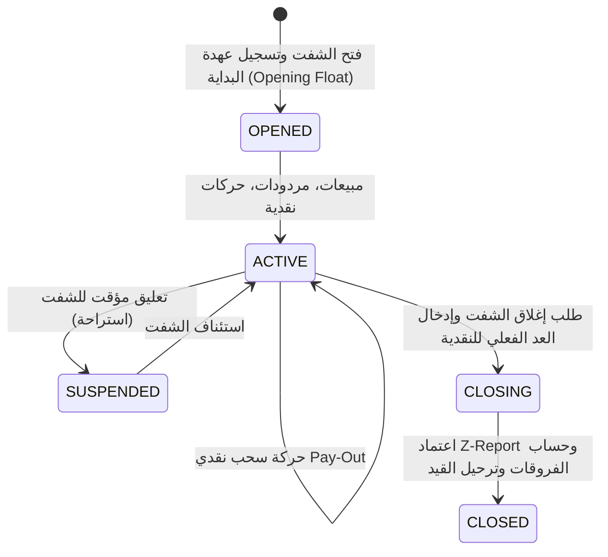
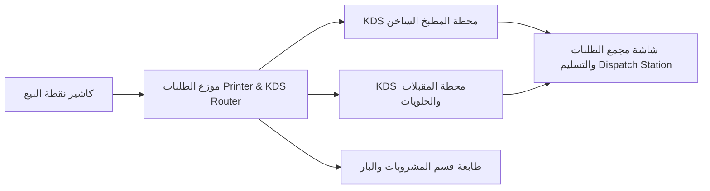

# ThinkOnErp - موديول نقاط البيع والمطاعم والتجزئة (Point of Sale - POS)
## وثيقة متطلبات وقواعد الأعمال (busniss.md)

---

## 1. نظرة عامة والهدف التجاري (Business Overview & Strategic Goals)

موديول **نقاط البيع (POS Engine)** في **ThinkOnErp** هو منصة متكاملة عالية السرعة مصممة لإدارة عمليات البيع المباشر في بيئات التجزئة الفائقة الحركة (Retail) ومطاعم الخدمة السريعة والمطاعم الراقية (Quick Service & Fine Dining Restaurants).

### الأهداف الاستراتيجية:
1. **السرعة العالية وموثوقية الكاشير (Sub-Second Transaction Processing):** تنفيذ عمليات البيع وإصدار الفواتير وطباعة الإيصالات في أجزاء من الثانية لمنع طوابير الانتظار.
2. **العمل بدون اتصال والمزامنة المرنة (Offline-First & Resilient Sync):** استمرار نقاط البيع في العمل والبيع حتى في حال انقطاع شبكة الإنترنت أو الاتصال بالخادم المركزي، مع مزامنة الحركات تلقائياً عند عودة الاتصال وحل تعارضات المخزون.
3. **حوكمة دورة حياة الشفتات والدرج النقدي (Shift & Till Governance):** رقابة نقدية مشددة تبدأ برصيد العهدة الافتتاحي (Opening Float)، تتبع حركات السحب والإيداع النقدي (Pay-In / Pay-Out)، ومطابقة رصيد الدرج عند الإغلاق واكتشاف العجز أو الزيادة.
4. **دعم بيئات المطاعم والضيافة الشامل (Restaurant & Hospitality Suite):**
   - خريطة الطاولات والصالات التفاعلية (Visual Floor & Table Layout).
   - نظام شاشات المطبخ الرقمي (Kitchen Display System - KDS) وتوجيه الطابعات الحرارية حسب نوع الوجبات.
   - تجهيزات المطبخ المسبقة (Batch Prep) واستهلاك المكونات الخام.
   - حجوزات الطاولات ودمج وتقسيم الفواتير (Split & Merge Orders).
5. **محرك العروض الترويجية والولاء المتقدم (Promotions & Loyalty Engine):** دعم عروض اشترِ واحصل على الآخر مجاناً (BOGO)، الخصومات المتدرجة، الساعات السعيدة (Happy Hour)، بطاقات الهدايا (Gift Cards)، وبطاقات الخصم والقسائم الشرائية.
6. **التقارير المالية والرقابية (X-Report & Z-Report):** تقرير منتصف اليوم (X-Report) للاطلاع اللحظي، والتقرير المالي الختامي الإلزامي (Z-Report) لإقفال اليومية وترحيل القيود المحاسبية للأستاذ العام.
7. **الامتثال للفوترة الإلكترونية (E-Invoicing & ZATCA Phase 2):** توليد رمز الاستجابة السريعة المشفر (Cryptographic QR Code) والطوابع الضريبية وتشفير الفواتير المبسطة.

---

## 2. إدارة الشفتات والصناديق النقدية (Shift & Cash Drawer Lifecycle)

### 2.1 دورة حياة شفت الكاشير:
لا يمكن إجراء أي عملية بيع إلا بعد فتح شفت رسمي مرتبط بدرج كاشير (`PosTill`) ومستخدم محدد:

### 2.2 المطابقة النقدية وفرق الصندوق (Cash Reconciliation):
- **النقدية المتوقعة في الدرج (Expected Cash):**
  $$\text{ExpectedCash} = \text{OpeningFloat} + \text{CashSales} - \text{CashRefunds} + \sum \text{PayIn} - \sum \text{PayOut}$$
- **فرق الصندوق (Discrepancy):**
  $$\text{Discrepancy} = \text{ActualCountedCash} - \text{ExpectedCash}$$
  - إذا كانت القيمة موجبة: يُسجل كـ **فائض نقدي (Cash Overage)** في حساب أرباح متنوعة.
  - إذا كانت القيمة سالبة: يُسجل كـ **عجز نقدي (Cash Shortage)** ويُقيد كذمة على الكاشير أو مصروف عجز خزينة.

---

## 3. دورة حياة الطلبات وفواتير نقاط البيع (Order Workflow & Management)

### 3.1 أنواع الطلبات (Order Types):
1. **تناول في المطعم (Dine-In):** يرتبط برقم الصالة والطاولة، يدعم فتح الطلب، إضافة أصناف متعددة، إرسال للمطبخ، ثم المحاسبة عند الانتهاء.
2. **سفري / استلام (Takeaway / Counter):** دفع مباشر وإصدار فوري لرقم الاستلام والفاتورة.
3. **توصيل منزلي (Delivery):** تسجيل بيانات العميل، عنوان التوصيل، رسوم التوصيل، وتعيين السائق.
4. **طلبات المنصات الخارجية (Aggregators / External Orders):** تكامل مع تطبيقات التوصيل الشهيرة واستقبال الطلبات آلياً في شاشة الكاشير.

### 3.2 العمليات المتقدمة على الطلبات:
- **تقسيم الفاتورة (Split Bill):** تقسيم القيمة الإجمالية بالتساوي بين عدد من الزبائن، أو تقسيم الأصناف على فواتير متعددة مستقلة.
- **دمج الطلبات (Merge Orders):** دمج طاولتين أو طلبين في حساب موحد.
- **نقل الطاولة (Table Transfer):** تحويل طلب الزبون من طاولة إلى أخرى وتحديث شاشات الخدمة والمطبخ فوراً.
- **تعليق الطلب (Hold / Park Order):** تعليق طلب عميل ريثما يجهز أغراضه لخدمة عميل آخر في الطابور دون فقدان الأصناف المدخلة.

---

## 4. نظام المطبخ والتجهيز وشاشات KDS (Kitchen & Hospitality Suite)

### 4.1 شاشة عرض المطبخ الرقمية (KDS - Kitchen Display System):
- استبدال بونات المطبخ الورقية بشاشات تفاعلية فورية تعمل عبر SignalR / WebSockets.
- تصنيف شاشات المطبخ حسب الأقسام (شاشة المشويات، شاشة المقبلات والبار، شاشة تجهيز البيتزا، شاشة التعبئة والتسليم).
- **حالات بنود الطلب في المطبخ:**
  - `PENDING`: تم إرسال الطلب من الكاشير ولم يبدأ الطاهي بعد.
  - `IN_PREPARATION`: الطاهي بدأ في تجهيز الصنف (مع عداد زمني يبدأ باللون الأخضر ويتحول للأصفر ثم الأحمر عند التأخير).
  - `READY`: تم الانتهاء من الطهي وجاهز للاستلام.
  - `SERVED`: تم تسليم الوجبة للزبون.

### 4.2 تجهيزات المطبخ المسبقة (PosBatchPrep):
- طبخ كميات مسبقة (مثل: تجهيز 50 لتر مرق، تتبيل 100 كجم دجاج).
- تسجيل حركة استهلاك المواد الأولية من المستودع وإدخال المنتج شبه المصنع للمطبخ لضمان دقة تكلفة الوجبات وتجنب الهدر المجهول.

---

## 5. محرك العروض والخصومات التلقائي (Promotions & Discounts Engine)

يتم تطبيق العروض آلياً بمجرد استيفاء الشروط دون الحاجة لتدخل الكاشير البشري:
1. **عروض اشترِ X واحصل على Y (Buy-X-Get-Y / BOGO):** اشترِ 2 بيتزا واحصل على الثالثة مجاناً أو بخصم 50%.
2. **عروض المجموعات والوجبات (Combo Deals):** وجبة برجر + بطاطس + مشروب بسعر موحد مخفض.
3. **الخصومات الزمنية والسعيدة (Happy Hour):** خصم 20% على المشروبات بين الساعة 4 عصراً و 7 مساءً في أيام محددة.
4. **الخصم التراكمي لسلة المشتريات (Tiered Cart Discount):** إذا تجاوز إجمالي المشتريات 500 ريال، يحصل العميل على خصم 10%.
5. **بطاقات الهدايا والقسائم (Gift Cards & Vouchers):** شراء بطاقة هدية برقم تسلسلي، شحن رصيدها، استخدامها في الدفع الجزئي أو الكلي، ومتابعة رصيدها المتبقي.

---

## 6. تقارير الإقفال الرقابية (X-Report vs Z-Report)

| وجه المقارنة | تقرير منتصف اليوم (X-Report) | التقرير المالي الختامي (Z-Report) |
|---|---|---|
| **الهدف** | استعراض مؤقت للمبيعات والنقدية خلال الشفت دون تصفير | إقفال رسمي ونهائي لليومية والشفت |
| **التأثير على الشفت** | لا يغلق الشفت ويسمح بمواصلة البيع | يغلق الشفت نهائياً ويمنع أي حركة بيع بعده |
| **التأثير المحاسبي** | لا يولد أي قيد محاسبي | يولد قيد اليومية الآلي ويرحله للأستاذ العام |
| **التأثير المخزني** | استعراض نظري لحركة المواد | خصم المخزون المستهلك وتثبيت حركة تكلفة المبيعات |
| **الرقم التسلسلي** | استعلام عادي متكرر | رقم تسلسلي تصاعدي إلزامي لا يقبل الثغرات (Z-Seq) |

---

## 7. العمل بدون اتصال وحل تعارضات المخزون (Offline-First & Conflict Resolution)

- في حال تعطل الاتصال بالخادم المركزي، تحتفظ نقطة البيع بالطلبات محلياً في IndexedDB أو SQLite محلي.
- عند استعادة الاتصال، تُرسل حزم البيانات عبر خدمة `PosSyncService`.
- **حل تعارضات المخزون (Inventory Conflict Strategy):**
  - إذا تم بيع صنف في وضع عدم الاتصال وتبين بعد الاتصال نفاذ كميته في الخادم المركزي، يتم تسجيل الحدث في جدول `POS_INVENTORY_CONFLICT` واعتماد البيع مع تسجيل رصيد سالب إجرائي أو تعليق التسوية لمراجعة مدير الفرع، مما يضمن عدم تعطيل عملية العميل تحت أي ظرف.
