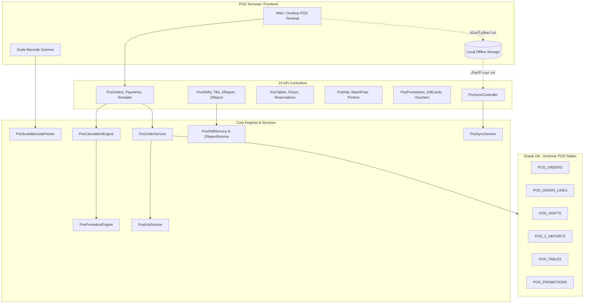

# ThinkOnErp - موديول نقاط البيع والمطاعم والتجزئة (Point of Sale - POS)
## وثيقة المعمارية والمنطق التقني البرمجي (logic.md)

---

## 1. المعمارية الفنية لموديول نقاط البيع (Technical Architecture)

صُممت معمارية موديول نقاط البيع لتدعم العمليات الموزعة ذات التردد العالي، حيث تفصل بين عمليات واجهة الكاشير الفورية (Low-Latency Front-Office Operations) والعمليات التحليلية والمحاسبية اللاحقة (Back-Office Sync & Posting). يعتمد الموديول على محرك حسابات دقيق (`PosCalculationEngine`)، محرك عروض ترويجية مرن (`PosPromotionEngine`)، وقناة اتصال آنية عبر SignalR / WebSockets لشاشات المطابخ KDS.

---

## 2. فهرس الملفات البرمجية المكونة للموديول (Source Files Catalog)

### 2.1 طبقة المجال (Domain Entities & Enums)
- **ملفات الصناديق والشفتات والإقفال المالي:**
  - `PosTill.cs`: سجل جهاز الكاشير أو الدرج النقدي، الكود، الاسم، الفرع التابع له، المستودع التلقائي للصرف، وحساب الأستاذ العام المقابل.
  - `PosShift.cs`: شفت الكاشير، رقم الشفت، المستخدم (`CashierId`)، وقت الفتح، وقت الإغلاق، رصيد البداية (`OpeningFloat`)، إجمالي المبيعات النقدية والبطاقات، النقدية الفعلية عند الإغلاق (`ActualCash`)، النقدية المتوقعة (`ExpectedCash`)، فرق الصندوق (`DifferenceAmount`)، وحالة الشفت (`ShiftStatus`: OPEN, SUSPENDED, CLOSED).
  - `PosShiftCashMovement.cs`: حركات السحب والإيداع النقدي المؤقتة خلال الشفت (`PAY_IN`, `PAY_OUT`) مع السبب والمعتمد.
  - `PosZReport.cs`: التقرير المالي الختامي للشفت أو اليومية، رقم الـ Z التسلسلي الإلزامي، إجمالي المبيعات، الضرائب، الخصومات، المردودات، ورقم قيد اليومية العام المولد في الأستاذ العام (`GlVoucherId`).
- **ملفات الطلبات والفواتير والمبيعات:**
  - `PosOrderHeader.cs`: رأس فاتورة نقطة البيع، رقم الفاتورة اليومي ورقم الفاتورة العالمي الموحد (UUID)، معرف الفرع، الشفت، الطاولة، نوع الطلب (`OrderType`: DINE_IN, TAKEAWAY, DELIVERY, EXTERNAL)، المبالغ المالية (الإجمالي الخام، الخصومات، رسوم الخدمة، التوصيل، الضرائب، الصافي)، حالة الطلب (`OrderStatus`: OPEN, HELD, PREPARING, READY, COMPLETED, CANCELLED)، وحالة الدفع (`PaymentStatus`).
  - `PosOrderLine.cs`: أسطر الطلب، معرف الصنف، المتغير، الكمية، سعر الوحدة، الخصم، النسبة الضريبية، مبلغ الضريبة، الإجمالي، والملاحظات الخاصة بالمطبخ.
  - `PosOrderLineModifier.cs`: تفاصيل الإضافات والمعدلات على السطر (مثل: جبن إضافي، بدون ثوم، حجم كبير) مع سعر الإضافة الإضافي إن وجد.
  - `PosOrderPayment.cs`: وسائل السداد المجزأة للطلب الواحد (دفع نقدي، دفع بطاقة شبكة، دفع بطاقة ائتمانية، دفع ببطاقة هدية، دفع على الحساب).
  - `PosOrderTax.cs`: تفصيل الضرائب المطبقة على الطلب لكل فئة ضريبية للامتثال الرقابي.
- **ملفات الصالات والطاولات والمطاعم والضيافة:**
  - `PosFloor.cs`: الصالات والمناطق في المطعم (الصالة الرئيسية، صالة العائلات، التراس الخارجي، صالة الـ VIP).
  - `PosTable.cs`: الطاولات ومواقعها، رقم الطاولة، سعة المقاعد، الإحداثيات المرئية (X, Y)، وحالة الطاولة (`TableStatus`: AVAILABLE, OCCUPIED, RESERVED, BILLED).
  - `PosReservation.cs`: حجوزات الطاولات، اسم الضيف، الهاتف، عدد المقاعد، وقت وتاريخ الحجز، وحالة الحجز.
  - `PosBatchPrep.cs`, `PosBatchPrepLine.cs`: تجهيزات وتحضيرات المطبخ المسبقة، الصنف المجهز، الكمية المنتجة، وتفاصيل المواد الخام المستهلكة.
  - `PosExternalOrder.cs`: إدارة وتكامل طلبات منصات التوصيل الخارجية (جاهز، هنقرستيشن، تويو).
- **ملفات العروض وبطاقات الهدايا والطباعة:**
  - `PosPromotion.cs`, `PosPromotionRule.cs`: العروض الترويجية، نوع العرض (BOGO, Combo, Tiered, HappyHour)، تاريخ البداية والنهاية، الساعات المفعلة، والشروط والأحكام.
  - `PosGiftCard.cs`, `PosGiftCardTransaction.cs`: بطاقات الهدايا المشحونة مسبقاً، رقم البطاقة، الرصيد الحالي، وتاريخ الصلاحية وسجل الحركات.
  - `PosPrintTemplate.cs`, `PosPrinterRouting.cs`: قوالب طباعة الإيصالات، وتوجيه الطباعة حسب الأقسام (طابعات المطبخ، طابعات البار، طابعة الكاشير).
  - `PosStaffAttendance.cs`: تسجيل حضور وانصراف موظفي نقاط البيع عبر الشاشة المباشرة.
  - `PosInventoryConflict.cs`: سجل توثيق ومعالجة تعارضات المخزون الناتجة عن المبيعات أثناء انقطاع الاتصال (Offline Sales).
- **التعدادات الشاملة (`PosEnums.cs`):**
  - يحتوي على كافة التعدادات: `OrderStatus`, `OrderType`, `PaymentStatus`, `ShiftStatus`, `TableStatus`, `KdsStatus`, `ConflictResolutionStrategy`, `PromotionType`, `DiscountType`.

### 2.2 طبقة التطبيق ومحركات الحساب (Application Services & Engines)
- `PosCalculationEngine.cs`: محرك الحسابات الرياضي بالغ الدقة للطلبات، حساب أسعار المعدلات، الخصومات الترويجية، الضرائب النسبية، ورسوم الخدمة والتقريب.
- `PosPromotionEngine.cs`: تقييم سلة المشتريات وتطبيق العروض التلقائية وفق القواعد دون أي تدخل يدوي.
- `PosOrderService.cs`: دورة حياة الطلبات (فتح، تعديل، تعليق، تقسيم، دمج، سداد، وإلغاء) وتحديث المخزون الفوري.
- `PosShiftService.cs`: إدارة الشفتات، تسجيل العهدة، تتبع الحركات النقدية، واحتساب الفروقات.
- `PosZReportService.cs`: توليد تقرير الـ Z الختامي، وإصدار القيد المحاسبي الآلي للأستاذ العام.
- `PosKdsService.cs`: إرسال وتحديث حالات الوجبات على شاشات المطبخ فورياً عبر SignalR.
- `PosScaleBarcodeParser.cs`: فك تشفير باركود الموازين الرقمية للأصناف الموزونة واستخراج كود الصنف والوزن أو السعر الصافي بدقة.
- `PosSyncService.cs`: استقبال حزم العمليات المنفذة في وضع عدم الاتصال (Offline Mode)، مطابقتها، وحل تعارضات المخزون تلقائياً.
- `PosGiftCardService.cs`: شحن، تفعيل، والتحقق من أرصدة بطاقات الهدايا وسداد الطلبات منها.
- `PosPrintTemplateService.cs`: دمج بيانات الطلب مع قوالب الطباعة وتجهيز أوامر الطباعة المتوافقة مع ESC/POS ورموز QR الضريبية.
- `PosAnalyticsService.cs`, `PosReportService.cs`: تحليلات المبيعات، أداء الكاشيرات، أكثر الأصناف مبيعاً، وتحليل ساعات الذروة.

---

## 3. المنطق الرياضي لمحرك حساب الفاتورة (`PosCalculationEngine`)

يعالج المحرك كل طلب في 5 خطوات رياضية متسلسلة لضمان مطابقة الهلل والمحاسبة الضريبية:

### الخطوة 1: احتساب الإجمالي الخام للأسطر والخصومات المباشرة
لكل سطر $i$ في الطلب:
$$\text{LineGross}_i = \text{Quantity}_i \times \text{UnitPrice}_i$$
$$\text{ModifiersExtra}_i = \sum (\text{ModQty}_j \times \text{ExtraPrice}_j)$$
$$\text{BaseLineTotal}_i = \text{LineGross}_i + \text{ModifiersExtra}_i$$
$$\text{LineDiscount}_i = \min(\text{SpecifiedDiscount}, \text{BaseLineTotal}_i)$$
$$\text{LineNetBeforeTax}_i = \text{BaseLineTotal}_i - \text{LineDiscount}_i$$
$$\text{RawSubtotal} = \sum \text{BaseLineTotal}_i, \quad \text{TotalLineDiscounts} = \sum \text{LineDiscount}_i$$
$$\text{NetAfterLineDiscounts} = \text{RawSubtotal} - \text{TotalLineDiscounts}$$

### الخطوة 2: تطبيق محرك العروض الترويجية التلقائية (`PosPromotionEngine`)
$$\text{PromoDiscount} = \text{EvaluatePromotions}(\text{BranchId}, \text{Lines}, \text{NetAfterLineDiscounts})$$
$$\text{NetAfterPromo} = \text{NetAfterLineDiscounts} - \text{PromoDiscount}$$

### الخطوة 3: تطبيق الخصم الإجمالي على مستوى الفاتورة (Manual Order Discount)
$$\text{OrderDiscount} = \begin{cases} \text{ManualDiscountAmount} & \text{إذا تم إدخال مبلغ ثابت} \\ \text{NetAfterPromo} \times \frac{\text{DiscountPercent}}{100} & \text{إذا تم إدخال نسبة} \end{cases}$$
$$\text{NetTaxableAmount} = \text{NetAfterPromo} - \text{OrderDiscount}$$

### الخطوة 4: التوزيع النسبي للوعاء الضريبي واحتساب ضريبة كل سطر بدقة
لتجنب أخطاء التقريب المالي في الضرائب، يتم توزيع الوعاء الضريبي الصافي نسبياً على الأسطر:
$$\text{LineProportion}_i = \frac{\text{LineNetBeforeTax}_i}{\text{NetAfterLineDiscounts}}$$
$$\text{EffectiveLineTaxable}_i = \text{LineProportion}_i \times \text{NetTaxableAmount}$$
$$\text{LineTax}_i = \text{Round}\left(\text{EffectiveLineTaxable}_i \times \frac{\text{TaxPercent}_i}{100}, 4\right)$$
$$\text{TotalTaxAmount} = \sum \text{LineTax}_i$$

### الخطوة 5: احتساب القيمة الإجمالية النهائية للفاتورة
$$\text{TotalAmount} = \text{Round}(\text{NetTaxableAmount} + \text{TotalTaxAmount} + \text{ServiceCharge} + \text{DeliveryFee} + \text{TipAmount}, 4)$$

---

## 4. فك تشفير باركود الموازين الرقمية (`PosScaleBarcodeParser`)

تنتج موازين الخضار واللحوم والأجبان باركود عالمي قياسي مكون من 13 خانة بتنسيق:
`PP IIIII WWWWW C` أو `PP IIIII PPPPP C`
حيث:
- `PP` (2 خانة): بادئة الميزان (افتراضياً `20`, `21`, `22`, `99`).
- `IIIII` (5 خانات): كود الصنف في النظام (Item PLU Code).
- `WWWWW` (5 خانات): الوزن بالجرام مقسوماً على 1000 لاستخراج الكيلوجرام، أو السعر الصافي مقسوماً على 100.
- `C` (خانة واحدة): رقم التحقق المعياري (Checksum Digit).

تقوم دالة `PosScaleBarcodeParser.TryParse` بالتعرف التلقائي على الباركود الموزون، والتحقق من صحة رقم الـ Checksum وفق خوارزمية Modulo-10، وفصل كود الصنف وجلب سعره من قاعدة البيانات ثم احتساب الكمية الموزونة بدقة تصل إلى 3 خانات عشرية.

---

## 5. خوارزمية إغلاق الشفت وتوليد قيد الـ Z-Report المحاسبي

عند إغلاق الشفت واعتماد تقرير الـ Z:
1. تجميع كافة مبيعات ومردودات ومقبوضات الشفت.
2. احتساب النقدية المتوقعة ومقارنتها بالعد الفعلي وتسجيل فرق الصندوق.
3. استدعاء `IGlVoucherService` لتوليد قيد يومية آلي مركب:
   - **مدين:** حـ/ صندوق الكاشير (بإجمالي النقدية المحصلة).
   - **مدين:** حـ/ البنك أو وسيط بطاقات الشبكة مدى/فيزا (بإجمالي مبيعات البطاقات مخصوماً منها عمولة البنك).
   - **مدين:** حـ/ مصروف فروقات وعجز الصندوق (في حال وجود عجز نقدي).
   - **دائن:** حـ/ إيرادات المبيعات (بصافي المبيعات قبل الضريبة).
   - **دائن:** حـ/ ضريبة القيمة المضافة المحصلة (ضريبة مبيعات نقاط البيع).
   - **دائن:** حـ/ أرباح متنوعة وفائض الصندوق (في حال وجود فائض نقدي).
4. ترحيل القيد فوراً وتثبيت رقم القيد المالي داخل سجل `POS_Z_REPORT`.
5. خصم الكميات المستهلكة من المستودع التابع لنقطة البيع وتوليد قيد تكلفة البضاعة المباعة (COGS).

---

## 6. الكتالوج الشامل لنقاط النهاية البرمجية لنقاط البيع (API Endpoints Catalog)

| المتحكم (Controller) | المسار (Route) | الأفعال (HTTP Methods) | الوظيفة التقنية |
|---|---|---|---|
| `PosOrdersController` | `/api/pos/orders` | GET, POST, PUT, DELETE | إنشاء الطلب، تحديث البنود، تقسيم الفاتورة، دمج الطلبات، والإلغاء |
| `PosPaymentsController` | `/api/pos/payments` | POST | معالجة المدفوعات المجزأة، نقد، بطاقات، وإصدار المخالصة |
| `PosReceiptsController` | `/api/pos/receipts` | GET | استخراج بيانات الإيصال الحراري ورمز الاستجابة السريعة QR |
| `PosShiftsController` | `/api/pos/shifts` | GET, POST, PUT | فتح شفت، تعليق، إدخال حركات سحب/إيداع، وإغلاق الشفت |
| `PosTillsController` | `/api/pos/tills` | GET, POST, PUT | إدارة أدراج الكاشير وربطها بالمستودعات والحسابات المالية |
| `PosXReportController` | `/api/pos/x-report` | GET | إصدار تقرير منتصف اليوم اللحظي دون إغلاق الشفت |
| `PosZReportController` | `/api/pos/z-report` | POST, GET | إصدار التقرير الختامي الرسمي، تسوية الدرج، وترحيل القيود |
| `PosTablesController` | `/api/pos/tables` | GET, POST, PUT, DELETE | إدارة خريطة الصالات والطاولات وحالات الانشغال |
| `PosReservationsController`| `/api/pos/reservations` | GET, POST, PUT, DELETE | حجوزات الطاولات، تأكيد الحضور، وإلغاء الحجز |
| `PosKdsController` | `/api/pos/kds` | GET, POST | شاشات المطبخ الرقمية، تحديث حالة الوجبات (تجهيز، جاهز، تسليم) |
| `PosBatchPrepController` | `/api/pos/batch-prep` | GET, POST | تحضيرات المطبخ المسبقة واستهلاك المكونات الخام |
| `PosPromotionsController`| `/api/pos/promotions` | GET, POST, PUT, DELETE | إدارة العروض الترويجية، الخصومات المتدرجة، وساعات التخفيض |
| `PosGiftCardsController` | `/api/pos/gift-cards` | GET, POST, PUT | إصدار بطاقات الهدايا، شحن الرصيد، والدفع بها |
| `PosVouchersController` | `/api/pos/vouchers` | POST, GET | فحص وتطبيق القسائم الترويجية وأكواد الخصم |
| `PosCustomersController` | `/api/pos/customers` | GET, POST, PUT | إدارة عملاء نقاط البيع، نقاط الولاء، والعناوين للتوصيل |
| `PosItemsController` | `/api/pos/items` | GET | قوائم الأصناف المصغرة والسريعة المخصصة لشاشات اللمس |
| `PosCategoriesController`| `/api/pos/categories` | GET | تصنيفات نقاط البيع السريعة مع الألوان والأيقونات |
| `PosStaffAttendanceController`| `/api/pos/staff-attendance`| POST, GET | تسجيل حضور وانصراف الكاشيرات وعمال الصالة عبر الشاشة |
| `PosPrintTemplatesController`| `/api/pos/print-templates`| GET, POST, PUT | تخصيص قوالب طباعة الإيصالات وبونات المطبخ |
| `PosAnalyticsController` | `/api/pos/analytics` | GET | لوحة مؤشرات الأداء اللحظية لنقاط البيع ومتوسط سلة الشراء |
| `PosReportsController` | `/api/pos/reports` | GET | تقارير المبيعات التفصيلية حسب الكاشير، الصنف، وطرق الدفع |
| `PosSyncController` | `/api/pos/sync` | POST | استقبال ومزامنة فواتير وضع عدم الاتصال وحل تعارضات المخزون |
