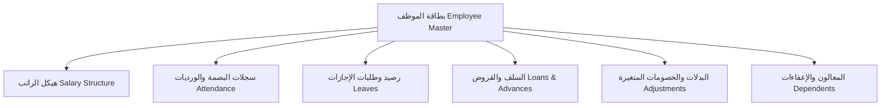
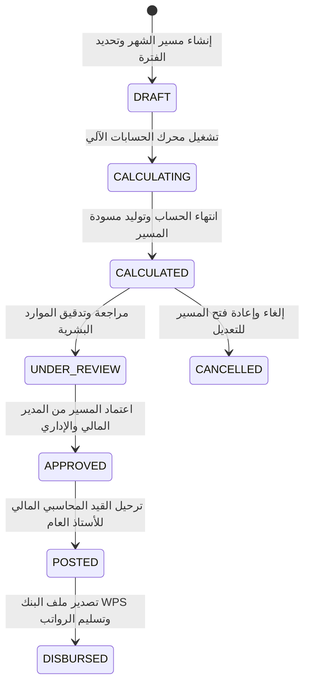

# ThinkOnErp - موديول الموارد البشرية والرواتب الذكية (HR & Dynamic Payroll)
## وثيقة متطلبات وقواعد الأعمال (busniss.md)

---

## 1. نظرة عامة والهدف التجاري (Business Overview & Strategic Goals)

موديول **الموارد البشرية والرواتب الذكية (HR & Dynamic Payroll Engine)** في **ThinkOnErp** هو نظام مؤسسي متقدم لإدارة رأس المال البشري وميكنة مسيرات الرواتب الشهرية والامتثال لأنظمة العمل والتأمينات الاجتماعية ونظام حماية الأجور (WPS / Mudad).

### الأهداف الاستراتيجية:
1. **إدارة دورة حياة الموظف الكاملة (End-to-End Employee Lifecycle):** من التعيين، تجديد العقود، الإجازات، الحضور والانصراف، السلف والقروض، والتقييم، وحتى نهاية الخدمة ومكافأة نهاية الخدمة (End of Service Gratuity).
2. **محرك احتساب الرواتب التلقائي الديناميكي (Dynamic Payroll Calculation Engine):** احتساب المسيرات الشهرية لآلاف الموظفين في دقائق مع مراعاة التناسب الزمني (Proration)، الإجازات غير المدفوعة، الغيابات، التأخير، وساعات العمل الإضافي.
3. **الامتثال الصارم لأنظمة العمل والتأمينات الاجتماعية (Labor Law & Social Security Compliance):**
   - احتساب اشتراكات التأمينات الاجتماعية (GOSI / SSC) بنسب الموظف ونسب صاحب العمل وسقوف الرواتب الخاضعة للاشتراك.
   - احتساب ضريبة كسب العمل والدخل التصاعدية وتطبيق الإعفاءات الشخصية والعائلية.
4. **نظام الحضور والانصراف الذكي والدوام (Smart Attendance & Rostering):** الربط المباشر مع أجهزة البصمة البيومترية، التعرف على الوجه، وتطبيق البصمة الجغرافية عبر الجوال (Geofencing)، وإدارة الورديات الدورية وشفتات المناوبة.
5. **إدارة الإجازات والأرصدة المستحقة (Leave Management & Accruals):** تتبع رصيد الإجازات السنوية، الإجازات المرضية، إجازات الأمومة والأبوة، والاحتساب التلقائي لمستحقات بدل الإجازة.
6. **الربط المالي الآلي مع الأستاذ العام (Automated General Ledger Integration):** توليد قيد الرواتب المركب آلياً فور اعتماد المسير وتحميل كل فرع ومركز تكلفة بنصيبه من مصروف الرواتب ومستحقات التأمينات.
7. **نظام حماية الأجور والملفات البنكية (WPS / SAMA Banking Export):** توليد ملفات صرف الرواتب المتوافقة مع البنوك المركزية (ملفات الـ Sif القياسية).

---

## 2. إدارة الموظفين والهيكل التنظيمي (Employee Master Data)

### 2.1 بطاقة الموظف المركزية:
- **البيانات الشخصية:** الاسم الرباعي (محلي وإنجليزي)، الرقم القومي / رقم الإقامة، تاريخ الميلاد، الجنسية، الحالة الاجتماعية، وعدد المعالين (المؤثرين في الإعفاء الضريبي).
- **البيانات الوظيفية:** الرقم الوظيفي الفريد (`EmployeeCode`)، الشركة، الفرع التابع له، القسم، المسمى الوظيفي، المدير المباشر، وتاريخ التعيين (`HireDate`).
- **بيانات التعاقد والانتهاء:** نوع العقد (محدد المدة، غير محدد المدة)، فترة التجربة، وتاريخ نهاية الخدمة وسبب انتهاء العقد.
- **البيانات البنكية:** اسم البنك، رقم الحساب الدولي (IBAN)، ورمز البنك في نظام حماية الأجور (WPS Routing Code).

---

## 3. الحضور والانصراف وإدارة الورديات (Attendance & Rostering)

### 3.1 سجلات البصمة وحساب ساعات العمل (Raw Punches & Pairing):
- استقبال حركات البصمة الخام (`RawAttendance`) من أجهزة البصمة أو تطبيق الجوال الجغرافي (`GeoLocationService`).
- خوارزمية الربط الذكي: فرز البصمات وتحديد بصمة الدخول (أول حركة مطابقة لبداية الوردية) وبصمة الخروج (آخر حركة عند نهاية الوردية).
- **حساب مخرجات يوم العمل (`AttendanceDay`):**
  - ساعات العمل الفعلية (Worked Hours).
  - التأخير الصباحي (Late Arrival) بعد فترة السماح (Grace Period).
  - الخروج المبكر (Early Departure).
  - الغياب التام (Absent): غياب مبرر بإجازة أو غياب غير مبرر يخضع للجزاءات.

### 3.2 العمل الإضافي (Overtime Rules):
- **إضافي الأيام العادية (Normal Overtime):** احتساب الساعات الإضافية بنسبة 150% (ساعة ونصف لكل ساعة عمل).
- **إضافي عطلات نهاية الأسبوع والأعياد (Weekend / Public Holiday Overtime):** احتساب الساعات بنسبة 200% (ساعتان لكل ساعة).

### 3.3 طلبات تصحيح البصمة (Attendance Correction Requests):
- تمكين الموظف من رفع طلب تبرير نسيان البصمة أو العطل الفني مع إرفاق المبرر، وتمرير الطلب في مسار موافقات معتمد من المدير المباشر ومدير الموارد البشرية.

---

## 4. الإجازات والأرصدة المستحقة (Leave Management)

### 4.1 أنواع الإجازات وقواعدها:
1. **الإجازة السنوية الاعتيادية (Annual Leave):** رصيد سنوي يستحق الموظف عنه 21 إلى 30 يوماً حسب سنوات الخدمة، مع استحقاق شهري متراكم (Accrual).
2. **الإجازة المرضية (Sick Leave):** مدفوعة الأجر بالكامل لأول 30 يوماً، ثم 75% من الراتب للـ 60 يوماً التالية، ثم بدون أجر.
3. **الإجازة بدون راتب (Unpaid Leave):** تخصم قيمتها تلقائياً من الراتب الأساسي والبدلات في مسير الرواتب الشهري وتوقف احتساب مستحقات نهاية الخدمة خلال مدتها.
4. **الإجازات الرسمية والعارضة:** إجازات الأعياد الوطنية، إجازة الوفاة، إجازة الزواج، وإجازة الوضع للأمهات.

---

## 5. السلف والقروض المالية (Employee Loans & Advances)

- **السلف المؤقتة (Short-Term Advances):** تسدد وتخصم بالكامل من أول مسير راتب قادم.
- **القروض طويلة الأجل (Long-Term Loans):**
  - جدول سداد شهري ثابت (`LoanRepaymentSchedule`).
  - تحديد القسط الشهري مع التحقق من عدم تجاوز القسط للحد الأقصى القانوني المسموح استقطاعه من الراتب (حسب نظام العمل: بحد أقصى 33% من صافي الراتب).
  - خصم القسط آلياً أثناء حساب مسير الرواتب وتخفيض رصيد القرض المتبقي (`RemainingBalance`).

---

## 6. محرك احتساب الرواتب التلقائي (Dynamic Payroll Engine)

### 6.1 مكونات الراتب (Salary Components):
- **الاستحقاقات (Earnings):** الراتب الأساسي (Basic Salary)، بدل السكن (Housing)، بدل النقل (Transport)، بدل طبيعة عمل، المكافآت، الحوافز، والعمل الإضافي.
- **الاستقطاعات (Deductions):** حصة الموظف في التأمينات (GOSI)، ضريبة الدخل، خصومات الغياب والتأخير، أقساط السلف والقروض، والجزاءات التأديبية.

### 6.2 دورة حياة مسير الرواتب الشهري (Payroll Run Lifecycle):

### 6.3 التناسب الزمني للرواتب (Payroll Proration Rules):
عند تعيين موظف جديد خلال الشهر (مثلاً في 18 من الشهر) أو إنهاء خدمة موظف قبل نهاية الشهر:
- يتم احتساب معامل التناسب:
  $$\text{ProrationFactor} = \frac{\text{EligibleDays}}{\text{TotalMonthDays}}$$
- يُحسب الراتب الأساسي والبدلات المستحقة بضرب الراتب الاسمي في معامل التناسب بدقة متناهية، مع خصم أيام الإجازات غير المدفوعة.

---

## 7. التكامل المحاسبي التلقائي وقيد الرواتب (GL Accounting Integration)

عند اعتماد مسير الرواتب وترحيله (`POSTED`)، يقوم النظام بإنشاء قيد محاسبي مركب وموزع على مراكز التكلفة والفروع:
- **الجانب المدين (Debit - المصروفات):**
  - حـ/ مصروف الرواتب الأساسية.
  - حـ/ مصروف بدل السكن وبدل النقل والبدلات الأخرى.
  - حـ/ مصروف ساعات العمل الإضافي.
  - حـ/ مساهمة صاحب العمل في التأمينات الاجتماعية (Employer GOSI Expense).
- **الجانب الدائن (Credit - الالتزامات والوسيط):**
  - حـ/ تأمينات اجتماعية مستحقة السداد (حصة الموظف + حصة صاحب العمل).
  - حـ/ ضريبة دخل مستحقة (إن وجدت).
  - حـ/ ذمم موظفين - استرداد السلف والقروض.
  - حـ/ وسيط رواتب مستحقة الدفع (Net Payroll Payable) يتم تصفيره عند الصرف البنكي.
