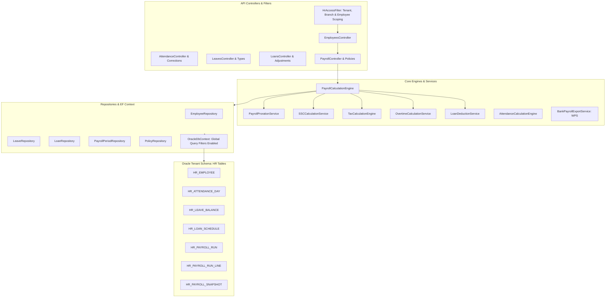

# ThinkOnErp - موديول الموارد البشرية والرواتب الذكية (HR & Dynamic Payroll)
## وثيقة المعمارية والمنطق التقني البرمجي (logic.md)

---

## 1. المعمارية التقنية والتصميم البرمجي (Technical Architecture)

يتميز موديول الموارد البشرية والرواتب بمعمارية عزل أمني صارمة على مستوى الصفوف وقواعد البيانات (Row-Level Security & EF Core Global Query Filters). يتم تطبيق فلتر الوصول الشامل (`HrAccessFilter`) عند كل طلب لفحص صلاحيات المستخدم والفرع ونطاق الخدمة الذاتية، وحقن متغيرات العزل مباشرة في سياق قاعدة البيانات (`OracleDbContext`). يعتمد الموديول على محرك حسابات غير متزامن فائق القوة (`PayrollCalculationEngine`) ومحرك احتساب ضريبي معقد (`TaxCalculationEngine`) ونظام لقطات التدقيق غير القابلة للتغيير (`PayrollCalculationSnapshot`).



---

## 2. فهرس الملفات البرمجية المكونة للموديول (Source Files Catalog)

### 2.1 طبقة المجال (Domain Entities)
- **ملفات الموظفين والهيكل الوظيفي (`EmployeeEntities.cs`):**
  - `Employee.cs`: سجل الموظف الشامل، الكود الوظيفي الفريد (`EmployeeCode`)، الشركة، الفرع، القسم، المسمى الوظيفي، تاريخ التعيين (`HireDate`)، تاريخ انتهاء الخدمة (`TerminationDate`)، الحالة الوظيفية (`EmploymentStatus`: ACTIVE, PROBATION, TERMINATED, SUSPENDED)، البيانات البنكية، ومعرف الحساب المقابل في شجرة الحسابات.
  - `EmployeeDependent.cs`: بيانات المعالين (الزوجة والأبناء) لحساب الإعفاءات الضريبية وبدلات التأمين.
- **ملفات الحضور والورديات والتقويم (`AttendanceEntities.cs`, `WorkCalendar.cs`):**
  - `WorkCalendar.cs`, `WorkCalendarDay.cs`, `PublicHoliday.cs`: تقويم أيام العمل الرسمية، العطلات الأسبوعية، والإجازات والأعياد الوطنية.
  - `ShiftSchedule.cs`: الورديات، وقت البداية، وقت النهاية، فترة السماح، وساعات العمل القياسية.
  - `EmployeeShiftAssignment.cs`: جدول مناوبات الموظفين وتعيين الورديات لكل موظف.
  - `RawAttendance.cs`: سجل حركات البصمة الخام الواردة من أجهزة البصمة أو الجوال.
  - `AttendanceDay.cs`: السجل اليومي المحسوب لحضور الموظف (وقت الدخول، الخروج، ساعات التأخير، الخروج المبكر، الساعات الفعلية، والساعات الإضافية).
  - `AttendanceCorrectionRequest.cs`: طلبات تصحيح وتبرير البصمات المرفوعة من الموظفين ودورة موافقاتها.
  - `OvertimeRule.cs`: قواعد احتساب ساعات العمل الإضافي ومعاملات الأيام العادية وأيام العطلات.
- **ملفات الإجازات والأرصدة (`LeaveEntities.cs`):**
  - `LeaveType.cs`: أنواع الإجازات (سنوية، مرضية، بدون راتب، حج، وضع)، هل هي مدفوعة، وهل ترحل للعام القادم.
  - `LeavePolicy.cs`: سياسات الاستحقاق السنوي، الحد الأقصى للأيام المتصلة، وتاريخ انتهاء الصلاحية.
  - `LeaveBalance.cs`: رصيد إجازات الموظف، الأيام المستحقة، الأيام المستهلكة (`UsedDays` مزود برمز التزامن `ConcurrencyToken`)، والرصيد المتبقي.
  - `LeaveRequest.cs`: طلبات الإجازة وتاريخ البداية والنهاية، وحالة الاعتماد (`Status` مزود بـ `ConcurrencyToken`).
- **ملفات السلف والقروض والتسويات (`LoanAndAdjustmentEntities.cs`):**
  - `EmployeeLoan.cs`: القروض الممنوحة، القيمة الإجمالية، عدد الأقساط، الرصيد المتبقي (`RemainingBalance` مزود بـ `ConcurrencyToken`).
  - `LoanRepaymentSchedule.cs`: جدول سداد أقساط القرض، رقم القسط، تاريخ الاستحقاق، مبلغ القسط، المبلغ المسدد (`PaidAmount` مع `ConcurrencyToken`)، وحالة القسط.
  - `EmployeeAdvance.cs`: السلف المالية المؤقتة واقتطاعها من أقرب مسير.
  - `PayrollAdjustment.cs`: التسويات والبدلات والمكافآت والجزاءات المتغيرة المضافة لشهر معين.
- **ملفات مسيرات الرواتب والهياكل (`PayrollEntities.cs`, `PayrollPolicies.cs`):**
  - `PayrollPeriod.cs`: الفترات الشهرية لمسيرات الرواتب، تاريخ البداية والنهاية، وحالتها.
  - `SalaryComponent.cs`: بطاقة مكون الراتب، الكود، الاسم، النوع (`EARNING` أو `DEDUCTION`)، هل يخضع للتأمينات، وهل يخضع لضريبة الدخل.
  - `SalaryStructure.cs`, `SalaryStructureLine.cs`: سلم وهيكل راتب الموظف، الراتب الأساسي الاسمي، والبدلات الثابتة ونسبها.
  - `PayrollRun.cs`: مسير الرواتب الشهري، رقم المسير، إجمالي الرواتب الإجمالية، إجمالي التأمينات، إجمالي الضرائب، إجمالي صافي الرواتب، الحالة (`Status` مع `ConcurrencyToken`).
  - `PayrollRunLine.cs`: تفاصيل سطر مسير كل موظف، الراتب الأساسي المحسوب، البدلات، الإضافي، خصم الغياب، خصم التأمينات، ضريبة الدخل، خصم السلف، وصافي الراتب النهائي المستحق (`NetPay`).
  - `PayrollRunLineComponent.cs`: تفكيك تحليلي لكل مكون ومبلغ تم احتسابه داخل سطر الموظف.
  - `PayrollCalculationSnapshot.cs`: لقطة تاريخية مشفرة لمدخلات وقوانين وسياسات الحساب وقت تشغيل المسير لمنع أي لبس مستقبلي.
  - `ProrationPolicy.cs`, `DeductionPolicy.cs`, `TaxPolicy.cs`, `TaxBracket.cs`, `SSCPolicy.cs`: السياسات والمعايير التشريعية المنظمة للحسابات.
  - `PayrollPostingConfiguration.cs`: تهيئة الحسابات المحاسبية للأستاذ العام للربط الآلي مع مسير الرواتب.

### 2.2 طبقة التطبيق والخدمات البرمجية (Application Services)
- `PayrollCalculationEngine.cs`: محرك الحسابات الرئيسي لتشغيل مسيرات الرواتب الشهرية وتطبيق كافة القواعد والسياسات.
- `PayrollProrationService.cs`: احتساب معامل التناسب الزمني وتجزئة الراتب لأيام العمل الفعلية عند التعيين أو إنهاء الخدمة.
- `SSCCalculationService.cs`: احتساب اشتراكات التأمينات الاجتماعية وسقوف الرواتب وحصص الموظف والمنشأة.
- `TaxCalculationEngine.cs`: احتساب شرائح ضريبة كسب العمل والإعفاءات وتوزيعها شهرياً.
- `OvertimeCalculationService.cs`: مطابقة ساعات العمل الإضافي مع التقويم وحساب المستحقات المالية.
- `LoanDeductionService.cs`: خصم أقساط القروض آلياً وفق جداول السداد المعتمدة وتحديث الأرصدة المتبقية.
- `AttendanceCalculationEngine.cs`, `HrAttendanceService.cs`: معالجة البصمات، احتساب ساعات العمل الفعلي، الغياب، والتأخيرات.
- `AttendanceCorrectionService.cs`: إدارة دورة حياة طلبات تصحيح البصمة واعتمادها.
- `LeaveService.cs`: فحص أرصدة الإجازات، تطبيق الخصومات للإجازات غير المدفوعة، واحتساب مستحقات نهاية الخدمة.
- `BankPayrollExportService.cs`: توليد ملفات حماية الأجور (WPS / SIF) للبنوك المركزية ومنصة مدد.
- `WorkCalendarService.cs`: إدارة تقويم أيام العمل والعطل الرسمية وتوزيع الورديات.
- `EmployeeService.cs`, `EmployeeExcelService.cs`: إدارة بطاقات الموظفين واستيراد وتصدير بياناتهم عبر Excel.
- `GeoLocationService.cs`: التحقق من النطاق الجغرافي (Geofencing) للبصمات المأخوذة عبر تطبيقات الهواتف الذكية.
- `PayrollPostingService.cs`: إنشاء وترحيل قيد اليومية الآلي لمسير الرواتب في الأستاذ العام.

---

## 3. المنطق الرياضي الشامل لمحرك احتساب الرواتب (`PayrollCalculationEngine`)

يتم احتساب راتب كل موظف للشهر المالي وفق 8 مراحل رياضية متتابعة:

### المرحلة 1: التناسب الزمني للراتب الأساسي (Proration Factor)
إذا بدأ الموظف العمل بعد بداية الفترة ($D_{\text{hire}} > D_{\text{start}}$) أو انتهت خدمته قبل نهاية الفترة ($D_{\text{term}} < D_{\text{end}}$):
$$\text{EligibleDays} = \text{CalculateWorkingDays}(D_{\text{effective\_start}}, D_{\text{effective\_end}})$$
$$\text{TotalMonthDays} = \text{CalculateWorkingDays}(D_{\text{start}}, D_{\text{end}})$$
$$\text{ProrationFactor} = \frac{\text{EligibleDays}}{\text{TotalMonthDays}}$$
$$\text{ProratedBasic} = \text{Round}(\text{NominalBasic} \times \text{ProrationFactor}, 3)$$

### المرحلة 2: خصم الإجازات غير المدفوعة والغياب غير المبرر
$$\text{UnpaidDays} = \text{GetUnpaidDaysInPeriod}(\text{EmployeeCode}, D_{\text{start}}, D_{\text{end}})$$
$$\text{DailyRate} = \frac{\text{NominalBasic}}{\text{TotalMonthDays}}$$
$$\text{UnpaidDeduction} = \text{Round}(\text{DailyRate} \times \text{UnpaidDays}, 3)$$
$$\text{ProratedBasic} \leftarrow \max(0, \text{ProratedBasic} - \text{UnpaidDeduction})$$

### المرحلة 3: احتساب البدلات الثابتة (Structure Allowances)
لكل بند في سلم راتب الموظف:
$$\text{AllowanceAmount}_i = \begin{cases} \text{FixedAmount}_i & \text{إذا كان مبلغاً ثابتاً} \\ \text{Round}\left(\text{NominalBasic} \times \frac{\text{Percent}_i}{100}, 3\right) & \text{إذا كان نسبة مئوية} \end{cases}$$
$$\text{TotalAllowances} = \sum \text{AllowanceAmount}_i$$

### المرحلة 4: احتساب ساعات العمل الإضافي (Overtime Pay)
$$\text{HourlyRate} = \frac{\text{NominalBasic}}{30 \times 8}$$
$$\text{OvertimePay} = \text{Round}\left((\text{NormalOTHours} \times \text{HourlyRate} \times 1.5) + (\text{HolidayOTHours} \times \text{HourlyRate} \times 2.0), 3\right)$$

### المرحلة 5: الراتب الإجمالي الخاضع (Gross Salary)
$$\text{GrossSalary} = \text{ProratedBasic} + \text{TotalAllowances} + \text{OvertimePay} + \text{ApprovedBonuses}$$

### المرحلة 6: احتساب اشتراكات التأمينات الاجتماعية (SSC / GOSI Engine)
- **الوعاء التأميني الخاضع (Contributory Wage):**
  $$\text{SubjectWage} = \min(\text{BasicSalary} + \text{HousingAllowance}, \text{SSCCeiling})$$
- **حصة الموظف المستقطعة (Employee Share):**
  $$\text{EmployeeSSC} = \text{Round}\left(\text{SubjectWage} \times \frac{\text{EmployeePercent}}{100}, 3\right)$$
- **حصة صاحب العمل (Employer Share):**
  $$\text{EmployerSSC} = \text{Round}\left(\text{SubjectWage} \times \frac{\text{EmployerPercent}}{100}, 3\right)$$

### المرحلة 7: احتساب ضريبة كسب العمل والدخل التصاعدية (`TaxCalculationEngine`)
1. تحويل الدخل السنوي التقديري الخاضع:
   $$\text{AnnualTaxable} = (\text{GrossSalary} - \text{EmployeeSSC}) \times 12$$
2. طرح الإعفاء الشخصي وإعفاء المعالين:
   $$\text{NetAnnualTaxable} = \max(0, \text{AnnualTaxable} - \text{PersonalExemption} - \text{DependentExemption})$$
3. تطبيق شرائح الضريبة التصاعدية (Progressive Brackets):
   $$\text{AnnualTax} = \sum_{j} (\text{BracketAmount}_j \times \text{TaxRate}_j)$$
4. استخراج الاستقطاع الضريبي الشهري:
   $$\text{MonthlyIncomeTax} = \text{Round}\left(\frac{\text{AnnualTax}}{12}, 3\right)$$

### المرحلة 8: أقساط السلف وصافي الراتب النهائي (Net Pay)
$$\text{LoanDeduction} = \text{GetDueInstallmentForPeriod}(\text{EmployeeCode})$$
$$\text{NetPay} = \text{GrossSalary} - \text{EmployeeSSC} - \text{MonthlyIncomeTax} - \text{LoanDeduction} - \text{OtherDeductions}$$

---

## 4. الحماية الأمنية والعزل على مستوى الصفوف (Row-Level Security & Filters)

تطبق فئة `HrAccessFilter` بالتعاون مع `OracleDbContext` حماية حتمية لا يمكن تجاوزها:
- **فلاتر الاستعلام العامة (Global Query Filters):**
  ```csharp
  modelBuilder.Entity<Employee>().HasQueryFilter(e => !HrScopeEnabled ||
      ((HrScopeAllBranches || (e.BranchId.HasValue && HrScopeBranchIds.Contains(e.BranchId.Value))) &&
       (HrScopeEmployeeCode == null || e.EmployeeCode == HrScopeEmployeeCode)));
  ```
- **منع تسريب البيانات بين الفروع:**
  لا يمكن لأي مدير فرع أو مسؤول موارد بشرية في فرع معين قراءة أو تعديل بيانات موظفي فروع أخرى؛ حيث يقوم المحرك بتصفية البيانات تلقائياً على مستوى استعلام SQL المنفذ في Oracle Database.
- **خدمة الموظف الذاتية (Self-Service Scoping):**
  عند دخول موظف عادي للاستعلام عن مسير راتبه أو رصيد إجازاته، يُقفل حقل `HrScopeEmployeeCode` برقم الموظف، مما يضمن استحالة وصوله لسجلات زملائه حتى لو تلاعب برقم الموظف في الطلب.

---

## 5. الكتالوج الشامل لنقاط النهاية البرمجية للموارد البشرية (API Endpoints Catalog)

| المتحكم (Controller) | المسار (Route) | الأفعال (HTTP Methods) | الوظيفة التقنية |
|---|---|---|---|
| `EmployeesController` | `/api/hr/employees` | GET, POST, PUT, DELETE | إدارة بطاقات الموظفين، العقود، والبيانات البنكية |
| `AttendanceController` | `/api/hr/attendance` | GET, POST | استقبال سجلات البصمات، استعراض الحضور وساعات التأخير والإضافي |
| `AttendanceCorrectionsController`| `/api/hr/attendance-corrections`| GET, POST, PUT | رفع واعتماد طلبات تصحيح وتبرير البصمات المفقودة |
| `LeavesController` | `/api/hr/leaves` | GET, POST, PUT, DELETE | طلبات الإجازات، استعراض الأرصدة، واعتماد الإجازة |
| `LoansController` | `/api/hr/loans` | GET, POST, PUT | منح القروض والسلف، جدولة الأقساط، ومتابعة الأرصدة |
| `SalaryComponentsController`| `/api/hr/salary-components` | GET, POST, PUT | تعريف مكونات الراتب، البدلات، والاستقطاعات وقواعدها |
| `PayrollPoliciesController`| `/api/hr/payroll-policies` | GET, POST, PUT | ضبط سياسات التناسب الزمني، التأمينات، والشرائح الضريبية |
| `PayrollAdjustmentsController`| `/api/hr/payroll-adjustments`| GET, POST, PUT, DELETE | إضافة المكافآت والحوافز والجزاءات المؤقتة لشهر معين |
| `PayrollController` | `/api/hr/payroll` | GET, POST, PUT | تشغيل محرك حساب الرواتب، مراجعة المسير، اعتماده، وإلغاؤه |
| `PayrollPostingConfigurationsController`| `/api/hr/payroll-posting-configurations`| GET, POST, PUT | تهيئة الحسابات المحاسبية للأستاذ العام للربط المالي |
| `WorkCalendarsController`| `/api/hr/work-calendars` | GET, POST, PUT | إدارة تقويم العمل السنوي والعطل الرسمية ومناوبات الورديات |
