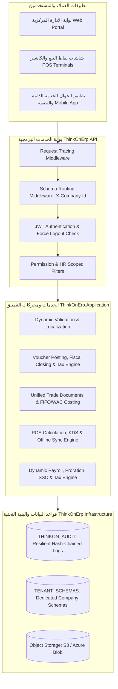

# ThinkOnErp - الدليل الشامل لوثائق النظام والمنطق البرمجي والأعمال
## Enterprise Resource Planning Architecture & Master Documentation Hub

---

## 1. مقدمة عن المنظومة (Platform Overview)

منظومة **ThinkOnErp** هي منصة متكاملة لتخطيط موارد المؤسسات (Enterprise Resource Planning - ERP) مبنية وفق أحدث المعايير البرمجية باستخدام معمارية البصلة النظيفة (.NET 8/9 Clean Architecture) وقواعد بيانات Oracle فائقة الأداء، مع دعم كامل للشركات المتعددة والفروع المتعددة (Multi-Tenancy & Multi-Branch) وعزل تام للمخططات (Schema Isolation).

تم إعداد هذا التوثيق الشامل لتقديم دراسة مفصلة ودقيقة سطر بسطر لكافة ملفات، كيانات، خدمات، ومتحكمات النظام، مع توفير ملفين أساسيين لكل موديول:
1. **ملف المنطق البرمجي والمعمارية الفنية (`logic.md`):** يغطي بنية الكود، الكيانات، جداول قاعدة البيانات، المستودعات، الخدمات، الخوارزميات الحسابية، البرمجيات الوسيطة، وكتالوج واجهات الـ API.
2. **ملف متطلبات وقواعد الأعمال (`busniss.md`):** يغطي الأهداف الاستراتيجية، المعايير المحاسبية والتجارية الدولية (IFRS, ZATCA, WPS)، دورات الحياة، مسارات العمل، حالات الاستخدام، والرقابة التشغيلية.

---

## 2. فهرس وثائق موديولات النظام (Modules Documentation Index)

| الموديول (Module) | وثيقة قواعد ومتطلبات الأعمال | وثيقة المنطق والمعمارية البرمجية | النطاق التشغيلي والمسؤوليات |
|---|---|---|---|
| **01. المنصة الأساسية والأمان والتدقيق** *(Core Platform & System)* | [business.md](./01_Core_Platform/busniss.md) | [logic.md](./01_Core_Platform/logic.md) | تعدد المستأجرين، عزل المخططات، الصلاحيات المصفوفية، التدقيق المرن فائق الصمود (Zero-Log-Loss)، التهديدات الأمنية، نظام التذاكر والدعم الفني، وقواعد التحقق الديناميكية. |
| **02. المحاسبة والإدارة المالية** *(Accounting & Financials)* | [business.md](./02_Accounting/busniss.md) | [logic.md](./02_Accounting/logic.md) | شجرة الحسابات متعددة المستويات، قيود اليومية، دفاتر الأستاذ المساعدة (AR/AP)، الخزائن والبنوك والمطابقة البنكية، دورة حياة الشيكات المؤجلة (PDC)، المحرك الضريبي، والإقفال السنوي. |
| **03. المخزون والتجارة الموحدة** *(Inventory & Unified Trade)* | [business.md](./03_Inventory/busniss.md) | [logic.md](./03_Inventory/logic.md) | إدارة الأصناف والمتغيرات والمعدلات، محرك الوثائق التجارية الموحد (GRN، مشتريات، مبيعات، مناقلات)، تقييم المخزون (FIFO / WAC)، تتبع الدفعات وتواريخ الصلاحية والسيريال، وقوائم المواد والتصنيع (BOM). |
| **04. نقاط البيع والمطاعم والتجزئة** *(Point of Sale - POS)* | [business.md](./04_POS/busniss.md) | [logic.md](./04_POS/logic.md) | إدارة الشفتات والصناديق، محرك حساب الفواتير فائق الدقة، العروض الترويجية التلقائية، شاشات المطبخ الرقمية (KDS)، خريطة الصالات والطاولات، تقارير الـ X والـ Z، والمزامنة في وضع عدم الاتصال (Offline-First). |
| **05. الموارد البشرية والرواتب الذكية** *(HR & Dynamic Payroll)* | [business.md](./05_HR_Payroll/busniss.md) | [logic.md](./05_HR_Payroll/logic.md) | بطاقات الموظفين، البصمة البيومترية والحضور والانصراف، الإجازات، السلف والقروض، محرك احتساب الرواتب التلقائي، التناسب الزمني (Proration)، التأمينات الاجتماعية والضرائب، والربط المالي بالأستاذ العام. |

---

## 3. خريطة المعمارية المتكاملة للنظام (Full Enterprise Architecture)

---

## 4. ملخص إحصائي لمكونات الكود البرمجي (Codebase Metrics & Footprint)

- **عدد مشاريع الـ C# في المنظومة:** 4 مشاريع رئيسية (`Domain`, `Application`, `Infrastructure`, `API`) بالإضافة إلى مشاريع الاختبارات (`HR.Tests`, `Infrastructure.Tests`, `Inventory.Tests`, `SuperAdmin.Tests`).
- **عدد كيانات قاعدة البيانات (Domain Entities):** أكثر من 110 كيان تغطي كافة متطلبات المنشآت الضخمة.
- **عدد خدمات التطبيق (Application Services):** أكثر من 75 خدمة محكمة بتطبيقات الـ Dependency Injection.
- **عدد متحكمات الـ API (Controllers):** أكثر من 60 متحكم مع أكثر من 350 نقطة نهاية برمجية (Endpoints) موثقة ومفصلة في مستندات Swagger و OpenApi.
- **تطبيق أعلى معايير الجودة والأمان:**
  - صفر فقدان في سجلات التدقيق (Zero-Log-Loss Guaranteed via Circuit Breaker & Encrypted Local Fallback).
  - حماية تامة ضد التلاعب بالبيانات (HMAC SHA-256 Hash Chaining).
  - عزل بيانات الفروع والشركات على مستوى قاعدة البيانات (Row-Level Security & Schema Isolation).
